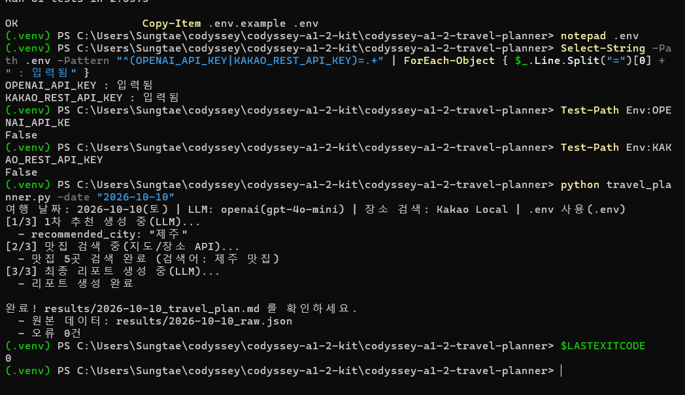
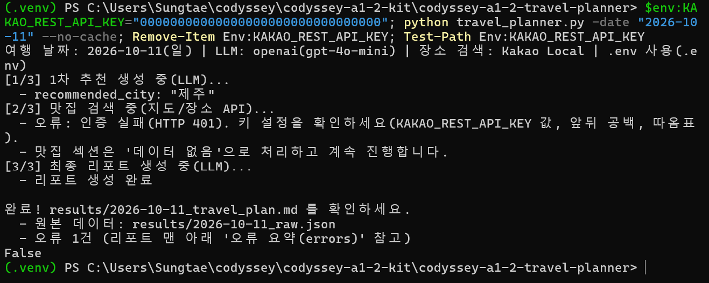

# 국내 여행 추천 CLI (코디세이 A1-2)

여행 날짜 하나를 넣으면 **LLM API**가 그 시기에 가기 좋은 국내 지역을 추천하고, **지도/장소 API**가 그 지역 맛집을 찾고, 다시 **LLM API**가 둘을 엮어 여행 리포트를 만드는 Python CLI 프로그램입니다.

```
python travel_planner.py -date "2026-10-10"
        │
        ▼
[1/3] LLM 1차 추천 (POST, JSON 강제)  →  {recommended_city, weather, events, reason}
        │   recommended_city를 그대로 다음 단계의 검색어로 사용
        ▼
[2/3] 지도/장소 API 맛집 검색 (GET)   →  맛집 N곳 (0건이거나 실패해도 "데이터 없음"으로 계속)
        │
        ▼
[3/3] LLM 최종 리포트 (POST)          →  프로그램이 실제 맛집 표와 오류 요약을 채워 저장
        │
        ▼
results/2026-10-10_raw.json   +   results/2026-10-10_travel_plan.md
```

---

## 1. 프로그램 개요

| 항목 | 내용 |
|---|---|
| 입력 | `-date "YYYY-MM-DD"` (필수). 형식이 틀리면 사용법을 출력하고 종료(종료 코드 2) |
| LLM API (택1) | **OpenAI**(기본, `gpt-4o-mini`) 또는 **Google Gemini**(`gemini-3.5-flash-lite`). REST `POST`로 직접 호출 |
| 지도/장소 API (택1) | **Kakao Local** 키워드 검색(기본) 또는 **Naver 지역 검색**. REST `GET`으로 직접 호출 |
| 출력 | 진행 로그 + `results/{날짜}_raw.json`(원본 데이터) + `results/{날짜}_travel_plan.md`(최종 리포트) |
| 오류 정책 | 키 없음: 즉시 종료 / 장소 API 실패·0건: "데이터 없음"으로 계속 / LLM JSON 파싱 실패: 재요청 1회 |
| 보너스 | 복수 지역 추천(`--cities 2~3`), 같은 조건 재실행 시 결과 캐싱 |
| 환경 | Python 3.10 이상, 터미널(Windows PowerShell, macOS/Linux 터미널) |

---

## 2. 폴더 구조

```
codyssey-a1-2-travel-planner/
├── travel_planner.py        # CLI 진입점: argparse, 날짜 검사, 종료 코드
├── planner/
│   ├── config.py            # .env/환경변수에서 키 읽기, 제공자 선택, 키 없으면 설정 안내
│   ├── errors.py            # 오류 타입, errors 목록 관리, HTTP 상태 코드 분류, 조치 안내
│   ├── http_client.py       # 공통 GET/POST 호출, 일시적 오류 1회 재시도, 키 가리기(***)
│   ├── schema.py            # LLM 출력에서 JSON 꺼내기, 필수 키/타입 검사
│   ├── llm.py               # OpenAI/Gemini 호출, 1차 추천·재요청·리포트 프롬프트
│   ├── places.py            # Kakao/Naver 검색, 지명 보정, 응답 필드 통일, 지역 검증
│   ├── report.py            # 리포트 조립(맛집 표, 오류 요약), LLM 실패 시 기본 템플릿
│   ├── storage.py           # results/ 저장, 캐시 읽기
│   └── pipeline.py          # [1/3] → [2/3] → [3/3] 실행 순서와 저장
├── tests/
│   ├── test_travel_planner.py  # 단위·흐름 테스트 43개 (API 응답을 가짜로 바꿔 실행)
│   ├── test_e2e_cli.py         # 실제 CLI를 로컬 가짜 API 서버에 붙여 실행하는 E2E 테스트 8개
│   ├── fake_api_server.py      # OpenAI/Gemini/Kakao/Naver 흉내 서버
│   └── fakes.py                # 가짜 응답 데이터
├── tools/check_secrets.py   # 커밋 전 키 노출 검사
├── results/                 # 실행 결과 (프로그램이 만듦, 제출물에 포함)
├── docs/screenshots/        # 실제 API 실행 화면 캡처 (키가 보이지 않는 화면만)
├── .env.example             # 키 설정 양식 (값 없음)
├── .gitignore               # .env 커밋 방지
├── requirements.txt
└── README.md
```

---

## 3. 설치

```powershell
# 1) Python 버전 확인 (3.10 이상)
python --version

# 2) 가상환경 만들기와 켜기 (Windows PowerShell)
python -m venv .venv
Set-ExecutionPolicy -Scope Process -ExecutionPolicy Bypass -Force   # 지금 창에서만 스크립트 실행 허용
.\.venv\Scripts\Activate.ps1
#   macOS / Linux: python3 -m venv .venv && source .venv/bin/activate

# 3) 패키지 설치 (requests, python-dotenv)
python -m pip install -r requirements.txt
```

- `Set-ExecutionPolicy` 줄: Windows 기본 설정에서는 `Activate.ps1`이 "스크립트를 실행할 수 없으므로" 오류로 막힙니다. 이 줄은 지금 창에만 적용되고, 창을 닫으면 원래대로 돌아갑니다.
- `pip` 대신 `python -m pip`: Windows 11 스마트 앱 컨트롤 같은 애플리케이션 제어 정책이 켜진 PC에서는 가상환경에 새로 생긴 `pip.exe`가 차단됩니다(`애플리케이션 제어 정책에서 이 파일을 차단했습니다`). `python -m pip`은 이 문제 없이 설치됩니다.

---

## 4. API 키 설정 방법

API 키는 **코드에 쓰지 않습니다.** 프로젝트 폴더의 `.env` 파일이나 환경변수에서만 읽습니다.

### 4-1. 키 발급처

| 변수 이름 | 발급 위치 | 비고 |
|---|---|---|
| `OPENAI_API_KEY` | https://platform.openai.com/api-keys | 기본 LLM. 결제(크레딧) 등록 필요 |
| `GEMINI_API_KEY` | https://aistudio.google.com/apikey | LLM을 Gemini로 쓸 때 |
| `KAKAO_REST_API_KEY` | https://developers.kakao.com/console/app → [앱] → [플랫폼 키] → REST API 키 | 기본 장소 검색. **[카카오맵] → [사용 설정] 상태 ON 필수** |
| `NAVER_CLIENT_ID`, `NAVER_CLIENT_SECRET` | https://developers.naver.com → Application → 애플리케이션 등록 (사용 API: 검색) | 장소 검색을 Naver로 쓸 때 |

> 카카오: 2024년 12월 1일 이후 새로 카카오맵(로컬) API를 호출하는 앱은 **카카오맵 사용 설정(ON)** 을 해야 합니다. 안 하면 `403 ... disabled OPEN_MAP_AND_LOCAL service` 오류가 납니다.
> 무료 쿼터는 개발자 계정마다 **처음으로 카카오맵을 켠 앱 1개**에만 주어집니다. 두 번째 앱부터는 비즈월렛 연결과 유료 API 설정이 필요하므로, 이미 카카오맵을 켠 앱이 있으면 그 앱의 REST API 키를 씁니다.

### 4-2. 방법 A: `.env` 파일 (권장)

```powershell
Copy-Item .env.example .env      # macOS/Linux: cp .env.example .env
notepad .env                     # 메모장으로 열어 '=' 뒤에 키만 붙여 넣고 저장
```

`.env` 내용 예시 (값에는 따옴표·공백을 넣지 않습니다):

```
LLM_PROVIDER=openai
OPENAI_API_KEY=발급받은_OpenAI_키
PLACE_PROVIDER=kakao
KAKAO_REST_API_KEY=발급받은_카카오_REST_API_키
```

- `.env`는 `.gitignore`에 들어 있어 Git에 올라가지 않습니다.
- 메모장(UTF-8, BOM 포함)이나 PowerShell 리다이렉션(UTF-16)으로 저장한 `.env`도 읽도록 처리했습니다.

### 4-3. 방법 B: 환경변수 (지금 열린 터미널 창에서만 유지)

```powershell
# Windows PowerShell
$env:OPENAI_API_KEY="발급받은_키"
$env:KAKAO_REST_API_KEY="발급받은_키"
```

```bash
# macOS / Linux
export OPENAI_API_KEY="발급받은_키"
export KAKAO_REST_API_KEY="발급받은_키"
```

터미널에 설정한 환경변수가 `.env`보다 우선합니다.

### 4-4. 제공자 고르는 규칙

1. 실행 옵션 `--llm openai|gemini`, `--place kakao|naver`
2. `.env`의 `LLM_PROVIDER`, `PLACE_PROVIDER`
3. 둘 다 없으면 키가 들어 있는 쪽을 자동 선택 (LLM은 OpenAI 우선, 장소는 Kakao 우선)

모델을 바꾸려면 `.env`에 `OPENAI_MODEL=...` 또는 `GEMINI_MODEL=...`을 적습니다.

### 4-5. 키가 없으면

필요한 키가 하나라도 비어 있으면(또는 `YOUR_KEY` 같은 예시 값이면) API를 부르지 않고 **즉시 종료**합니다(종료 코드 3). 화면에 비어 있는 변수 이름, `.env` 만드는 법, 환경변수 설정법, 키 발급처를 보여 줍니다.

---

## 5. 실행 방법

```powershell
# 과제 기본 형태 (지역 1곳, 맛집 5곳)
python travel_planner.py -date "2026-10-10"

# --date 형식도 됩니다
python travel_planner.py --date "2026-10-10"

# 보너스: 지역 3곳 추천
python travel_planner.py -date "2026-10-10" --cities 3

# 캐시 무시하고 API 다시 호출
python travel_planner.py -date "2026-10-10" --no-cache

# 제공자 바꾸기 (.env 수정 없이)
python travel_planner.py -date "2026-10-10" --llm gemini --place naver
```

| 옵션 | 기본값 | 설명 |
|---|---|---|
| `-date`, `--date` | (필수) | 여행 날짜 `YYYY-MM-DD` |
| `--cities N` | 1 | 추천 지역 수 1~3. 2~3은 보너스(복수 지역) |
| `--count N` | 5 | 지역당 맛집 수 1~15 (Naver는 최대 5) |
| `--keyword 단어` | 맛집 | 검색어는 `{지역} {키워드}`로 만들어짐 (예: 해산물, 카페). 카카오는 음식점(FD6)으로 좁혀 찾고, 키워드에 `카페`·`커피`가 있으면 카페(CE7)로 찾음 |
| `--no-cache` | 꺼짐 | 같은 조건의 결과가 있어도 API를 다시 호출 |
| `--results-dir 폴더` | results | 결과 저장 폴더 |
| `--llm`, `--place` | `.env` 값 | 제공자 지정 |
| `--env-file 경로` | 프로젝트 폴더의 `.env` | 다른 `.env` 파일 사용 |

실행 화면 예시 (형식 참고용):

```
여행 날짜: 2026-10-10(토) | LLM: openai(gpt-4o-mini) | 장소 검색: Kakao Local | .env 사용(.env)
[1/3] 1차 추천 생성 중(LLM)...
  - recommended_city: "제주"
[2/3] 맛집 검색 중(지도/장소 API)...
  - 맛집 5곳 검색 완료 (검색어: 제주 맛집)
[3/3] 최종 리포트 생성 중(LLM)...
  - 리포트 생성 완료

완료! results/2026-10-10_travel_plan.md 를 확인하세요.
  - 원본 데이터: results/2026-10-10_raw.json
  - 오류 0건
```

| 종료 코드 | 의미 |
|---|---|
| 0 | 정상 완료 (장소 검색 실패·0건이어도 리포트가 만들어지면 0) |
| 1 | 실행 실패: 1차 추천(LLM)이 인증·한도·네트워크 오류이거나, JSON 재요청 후에도 실패 |
| 2 | 입력 오류: 날짜 형식, 옵션 값 |
| 3 | 설정 오류: API 키 미설정 |

---

## 6. 결과물 확인 방법

### 6-1. 파일 이름 규칙 (입력한 여행 날짜 기준)

| 실행 | 원본 데이터 JSON | 최종 리포트 Markdown |
|---|---|---|
| 기본 (지역 1곳) | `results/2026-10-10_raw.json` | `results/2026-10-10_travel_plan.md` |
| 보너스 (`--cities 3`) | `results/2026-10-10_3cities_raw.json` | `results/2026-10-10_3cities_travel_plan.md` |

### 6-2. 원본 JSON 구조

```json
{
  "meta": { "travel_date": "2026-10-10", "llm": {"provider": "openai", "model": "gpt-4o-mini"},
            "place": {"provider": "kakao"}, "cache": {"used": false}, "...": "..." },
  "recommendation": {
    "recommended_city": "제주",
    "weather": "10월 초순 제주는 ...",
    "events": ["...", "..."],
    "reason": "..."
  },
  "restaurants": [
    {"name": "...", "address": "...", "category": "...", "url": "...", "lat": 33.5, "lng": 126.5,
     "phone": "...", "city": "제주"}
  ],
  "place_searches": [
    {"city": "제주", "query": "제주 맛집", "status": "ok", "result_count": 5}
  ],
  "errors": []
}
```

- `recommendation`: 1차 추천 JSON(파싱·검증 결과). 필수 키 4개를 항상 가짐
- `restaurants`: 맛집 검색 결과 리스트(0건이면 `[]`)
- `errors`: 오류 요약 배열(없으면 `[]`). 예: `{"step": "place_search", "type": "EMPTY_RESULT", "message": "0 results for query=제주 맛집"}`

### 6-3. 리포트 구조

```
# 2026-10-10 국내 여행 추천 리포트
> 생성 시각 | 사용한 LLM·장소 API | 캐시 사용 여부 | 날씨·행사는 참고 정보라는 안내
## 추천 지역
## 추천 이유
## 날씨 요약
## 행사/축제
## 맛집 추천          ← 실제 검색 결과 표 (0건이면 "- 데이터 없음 (장소 검색 결과 0건 ...)")
## 1일 일정 제안      ← ### 오전 / ### 오후 / ### 저녁
## 오류 요약(errors)  ← 프로그램이 직접 붙임, 없으면 "- 없음"
```

### 6-4. 열어 보기

```powershell
Get-Content results\2026-10-10_travel_plan.md -Encoding UTF8
Get-Content results\2026-10-10_raw.json -Encoding UTF8
```

VS Code에서 `.md` 파일을 열고 `Ctrl+Shift+V`를 누르면 표가 정리된 미리보기가 나옵니다.

---

## 7. 오류 처리 정책

| 상황 | 프로그램 동작 | `errors` 기록 (step / type) | 종료 코드 |
|---|---|---|---|
| 날짜 형식 오류 | 사용법 출력 후 종료 | 없음 | 2 |
| API 키 미설정 | API 호출 없이 즉시 종료 + 설정 방법 안내 | 없음 | 3 |
| 1차 추천 응답이 JSON이 아니거나 필수 키 누락 | "필수 키만 다시 JSON으로" 재요청 **1회** | `recommendation / PARSE_ERROR` | 복구되면 0 |
| 재요청 후에도 실패 | 오류를 원본 JSON에 저장하고 중단 (무한 재시도 없음) | `recommendation / PARSE_ERROR` 2건 | 1 |
| 1차 추천 API 인증·한도·네트워크 실패 | 원인과 조치 안내 후 중단 | `recommendation / AUTH_ERROR 등` | 1 |
| 장소 API 401/403 | 맛집 "데이터 없음"으로 계속 | `place_search / AUTH_ERROR` | 0 |
| 장소 API 429, 5xx, 네트워크 | 맛집 "데이터 없음"으로 계속 (5xx·네트워크는 1회 재시도) | `QUOTA_ERROR`, `SERVER_ERROR`, `NETWORK_ERROR` | 0 |
| 장소 검색 0건 | 재검색 없이 "데이터 없음"으로 계속 | `place_search / EMPTY_RESULT` | 0 |
| 리포트 LLM 실패 또는 틀 위반 | 기본 템플릿으로 리포트 작성 (파일은 반드시 생성) | `report_generation / (타입)` 또는 `FORMAT_ERROR` | 0 |

- 오류 타입은 `planner/errors.py`의 `classify_http()` 한 곳에서 정합니다: 401·403 → `AUTH_ERROR`, 402·429 → `QUOTA_ERROR`, 5xx → `SERVER_ERROR`, 그 밖의 4xx → `HTTP_ERROR`. Gemini가 틀린 키에 400(`API_KEY_INVALID`)을 주는 경우도 `AUTH_ERROR`로 분류합니다.
- 일시적 오류(연결 실패, 시간 초과, 5xx)만 1회 다시 보냅니다. 4xx는 다시 보내도 결과가 같으므로 바로 멈춥니다.

---

## 8. API 키 유출 주의사항 (필수)

**지켜야 할 것**
- 키를 코드, README, 스크린샷, 채팅, 커밋 메시지에 쓰지 않습니다.
- `.env`는 절대 커밋하지 않습니다. `git status`에 `.env`가 보이면 멈춥니다.
- 커밋 전에 `python tools/check_secrets.py`를 실행해 **OK**가 나오는지 확인합니다.
- 터미널 캡처에 `.env` 내용이나 `$env:...="키"` 줄이 찍히지 않았는지 확인합니다.
- 키가 노출됐다면 발급처에서 즉시 삭제(폐기)하고 새로 발급합니다. Git 기록에 한 번 들어간 키는 지워도 남아 있다고 봐야 합니다.

**이 프로그램이 막아 주는 것**
- 키는 요청 **헤더**로만 보냅니다(URL에 넣지 않음). Gemini도 `?key=` 대신 `x-goog-api-key` 헤더를 씁니다.
- 오류 메시지와 저장 파일에 키 문자열이 섞이면 `***`로 바꿉니다(`http_client.mask()`, `storage.save_json()`). 예: 카카오의 403 오류 문구 `This api is not allowed by using app_key(...)`에는 앱 키가 그대로 들어 있습니다.
- 연결 오류 문구에는 요청 URL이 들어갈 수 있어 예외 이름만 남깁니다.
- `Settings` 객체를 출력해도 키는 보이지 않습니다(`repr=False`).

---

## 9. 보너스 기능

### 9-1. 복수 지역 추천 (`--cities 2` 또는 `--cities 3`)
- 1차 JSON을 `{"recommended_cities": [ {4개 키}, ... ]}`로 받고, 지역마다 맛집 검색을 반복합니다(루프).
- 결과의 최상위에는 1순위 지역의 4개 키를 그대로 두어 **기본 스키마도 항상 만족**합니다.
- 리포트는 `## 1. 제주`, `## 2. 강릉`처럼 지역별 장으로 나뉘고, 한 지역이 0건이어도 그 지역만 "데이터 없음"입니다.

### 9-2. 결과 캐싱
- 같은 조건(날짜, 지역 수, 맛집 수, 키워드, LLM·장소 제공자, 모델)으로 **성공했던** 원본 JSON이 있으면 1차 추천과 맛집 검색 API 호출을 건너뛰고 리포트만 다시 만듭니다. (LLM 호출 2회 + 장소 검색 N회 → LLM 1회)
- 인증·한도·네트워크 오류가 남은 결과는 캐시로 쓰지 않습니다(실패는 저장해 두고 다시 쓰지 않는 원칙). 0건은 정상 결과로 봅니다.
- `--no-cache`로 끕니다. 캐시 사용 여부는 로그의 `[캐시]` 줄, 원본 JSON의 `meta.cache.used`, 리포트 상단 안내에 남습니다.

---

## 10. 테스트

실제 키나 인터넷 없이 실행됩니다.

```powershell
python -m unittest -v
```

- `tests/test_travel_planner.py` (43개): 날짜 검사, 키 누락 안내, `.env` 인코딩(UTF-8 BOM, UTF-16), JSON 추출 3단계, 스키마 검증, 지명 보정, 장소 필드 통일, 카카오 카테고리(음식점/카페), HTTP 오류 분류, 재시도 1회, 키 가리기(카카오 오류 문구 속 키 포함), 정상 흐름, 0건, 인증 실패, 카카오맵 미설정 안내, JSON 재요청 1회, 리포트 템플릿 대체, 캐시, 복수 지역(목록 보정 포함)
- `tests/test_e2e_cli.py` (8개): `travel_planner.py`를 별도 프로세스로 실행해 로컬 가짜 API 서버와 실제 HTTP로 통신 (GET/POST, 헤더, 종료 코드, 파일 저장 확인)

키 없이 화면 흐름만 연습하려면 `python tests/fake_api_server.py`를 실행하고 안내대로 `--results-dir practice_results`를 붙여 실행합니다(가짜 데이터라 제출물이 아닙니다, `practice_results/`는 Git에서 제외).

- 연습 중에는 실행 화면 둘째 줄에 `(참고: 기본 API 주소 대신 OPENAI_BASE_URL(http://127.0.0.1:8765), ... 로 요청합니다...)`가 나옵니다.
- 연습이 끝나면 환경변수를 넣은 PowerShell 창을 닫고, **새 창**에서 실제 실행을 합니다. 같은 창에서 실행하면 가짜 주소로 요청합니다(환경변수가 `.env`보다 우선).

---

## 11. 문제 해결

| 증상 | 원인 | 해결 |
|---|---|---|
| `[설정 오류] ... OPENAI_API_KEY` | `.env`가 없거나 값이 비어 있음 | `Copy-Item .env.example .env` 후 값 채우기, 파일 이름이 `.env.txt`가 아닌지 확인 |
| 장소 검색 `인증 실패(HTTP 401)` | 카카오 REST API 키 오타, JavaScript 키를 넣음 | [플랫폼 키] → **REST API 키**를 다시 복사 |
| 장소 검색 `403`(`OPEN_MAP_AND_LOCAL` 또는 `권한 없음(HTTP 403)`) | 카카오맵 사용 설정이 꺼져 있음 | 개발자 콘솔 [카카오맵] → [사용 설정] 상태 ON, 몇 분 뒤 재실행 |
| 1차 추천 `AUTH_ERROR` (OpenAI 401) | 키 오타, 삭제된 키 | platform.openai.com에서 키 상태 확인 |
| 1차 추천 `QUOTA_ERROR` (429) | 크레딧 부족 또는 요청 한도 | 결제 잔액 확인, 잠시 후 재실행 |
| `HTTP 404` (LLM) | 모델 이름이 없거나 바뀜 | `.env`의 `OPENAI_MODEL` / `GEMINI_MODEL` 확인 |
| `NETWORK_ERROR` | 인터넷, 회사·학교 방화벽/프록시 | 다른 네트워크에서 재시도 |
| `ModuleNotFoundError: requests` | 패키지 미설치, 가상환경 꺼짐 | `.\.venv\Scripts\Activate.ps1` 후 `python -m pip install -r requirements.txt` |
| `'pip.exe' ... 애플리케이션 제어 정책에서 이 파일을 차단했습니다` | Windows 11 스마트 앱 컨트롤 등이 새 `pip.exe` 차단 | `python -m pip install -r requirements.txt` (보안 설정은 바꾸지 않음) |
| PowerShell에서 결과 파일 한글이 깨짐 | Windows PowerShell 5.1 기본 인코딩 | `Get-Content ... -Encoding UTF8` 또는 VS Code로 열기 |

---

## 12. 설계 메모

- **REST 직접 호출**: 공식 SDK 대신 `requests`로 호출해 GET(장소 조회: 조건을 URL 쿼리에)과 POST(LLM 생성: 긴 입력을 JSON 본문에)의 차이가 코드에 그대로 드러나게 했습니다.
- **JSON 강제 3겹**: ① 프롬프트에 형식과 규칙 명시 ② API 옵션(OpenAI `response_format=json_object`, Gemini `responseMimeType=application/json`) ③ 파싱 3단계 + 스키마 검증 + 재요청 1회.
- **사실 데이터는 프로그램이 넣기**: 리포트의 맛집 표와 오류 요약은 LLM이 아니라 프로그램이 API 원본으로 채웁니다. LLM에는 `{{RESTAURANTS_1}}` 자리만 두게 해 없는 식당이 섞이지 않습니다.
- **목록 보정 (실제 실행에서 발견)**: 2026-09-29 실제 gpt-4o-mini 복수 지역 리포트에서 LLM이 지역 이름과 `**오전**: ...` 일정을 목록 기호 없이 한 줄씩 써서, Markdown(GitHub 포함)에서는 한 줄로 붙어 보였습니다. 프롬프트에 목록 형식을 명시하고, 그래도 어기면 프로그램이 글머리표(`- `)로 보정합니다(`report.py > _normalize_lists()`).
- **제공자 교체**: LLM은 `BaseLLM.complete()`, 장소 검색은 `BasePlaceClient._request()`와 `_normalize_item()`만 다르게 구현합니다. 파이프라인은 어떤 제공자인지 몰라도 됩니다.
- **기본 모델 (2026-09 공식 문서 확인)**: Google은 Gemini 2.5 계열 접근을 기존 사용자로 제한하고 새 프로젝트에 3.5 Flash-Lite 또는 3.8 Flash를 권장합니다. OpenAI `gpt-4o-mini`는 2026-09 기준 Deprecations 목록에 종료 일정이 없습니다. 바뀌면 `.env`의 모델 이름만 고치면 됩니다.
- **날씨·행사 정확도**: 1차 추천의 날씨·행사는 LLM의 일반 지식입니다. 이 과제는 정확도가 아니라 "구조화된 출력과 다음 단계 연결"을 봅니다. 그래서 리포트에 참고 정보라는 안내를 붙이고, 확실하지 않은 행사에는 "(일정 변동 가능)"을 붙이게 했습니다.

참고 문서: [Kakao 로컬 API](https://developers.kakao.com/docs/ko/local/dev-guide) · [Kakao 앱 키](https://developers.kakao.com/docs/ko/app-setting/app) · [Gemini 모델](https://ai.google.dev/gemini-api/docs/models) · [Gemini 지원 종료 일정](https://ai.google.dev/gemini-api/docs/deprecations) · [OpenAI Deprecations](https://developers.openai.com/api/docs/deprecations)

---

## 13. 실행 화면 (2026-09-29, 실제 OpenAI·카카오 API로 실행)

키가 보이지 않는 화면만 캡처했습니다. 원본 결과 파일은 `results/` 폴더에 있습니다.

| # | 캡처 | 보여 주는 것 |
|---|---|---|
| 1 | [01_unittest_ok.png](docs/screenshots/01_unittest_ok.png) | 자동 테스트 51개 통과 |
| 2 | [02_run_success.png](docs/screenshots/02_run_success.png) | 정상 실행: [1/3] 추천 → [2/3] 맛집 5곳 → [3/3] 리포트, 오류 0건, 종료 코드 0 |
| 3 | [03_raw_json.png](docs/screenshots/03_raw_json.png) | 원본 JSON: 1차 추천 4개 키, 맛집 6개 필드, errors 0건 |
| 4 | [04_report_md_1.png](docs/screenshots/04_report_md_1.png), [04_report_md_2.png](docs/screenshots/04_report_md_2.png) | 첫 실행 리포트 미리보기(7개 섹션, 맛집 표). 이후 캐시 실행에서 리포트 문장은 다시 생성됨 |
| 5 | [05_invalid_date.png](docs/screenshots/05_invalid_date.png) | 날짜 형식 오류 → 사용법 출력, 종료 코드 2 |
| 6 | [06_missing_key.png](docs/screenshots/06_missing_key.png) | 키 없음 → API 호출 없이 즉시 종료 + 설정 안내, 종료 코드 3 |
| 7 | [07_place_auth_error.png](docs/screenshots/07_place_auth_error.png) | 카카오 401 → 맛집 "데이터 없음"으로 계속, 리포트 생성, errors 1건 |
| 8 | [08_empty_result.png](docs/screenshots/08_empty_result.png) | 검색 0건 → 재검색 없이 "데이터 없음"으로 계속 |
| 9 | [09_cache_hit.png](docs/screenshots/09_cache_hit.png) | 같은 조건 재실행 → 캐시로 1차 추천·맛집 검색 API 호출 생략 |
| 10 | [10_bonus_multi_city.png](docs/screenshots/10_bonus_multi_city.png) | 보너스: 지역 3곳 추천과 지역별 맛집 검색 |
| 11 | [11_secret_check_ok.png](docs/screenshots/11_secret_check_ok.png) | 키 노출 검사 OK |




