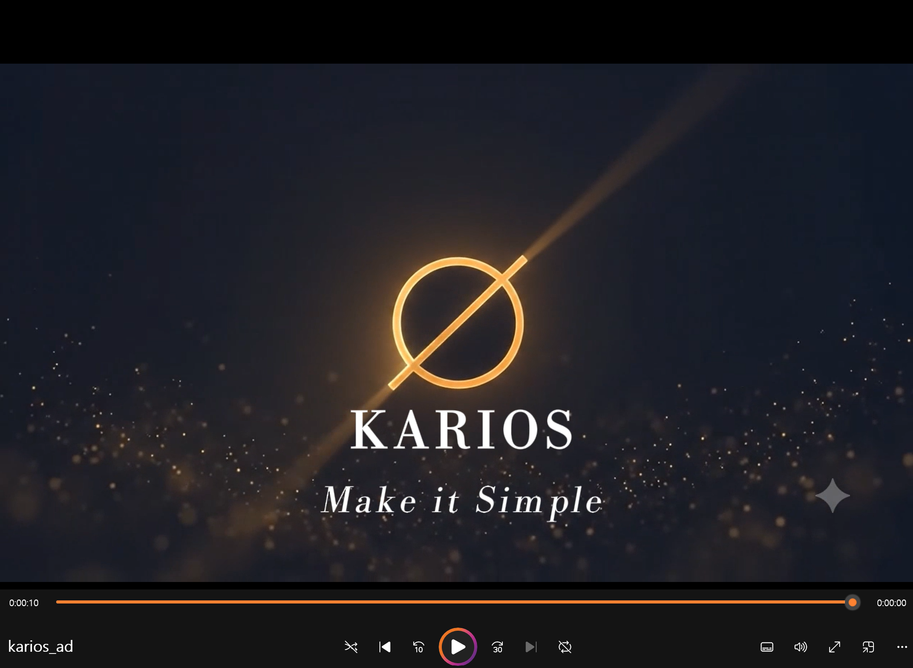

# KARIOS — AI 멀티모달 광고 (Codyssey AI Native · b2-2)

> 가상 AI·테크 브랜드 **KARIOS**의 **10초 광고**.
> 이미지·영상·오디오 **전 과정을 생성형 AI(무료/Pro 도구)** 로 제작 — 직접 촬영·유료 스톡 미사용.

**작성자:** 김성태 (성균관대 기술경영대학원 20기) · **미션:** b2-2 멀티모달 광고 제작

| 항목 | 내용 |
|---|---|
| 브랜드 | KARIOS — 예지형(선제) AI 비서 앱 |
| 핵심 메시지 | "기다리지 마세요. KARIOS AI가 먼저 압니다." |
| 영상 길이 | **10초** (2.5 + 2.5 + 2 + 3초) · 16:9 · H.264/AAC · 720p |
| 사용 AI | 이미지 Gemini(Nano Banana Pro) · 영상 Google Veo(Pro·T2V) · 음악 Suno |
| 통합 편집 | CapCut (컷·전환·자막·오디오 레벨만) |

---

## 0. 산출물 (Deliverables)

| 파일 | 위치 |
|---|---|
| 스토리보드(기획) PDF | [`docs/KARIOS_Storyboard_SungtaeKim.pdf`](docs/KARIOS_Storyboard_SungtaeKim.pdf) |
| 프롬프트 로그(전문 + 수정 전/후) | [`prompts/prompt-log.md`](prompts/prompt-log.md) |
| 생성 에셋 | [`assets/images/`](assets/images) · [`assets/videos/`](assets/videos) · [`assets/audio/`](assets/audio) |
| **최종 영상(MP4)** | [`assets/final/karios_ad_10s.mp4`](assets/final/karios_ad_10s.mp4) |
| **최종 영상 길이 증빙(10초)** | [`assets/images/video_duration_proof.jpg`](assets/images/video_duration_proof.jpg) |
| **1차 영상(비교용·Kling I2V)** | [`assets/archive/karios_ad_v1_before.mp4`](assets/archive/karios_ad_v1_before.mp4) |

**최종 영상 길이 증빙 (10초):**



> 재생바가 끝까지 찬 상태에서 좌측 하단 타임코드가 **`0:00:10`** — 최종 영상(`karios_ad_10s.mp4`)의 총 길이가 **10초**임을 확인.

---

## 1. 브랜드 아이덴티티

| 요소 | 정의 |
|---|---|
| **브랜드명** | KARIOS (카리오스) — 그리스어 **KARIOS(καιρός, "결정적 순간·기회")** 에서 파생한 조어. "정답의 순간을 먼저 아는 AI" |
| **카테고리** | **스마트폰 AI 비서 앱** — 알림·정보 과부하를 분석하고 묻기 전에 먼저 제안하는 예지형 AI |
| **타겟(Target)** | 정보·알림·결정 과부하에 시달리는 25–40세 지식 전문가 |
| **톤앤매너(Tone)** | 시네마틱 · 미니멀 · 차분한 프리미엄. "혼돈 → AI 분석 → 명료"의 시각 서사 |
| **USP** | "답하지 않고 먼저 안다" — 맥락을 읽어 적시에 선제 제안 (개인화된 corporate foresight) |
| **핵심 메시지** | "기다리지 마세요. KARIOS AI가 먼저 압니다." — 복잡한 알림·결정을 AI가 **단순하게** 정리한다는 약속(Make it Simple) |
| **슬로건 / CTA** | **KARIOS — Make it Simple.** / "지금 만나보세요 · karios.ai" |

> 이 브랜드는 작성자의 석사 연구 주제 **Corporate Foresight**(기업 예지력)를 소비자 AI 앱 서사로 번역한 것 — "먼저 알아서 단순하게 만든다"가 제품 약속 — DX/AI 전략 관점의 포트폴리오 자산.

---

## 2. 캠페인 & 영상 스펙

- **광고 목적:** 인지(Awareness) — KARIOS AI 앱이 어떤 문제를 어떻게 해결하는지 한 번에 각인
- **구조:** 기승전결(알림 과부하 → AI 앱 등장·분석 → AI가 먼저 제안 → 브랜드) · 마지막 3초 브랜드 장치
- **길이(확정):** **10초** — `씬1 2.5s + 씬2 2.5s + 씬3 2s + 씬4 3s = 10s`
- **스펙:** 16:9 · H.264 / AAC · 720p · 30fps

> ⏱ **길이 근거:** 평가 기준의 「최종 영상 10초 이내」가 PASS/FAIL 필수 조건.

---

## 3. 스토리보드 (10초 · 4씬)

> **내레이션 방식:** 본 광고는 **음성 내레이션 없이 화면 자막(온스크린 텍스트)** 으로 메시지를 전달합니다. 아래 **"내레이션/자막" 열이 각 씬의 내레이션(자막) 텍스트**이며, 씬4는 브랜드 자막(로고+슬로건+CTA)이 내레이션을 대신합니다.

| 씬 | 길이 | 목표 메시지 | 내레이션/자막(화면 텍스트) | 화면 구성 | 도구 |
|---|---|---|---|---|---|
| **1 · 기** | 2.5s | 알림·정보 과부하 문제 제시 | "매일, 결정의 순간은 너무 빨리 옵니다." | 직장인이 수십 개의 알림·메시지·캘린더 팝업에 머리를 감싸 쥐고 스트레스 받는 장면. AI 앱 알림들이 사방에서 쏟아짐 | Google Veo(Pro)·Suno |
| **2 · 승** | 2.5s | KARIOS AI 앱 등장·분석 | "KARIOS AI가 당신의 순간을 먼저 분석합니다." | 손이 스마트폰을 들고, 화면에 KARIOS AI 앱이 켜지며 중앙에 앰버 오브(AI 심볼)가 빛나고 UI 카드들이 정돈됨 | Google Veo(Pro)·Suno |
| **3 · 전** | 2s | AI가 먼저 추천·제안 | "당신보다 한 발 먼저, KARIOS가 제안합니다." | 사용자가 스마트폰 화면을 보며 안도·미소. KARIOS AI가 묻기 전에 먼저 추천 카드를 띄워줌 | Google Veo(Pro)·Suno |
| **4 · 결** | 3s | 브랜드 각인(필수) | (브랜드 자막) "KARIOS — Make it Simple / karios.ai" | 딥네이비 배경에 KARIOS 앰버 오브 → 로고·슬로건·CTA 각인 | Google Veo(Pro) |

> 씬별 **필수 필드(목표/화면/내레이션·자막/도구/프롬프트/씬 길이/출력 요약)** 전체와 프롬프트 전문은 [`prompts/prompt-log.md`](prompts/prompt-log.md) 및 스토리보드 PDF 참조.

**필수 요소 충족:** AI 생성 **시각 요소**(4씬 전부) + **청각 요소**(Suno BGM) + **내레이션/자막**(씬별 명시) · 마지막 3초 브랜드 장치(씬4). **"AI 프로그램(앱)"** 임을 화면에서 명확히 드러냄(씬2·3의 스마트폰+AI 앱 UI).

---

## 4. 파이프라인: 기획 → 생성 → 검수 → 편집/통합

크레딧이 비싼 단계(영상)를 **뒤로** 미루고, 싼 단계(텍스트)에서 방향을 **먼저 확정**하는 순서로 설계.

1. **① 기획(텍스트 확정)** — 이 문서. 크레딧 0. 모든 결정을 먼저 끝냄.
2. **② 생성-영상** — Google Veo(Pro)로 씬1–4 각각 **T2V(텍스트→영상)** 직접 생성. 씬당 4–8초.
3. **③ 생성-오디오** — Suno 1곡(Instrumental, 30–60초).
4. **④ 검수 → 편집/통합** — CapCut에서 컷 트림(각 2–3초)·전환(디졸브)·자막·BGM → **총 10초**.
5. **⑤ 내보내기** — 마지막 3초 엔드카드 확인 → H.264/AAC · 720p · 30fps.

---

## 5. 사용 도구 & 선택 근거 (2026.6 기준)

| 역할 | 사용 도구 | 선택 이유 | 대체 도구 |
|---|---|---|---|
| 영상 (T2V) | **Google Veo (Pro)** · T2V 직접 생성 | Pro 플랜으로 크레딧 제약 없음 · 오디오 내장 · 고품질 AI 앱 UI 씬 표현 가능 · Kling 무료 체험 소진 대응 | Kling 3.0(I2V), Hailuo |
| 이미지 | **Gemini · Nano Banana Pro** (일 ~15–20장) | 무료 최고 화질 + 참조로 화풍 락 | Leonardo, MS Copilot Designer |
| 음악 | **Suno** (일 ~10곡) | 무료 최고 품질·완곡 생성 | Google MusicFX(무제한 무료) |
| 내레이션 | **CapCut 자막** | 음성 대신 온스크린 텍스트로 내레이션 대체 | ElevenLabs(월 1만 자) |
| 통합 편집 | **CapCut** (무료) | 컷·전환·자막·오디오 레벨만 | DaVinci Resolve |

### T2V 선택 이유 — 이번 버전의 핵심 기술 결정

- **이전 버전 (I2V):** Gemini로 이미지 생성 → Kling I2V로 영상화. 화풍 일관성은 좋았으나, **각 씬이 무엇을 의미하는지 추상적**이라는 피드백.
- **이번 버전 (T2V):** Google Veo로 **텍스트 프롬프트에서 직접 영상 생성**. "AI 앱 UI가 화면에 명확히 보이는" 씬을 프롬프트로 정밀하게 지정 → **"이게 AI 프로그램이다"가 시각적으로 명확**.
- **T2V 채택 이유:** 스마트폰 화면·AI 앱 인터페이스·알림 UI 같은 **구체적인 AI 제품 시각화**는 T2V가 I2V보다 훨씬 정밀하게 표현 가능.
- **도구 우선순위 = 메시지 명확성 > 품질 > 제어 > 비용.** 평가 피드백("AI 프로그램임을 드러내라")을 반영해 도구 전략을 전면 수정.

> ℹ️ Veo는 한 번 생성에 최대 8초(4·6·8초 선택). 씬당 4–8초로 뽑아 CapCut에서 트림 후 합침.

---

## 6. 에셋 규격 · 네이밍 규칙 (표준화)

| 항목 | 표준 규격 |
|---|---|
| 영상 | 16:9 · 720p · 4–8초 생성(Veo) 후 트림 |
| 오디오 | BGM 1트랙(Suno) · AAC |
| 공통 | 30fps · 딥네이비 → 앰버 컬러 톤 통일 |

**파일 네이밍:** `s{씬번호}_{역할}.{확장자}`
예) `s1_chaos.mp4` · `s2_ai_analysis.mp4` · `s3_ai_suggest.mp4` · `s4_brand.mp4`

---

## 7. 화풍 · AI 앱 UI 일관성 제어

1. **씬2·3에 스마트폰+AI 앱 UI 명시** — "AI 프로그램"임을 화면에서 직접 드러냄.
2. **앰버 오브(AI 심볼) 공통 사용** — 씬2(앱 UI)·씬4(브랜드)에 동일 앰버 오브 → KARIOS AI 아이덴티티 통일.
3. **딥네이비 배경 일관** — 씬 전체에 딥네이비 계열 유지.
4. **자막 스타일 통일** — 흰색·클린 폰트·하단 중앙 배치.

**Veo 공통 스타일 레퍼런스** (모든 프롬프트 말미):
```
Style: cinematic tech commercial, premium and clean, deep navy blue to warm amber
color grade, volumetric light, shallow depth of field, smooth camera motion,
modern minimal UI design, Apple-style product film. 16:9.
```

---

## 8. 프롬프트 수정 전 / 후 로그 (A → B)

### 로그 1 — 이미지 프롬프트 수정 (씬1 · v1→v2)

| 구분 | 내용 |
|---|---|
| 버전 / 대상 | v1 → v2 · 씬1(문제 제시) · 2026-06 |
| 수정 전 의도 | 인물 "얼굴 클로즈업"으로 과부하 표정을 직접 표현 |
| **A (수정 전)** | `Cinematic close-up of a stressed person's face overwhelmed by floating notifications, detailed facial expression ...` |
| 발생한 문제 | ① 얼굴 일관성 붕괴(씬 간 인물 불일치) ② 표정 과장으로 프리미엄 톤과 충돌 ③ "스톡 영상" 느낌 |
| **B (수정 후)** | 얼굴 제거 → **실루엣** 중심, 과부하를 "빛·파편(환경)"으로 표현, 와이드 구도 |
| 결과 변화 · **원인** | 일관성 문제 소멸·톤 통일·시네마틱↑. 원인: 얼굴이라는 **고빈도 실패 지점**을 제거 → 재생성↓·**크레딧 절약** |

### 로그 2 — 영상 도구·방식 전환 (전체 · v2→v3)

| 구분 | 내용 |
|---|---|
| 버전 / 대상 | v2 → v3 · 전체 영상 · 2026-07 |
| 수정 전 방식 | Gemini(T2I) → Kling(I2V): 이미지를 먼저 만들고 영상으로 변환 |
| **A (수정 전)** | 추상적 빛·궤도·홀로그램 카드로 표현. 화풍은 통일됐으나 **"이게 AI 앱인지 불명확"** 하다는 피드백 |
| 발생한 문제 | ① 각 씬이 뭘 의미하는지 애매 ② "AI 프로그램"임이 시각적으로 드러나지 않음 |
| **B (수정 후)** | **Google Veo(T2V)** 로 전환: 텍스트 프롬프트에서 직접 영상 생성. 스마트폰·AI 앱 UI·알림 장면을 명확히 지정 |
| 결과 변화 · **원인** | "이건 AI 앱 광고구나"가 한눈에 읽힘. 원인: T2V는 T2I+I2V보다 **구체적 AI 제품 UI 시각화**에 훨씬 정밀하게 대응 가능 |


### 로그 3 — 영상 결과물 품질 비교 (1차 → 최종)

| 구분 | 내용 |
|---|---|
| 버전 / 대상 | v1(Kling I2V) → v2(Veo T2V) · 전체 영상 · 2026-07 |
| **A (1차 결과물)** | ① **제품 특성 미표현** — 추상적 빛·궤도만 있어 "무슨 AI 제품인지" 불명확 ② **인체 형태 붕괴** — 팔·다리·비율이 프레임마다 깨져 실루엣으로 우회할 수밖에 없었음 ③ 로고·브랜드 텍스트 생성 불가 |
| **B (최종 결과물)** | ① **제품 특성 명확** — 스마트폰 화면에 KARIOS AI 앱 UI(앰버 오브·추천 카드)가 직접 보임 ② **인체 형태 자연스러움** — 얼굴·손·자세가 정상 렌더링되어 실제 인물 등장 가능 ③ **로고·브랜드 텍스트 정상 생성** |
| **원인 분석** | I2V는 정지 이미지 1장을 기점으로 움직임을 **추론**하기 때문에 인체 구조·UI 디테일이 프레임마다 붕괴됨. 반면 T2V(Veo)는 텍스트에서 영상을 **직접 생성**하며 인체 해부학·UI 레이아웃·문자를 구조적으로 이해 → 형태가 유지됨 |
| **정량 결과** | 길이 10.05초 유지 · 용량 9.36MB → **7.94MB(-15%)** · 720p/30fps 동일 · 실루엣 우회 불필요 |
| **비교 파일** | **A(1차):** [`assets/archive/karios_ad_v1_before.mp4`](assets/archive/karios_ad_v1_before.mp4) &nbsp;→&nbsp; **B(최종):** [`assets/final/karios_ad_10s.mp4`](assets/final/karios_ad_10s.mp4) — 두 파일을 직접 재생해 개선 전후를 확인할 수 있음 |


---

## 9. 크레딧 / 제약 설계 & 리스크 대응

- **Veo 8초 제한:** 한 번 생성에 최대 8초 → 씬당 4–8초로 생성 후 CapCut에서 트림. 연장(Extend) 기능으로 더 긴 클립도 가능하나 씬 분할이 더 편리.
- **Kling 무료 체험 3회 소진:** Veo Pro로 전환해 해결. 대안: Hailuo(200크레딧), Veo AI Studio.
- **도구 간 불일치:** Veo 동일 스타일 레퍼런스 유지 + CapCut 색보정으로 톤 통일.
- **60초 → 15초 → 10초 축소:** 브랜드 엔드카드(씬4)와 문제→해결 대비(씬1·씬3)를 유지, 전환 씬(씬2)을 최우선 삭제·병합.

---

## 10. 평가 기준(5. 평가문항) 대응표

| 평가 항목 | 세부 체크 | 대응 위치 |
|---|---|---|
| **항목 1** 기능 동작 검증 | 브랜드 정의 · 씬 필수필드 · 수정 전후 · 3종 도구 · **10초 이내(+증빙)** · 시각+청각+내레이션 · 무촬영/무유료스톡 · **AI 프로그램 명확** | §1 · §3 · §8 · §5 · §0·§2 · §3 · §5 · §3 |
| **항목 2** 동작 구조·설계 | 파이프라인 순서 · 제약 설계 · 에셋 규격 · 네이밍 규칙 | §4 · §9 · §6 · §6 |
| **항목 3** 핵심 기술 원리 | T2V 선택(vs I2V) · 우선순위 · 프롬프트/결과물 A→B(3개) · 일관성 제어 | §5 · §5 · §8 · §7 |
| **항목 4** 심층 인터뷰 | 통합 불일치 보정 · 다른 도구 시 차이 · 크레딧 대응 · 60→10 재구성 | §9 · §5 · §9 · §9 |

---

## 11. 재현 방법 (How to reproduce)

1. **가입:** [Google Veo/Flow](https://labs.google.com/flow) (Pro 플랜) · [Suno](https://suno.com) (무료)
2. **영상:** `prompts/prompt-log.md`의 씬1–4 T2V 프롬프트를 Veo에 입력 → 각 4–8초 생성 → `videos/`에 저장.
3. **오디오:** Suno로 BGM 1곡(Instrumental) → `audio/`에 저장.
4. **편집:** CapCut에서 컷 트림(2.5/2.5/2/3초)·전환·자막·BGM → **10초** MP4 → `final/`.

---

## 폴더 구조

```
Codyssey-ai-tools-B1-2/
├── README.md                       # 본 문서 (평가 기준 대응 포함)
├── KARIOS_Storyboard_SungtaeKim.pdf       # 스토리보드(기획) PDF
├── prompts/
│   └── prompt-log.md               # 전체 프롬프트 + 수정 전/후(A→B) 로그
│   ├── images/                     # 키비주얼 + 길이 증빙(video_duration_proof.jpg)
├── videos/                         # Veo 생성 클립 (s1_chaos ~ s4_brand)
├── audio/                          # BGM (bgm.mp3)
├── archive/                        # 1차 영상 (비교용, karios_ad_v1_before.mp4)
└── final/                          # 최종 통합 MP4 (karios_ad_10s.mp4)
```

---

*AI 도구 정보는 2026년 7월 기준이며, 각 도구의 무료 한도·라이선스는 변경될 수 있습니다.*
