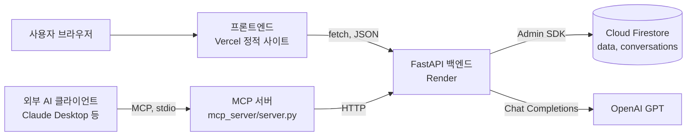
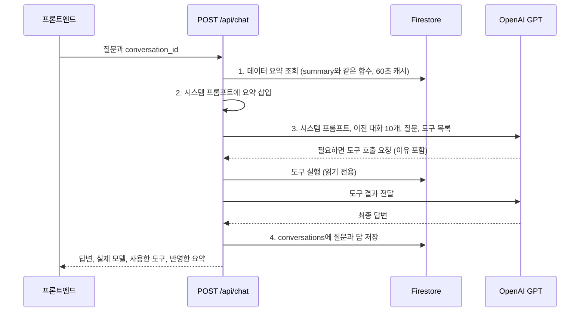

# 원/달러 환율 비서: 내 데이터를 아는 AI (코디세이 M1-2)

코디세이 M1-2 미션 "AI Agent 개발: 나만의 AI 비서 구축" 결과물 | 작성: 김성태

일반 ChatGPT에 "이번 달 환율 어때?"라고 물으면 내 데이터를 모르기 때문에 일반론만 돌아옵니다.
이 서비스는 직접 저장한 **원/달러 환율 일별 데이터(최근 1년, 251개)** 를 분석해 요약을 만들고,
그 요약을 **매 질문마다 GPT의 시스템 프롬프트에 넣어(컨텍스트 주입)** "내 데이터의 숫자"로 답합니다.
요약에 없는 날짜나 기간의 값은 GPT가 **도구(Function Calling)** 로 직접 조회해서 확인합니다.

## 1. 배포 주소

| 구분 | 주소 |
|---|---|
| 프론트엔드 (Vercel) | https://usdkrw-ai-assistant.vercel.app (배포 후 실제 주소로 바꾸기) |
| 백엔드 API (Render) | https://usdkrw-ai-assistant-api.onrender.com (배포 후 실제 주소로 바꾸기) |
| Swagger UI | https://usdkrw-ai-assistant-api.onrender.com/docs |

> **무료 서버 안내**: Render 무료 서버는 15분 동안 요청이 없으면 잠들고, 다음 첫 요청 때 깨어나는 데 약 1분이 걸립니다.
> 화면은 열리자마자 `/health`를 불러 서버를 깨우고, 기다리는 동안 경과 시간과 안내 문구를 보여 줍니다.
> 서버는 한 질문을 75초 안에 끝내고(시간 상한), 화면은 잠든 서버가 깨는 시간까지 더해 최대 150초 기다립니다. 12초가 넘으면 "서버가 잠들어 있었다면 1분 정도 걸릴 수 있어요"라고 알려 줍니다.

## 2. 제출 스크린샷

| 장면 | 파일 |
|---|---|
| 데이터 요약이 보이는 채팅 화면 (질문 + 답변) |  |
| 데이터 관리 화면 (추가·수정·삭제 중 동작 1개 이상) |  |
| 대화 기록 화면 (불러오기 동작) |  |

캡처 방법은 [docs/DEPLOY_GUIDE.md 7단계](docs/DEPLOY_GUIDE.md#7단계-제출-스크린샷-3장-찍기)에 있습니다.

## 3. 미션 요구사항 대응표

| 요구사항 | 구현 | 위치 |
|---|---|---|
| Python 3.10+, venv, 지정 패키지 5개 | Python 3.13, `fastapi` `uvicorn` `firebase-admin` `openai` `python-dotenv` (버전 고정) | `backend/requirements.txt` |
| 시계열 데이터 100개 이상 + 요약 | USD/KRW 251개, 기간·개수·평균·최고·최저·최신·추세·월별 | `backend/data/usdkrw_daily.csv`, `scripts/analyze_data.py` |
| FastAPI 구성, CORS, Swagger | 라우터·서비스·스키마·저장소 분리, `ALLOWED_ORIGINS` 기반 CORS, `/docs` | `backend/main.py`, `backend/app/` |
| Firestore 연동, 키는 환경 변수 | `data`, `conversations` 컬렉션. 키는 `FIREBASE_SERVICE_ACCOUNT_JSON` 또는 `..._PATH` | `app/database.py`, `app/repositories/` |
| 데이터 API 5개 | `POST/GET /api/data`, `PUT/DELETE /api/data/{id}`, `GET /api/data/summary` | `app/routers/data.py` |
| 대화 기록 API + 불러오기 | `POST/GET /api/conversations`, `DELETE /api/conversations/{id}`, **(A) 방식** `GET /api/conversations/{id}` | `app/routers/conversations.py` |
| AI 챗봇 (컨텍스트 주입 + 자동 저장) | 요약 조회 → 시스템 프롬프트 삽입 → GPT 호출 → conversations 저장 | `app/services/chat_service.py`, `prompt.py` |
| Render 배포 + 콜드스타트 대응 | Blueprint(`render.yaml`), 헬스 체크, 화면의 서버 깨우기 안내 | `render.yaml`, `frontend/public/app.js` |
| 바닐라 프론트엔드 | HTML/CSS/JS만 사용 (프레임워크·차트 라이브러리 없음) | `frontend/public/` |
| Vercel 배포 + API 주소 환경 변수 | 빌드 때 `API_BASE_URL`로 `config.js` 생성 | `frontend/vercel.json`, `scripts/generate-config.mjs` |
| 입력 검증, 예외 처리, 키 비노출 | Pydantic 검증(422), 한국어 오류 메시지, 키는 환경 변수만 | `app/schemas/`, `app/factory.py` |
| 비용 관리 | 답변 길이 700토큰, 질문 1번 75초 상한, 요청 제한(IP당 분당 10회·하루 100회, 서버 전체 분당 30회·하루 300회) | `app/services/ai_client.py`, `app/rate_limit.py` |
| 보너스 1: Function Calling + MCP | 읽기 전용 도구 6개, 호출 이유 기록, MCP 서버로 같은 도구 연결 | `app/services/tools.py`, `mcp_server/`, [docs/TOOL_CALLING.md](docs/TOOL_CALLING.md) |
| 보너스 2: 통계·그래프·내보내기·다크 모드 | `/api/data/statistics`, SVG 그래프(20일 이동평균), CSV/JSON 내려받기, 다크 모드 | `app/routers/data.py`, `frontend/public/chart.js` |

## 4. 기술 스택

- **백엔드**: Python 3.13, FastAPI 0.162, Pydantic 2, Uvicorn, firebase-admin 7.7 (Cloud Firestore), openai 3.37 (Chat Completions + Function Calling), python-dotenv
- **AI 모델**: 기본 `gpt-6-luna` (`reasoning_effort: none`). 기본 모델을 쓸 수 없을 때(모델 없음·권한 없음·요청 형식 오류, HTTP 400/403/404)만 `gpt-4o-mini`로 자동 대체하고, 실제로 답한 모델을 응답과 대화 기록에 남김. 키 오류·사용 한도·시간 초과는 대체하지 않고 원인을 알려 줌
- **프론트엔드**: HTML, CSS, JavaScript(ES 모듈). 그래프는 SVG로 직접 그림
- **배포**: Render(백엔드, Blueprint), Vercel(프론트엔드, 정적 사이트)
- **테스트**: pytest 70개 (메모리 저장소 + 가짜 LLM, OpenAI SDK의 HTTP 목, mock-firestore)
- **보너스**: MCP Python SDK 2.3 (MCP 서버)

## 5. 데이터 선정과 분석

- **데이터**: 원/달러 환율(USD/KRW) 일별 값, **2025-10-16 ~ 2026-10-16, 251개**
- **출처**: 미국 연방준비제도 H.10 통계(FRED 시리즈 DEXKOUS, 뉴욕 정오 매입환율). 배포 미러 GitHub `datasets/exchange-rates`
- **정제**: 미국 공휴일처럼 고시가 없는 날(11일)은 값을 만들어 넣지 않고 뺐습니다. 앞뒤 값으로 채우면 변화율 0%인 가짜 날이 생겨 변동성이 작게 계산되기 때문입니다.
- **선정 이유**: ① 앞선 미션 "데이터 기반 트렌드 분석"에서 분석한 환율을 이어서 쓰므로 해석에 자신이 있고, ② 반도체·자동차 같은 수출 제조 대기업의 원가와 채산성에 바로 영향을 주는 지표이며, ③ 매일 값이 있어 100개 이상을 쉽게 확보할 수 있습니다.
- **재현**: `python scripts/prepare_data.py` (내려받기와 정리) → `python scripts/analyze_data.py` (요약 계산, `docs/analysis_summary.json` 저장)

### 요약 정보 (`GET /api/data/summary`와 같은 값)

| 항목 | 값 |
|---|---|
| 기간 / 개수 | 2025-10-16 ~ 2026-10-16 / 251개 |
| 평균 | 1,454.44원 |
| 최고 | 1,555.96원 (2026-06-05) |
| 최저 = 최신 | 1,334.03원 (2026-10-16) |
| 기간 첫 값 대비 | -82.04원 (-5.79%) |
| 최근 추세 | **하락**: 최근 20개 평균 1,353.11원, 직전 20개 평균 대비 -0.94% |

**추세 판단 규칙**: 최근 20개(약 한 달치 고시일) 평균을 직전 20개 평균과 비교해 +0.5%보다 크면 상승, -0.5%보다 작으면 하락, 그 사이는 보합으로 봅니다.
기준 0.5%는 이 데이터의 하루 평균 변동폭(6.86원, 평균 환율의 약 0.47%)에서 정했습니다. 한 달 평균이 하루치 변동만큼도 움직이지 않았다면 방향이 있다고 보기 어렵다는 판단입니다.

### 월별 요약

| 월 | 평균 | 최저 | 최고 | 마지막 값 | 전월 대비 |
|---|---:|---:|---:|---:|---:|
| 2025-10 (16일부터) | 1,428.30 | 1,416.07 | 1,438.35 | 1,428.37 | - |
| 2025-11 | 1,459.88 | 1,430.65 | 1,475.94 | 1,467.65 | +2.75% |
| 2025-12 | 1,465.36 | 1,433.88 | 1,481.45 | 1,444.55 | -1.57% |
| 2026-01 | 1,455.50 | 1,433.84 | 1,478.33 | 1,444.51 | 0.00% |
| 2026-02 | 1,447.29 | 1,427.12 | 1,463.13 | 1,439.82 | -0.32% |
| 2026-03 | 1,490.52 | 1,439.80 | 1,523.50 | 1,523.50 | +5.81% |
| 2026-04 | 1,483.80 | 1,461.66 | 1,511.31 | 1,477.93 | -2.99% |
| 2026-05 | 1,488.40 | 1,447.01 | 1,517.33 | 1,503.96 | +1.76% |
| 2026-06 | 1,529.46 | 1,508.12 | 1,555.96 | 1,548.78 | +2.98% |
| 2026-07 | 1,486.01 | 1,424.05 | 1,550.59 | 1,436.81 | -7.23% |
| 2026-08 | 1,403.22 | 1,368.25 | 1,430.49 | 1,368.25 | -4.77% |
| 2026-09 | 1,359.21 | 1,339.81 | 1,387.97 | 1,355.91 | -0.90% |
| 2026-10 (16일까지) | 1,343.30 | 1,334.03 | 1,364.83 | 1,334.03 | -1.61% |

확장 통계(`GET /api/data/statistics`): 20일 이동평균 1,353.11원, 일간 변동률 표준편차 0.646%, 고점 대비 최대 하락 -14.26%(2026-06-05 → 2026-10-16), 하루 최대 상승 +45.80원(2026-03-03), 하루 최대 하락 -37.83원(2025-12-24).

## 6. 구조



### POST /api/chat 한 번의 흐름



### 폴더 구조와 나눈 기준

```
codyssey-ai-assistant-M1-2/
├── render.yaml                  # Render Blueprint (백엔드 배포 설정)
├── backend/
│   ├── main.py                  # 앱 시작점: uvicorn main:app --reload
│   ├── app/
│   │   ├── factory.py           # 앱 조립: CORS, 예외 처리, 라우터 등록
│   │   ├── config.py            # 환경 변수 → Settings
│   │   ├── container.py         # 서비스 객체 조립 (의존성 주입)
│   │   ├── database.py          # Firestore 연결 (서비스 계정 키 읽기)
│   │   ├── routers/             # HTTP 경로만: 요청 받기 → 서비스 호출 → 응답
│   │   ├── services/            # 규칙과 계산: CRUD 규칙, 분석, 프롬프트, GPT 호출, 도구
│   │   ├── schemas/             # Pydantic 요청·응답 모델 (입력 검증)
│   │   └── repositories/        # 저장소: Firestore / 메모리(테스트용)
│   ├── data/usdkrw_daily.csv    # 251개 데이터
│   ├── scripts/                 # 데이터 준비, 분석, Firestore 업로드
│   └── tests/                   # pytest 70개 + 로컬 전체 흐름 점검용 가짜 OpenAI
├── frontend/
│   ├── vercel.json              # 빌드 명령, 출력 폴더
│   ├── scripts/generate-config.mjs
│   └── public/                  # index.html, styles.css, app.js, api.js, chart.js, format.js
├── mcp_server/                  # 보너스: MCP 서버와 점검 클라이언트
└── docs/                        # 배포 가이드, 도구 호출 설명, 평가 대비 노트, 스크린샷
```

**라우터와 서비스를 나눈 기준**: 라우터는 "어떤 주소로 무엇을 받는가"만 정하고, 실제 규칙(같은 날짜 중복 금지, 요약 계산, 프롬프트 만들기, GPT 호출)은 서비스에 둡니다.
그래서 `/api/data/summary`와 `/api/chat`이 같은 `DataService.summary()`를 쓰고, 저장소를 메모리로 바꿔 끼우면 키 없이도 같은 코드를 테스트할 수 있습니다.

## 7. API 목록

| 메서드 | 경로 | 설명 |
|---|---|---|
| POST | `/api/data` | 데이터 추가 `{date, value, memo}` (같은 날짜면 409) |
| GET | `/api/data` | 목록 (`start`, `end`, `order`, `limit` 선택) |
| PUT | `/api/data/{id}` | 수정 (바꿀 항목만 보내도 됨) |
| DELETE | `/api/data/{id}` | 삭제 |
| GET | `/api/data/summary` | 요약 (프롬프트 주입용) |
| GET | `/api/data/statistics` | 확장 통계 (보너스) |
| GET | `/api/data/export?format=csv\|json` | 내려받기 (보너스) |
| POST | `/api/conversations` | 대화 저장 (messages 목록을 새 대화로) |
| GET | `/api/conversations` | 대화 목록 (**messages 미포함**, 가볍게) |
| GET | `/api/conversations/{id}` | 특정 대화의 messages 전체 (불러오기) |
| DELETE | `/api/conversations/{id}` | 대화 삭제 |
| POST | `/api/chat` | AI 대화 (요약 주입, 도구 호출, 자동 저장) |
| GET | `/api/tools`, POST `/api/tools/{name}` | 도구 목록과 실행 (보너스, MCP가 사용) |
| GET | `/health` | 서버 상태 (Firestore 연결, OpenAI 키 설정 여부) |

Firestore 컬렉션 구조

```
data/{자동ID}           date "2026-10-16", value 1334.03, memo "FRED H.10", created_at, updated_at
conversations/{자동ID}  title, messages[{role, content, created_at, model?, tool_calls?}],
                        message_count, preview, created_at, updated_at
```

## 8. 컨텍스트 주입: 실제로 GPT에 보내는 시스템 프롬프트 (월별·최근 값 줄만 줄여서 표시)

```
당신은 사용자가 저장한 데이터를 함께 보는 데이터 분석 비서입니다.

[사용자 데이터 요약]
- 데이터: 원/달러 환율 (USD/KRW) (단위: 원, 출처: 미국 연방준비제도 H.10 (FRED DEXKOUS, 뉴욕 정오 매입환율))
- 데이터 기간: 2025-10-16 ~ 2026-10-16
- 총 레코드: 251개
- 주요 지표: 평균 1,454.44원, 최고 1,555.96원 (2026-06-05), 최저 1,334.03원 (2026-10-16), 최신 1,334.03원 (2026-10-16), 기간 첫 값 대비 -82.04원 (-5.79%), 표준편차 51.88원
- 최근 트렌드: 하락 (최근 20개 평균 1,353.11원, 직전 20개 평균 대비 -0.94%)
- 월별: 2025-10 평균 1,428.30 (최저 1,416.07, 최고 1,438.35, 12개), (중략, 최근 13개월까지)
- 최근 값: 2026-10-02 1,345.75, (중략, 최근 10개), 2026-10-16 1,334.03

위 데이터를 기반으로 맞춤형 답변을 제공하세요.

[답변 규칙]
1. 숫자는 위 요약과 도구 결과에 있는 값만 쓰고, 날짜와 단위를 함께 적으세요. 없는 값을 지어내지 마세요.
2. 요약에 없는 구체적인 값이 필요하면 추측하지 말고 도구를 부르세요. 특정 날짜·기간은 get_data_by_range, 가장 높거나 낮은 날은 get_top_records, 이동평균·변동성·가장 크게 움직인 날·월별 변화는 get_statistics, 이전 대화는 list_conversations와 get_conversation. 요약만으로 답할 수 있으면 도구를 부르지 마세요.
3. 오늘은 2026-10-25이고, 데이터의 마지막 날짜는 2026-10-16입니다. '이번 달', '최근' 같은 말은 데이터의 마지막 날짜 기준으로 풀고, 어느 날짜까지의 값인지 밝히세요.
4. 값이 왜 움직였는지는 이 데이터만으로 확인할 수 없습니다. 원인을 물으면 데이터로 확인되는 사실과 일반적인 가능성을 나눠 말하고 단정하지 마세요.
5. 환전·투자 시점을 권하거나 앞으로의 값을 단정해 예측하지 마세요.
6. 한국어로, 핵심부터 3~6문장으로 간결하게 답하세요.
```

요약은 질문할 때마다 새로 계산하므로(60초 캐시, 데이터를 바꾸면 바로 비움) 화면에서 값을 추가하거나 고치면 다음 질문부터 AI 답에 반영됩니다.

## 9. 로컬 실행 방법

```bash
# 0) 내려받기
git clone https://github.com/Sungtae10/codyssey-ai-assistant-M1-2.git
cd codyssey-ai-assistant-M1-2

# 1) 백엔드
cd backend
python -m venv .venv
source .venv/bin/activate            # Windows: .venv\Scripts\activate
pip install -r requirements.txt
cp .env.example .env                 # OPENAI_API_KEY와 Firebase 키 파일 경로를 채움
python scripts/seed_firestore.py     # 처음 한 번: Firestore에 251개 올리기
uvicorn main:app --reload            # http://localhost:8000/docs

# 2) 프론트엔드 (새 터미널에서 저장소 폴더로 이동한 뒤)
cd frontend
node scripts/generate-config.mjs     # API_BASE_URL이 없으면 http://localhost:8000
python -m http.server 5500 --directory public   # http://localhost:5500
```

키 없이 화면만 먼저 보려면 `STORAGE_BACKEND=memory uvicorn main:app --reload` 로 실행합니다.
(CSV를 메모리에 올려 데이터 화면은 동작하고, 채팅은 `OPENAI_API_KEY`가 있어야 합니다. 서버를 끄면 메모리 내용은 사라집니다.)

## 10. 환경 변수

| 이름 | 넣는 곳 | 필수 | 설명 |
|---|---|---|---|
| `OPENAI_API_KEY` | Render, 로컬 `.env` | 필수 | OpenAI API 키 |
| `FIREBASE_SERVICE_ACCOUNT_JSON` | Render | 필수 (또는 아래 PATH) | 서비스 계정 키 파일 내용 전체 (JSON 문자열, base64도 가능) |
| `FIREBASE_SERVICE_ACCOUNT_PATH` | 로컬 `.env` | 선택 | 서비스 계정 키 파일 경로 (예: `./firebase-key.json`) |
| `ALLOWED_ORIGINS` | Render, 로컬 `.env` | 필수 | CORS 허용 주소 목록, 쉼표로 구분. `render.yaml`에 `https://usdkrw-ai-assistant.vercel.app`과 로컬 주소가 미리 들어 있음 |
| `API_BASE_URL` | Vercel | 필수 | 프론트가 부를 백엔드 주소 (예: `https://...onrender.com`) |
| `ALLOWED_ORIGIN_REGEX` | Render | 선택 | 미리보기 주소까지 허용할 때만. 다른 사람의 Vercel 주소가 걸리지 않게 본인 팀 이름까지 넣은 좁은 식으로 쓰기 |
| `FIRESTORE_DATABASE_ID` | Render | 선택 | 기본 데이터베이스 `(default)`가 아닌 것을 쓸 때만 |
| `SEED_IF_EMPTY` | Render | 선택 (`render.yaml`에 `true`) | 서버가 켜질 때 `data` 컬렉션이 완전히 비어 있으면 CSV 251개를 한 번 올림. 문서가 하나라도 있으면 아무것도 하지 않음 |
| `OPENAI_MODEL` / `OPENAI_FALLBACK_MODEL` | Render | 선택 | 기본 `gpt-6-luna` / `gpt-4o-mini` |
| `OPENAI_REASONING_EFFORT` | Render | 선택 | 기본 `none` (Chat Completions에서 도구 호출을 쓰기 위한 값) |
| `OPENAI_MAX_TOKENS` | Render | 선택 | 답변 최대 토큰, 기본 700 |
| `CHAT_RATE_LIMIT_PER_MINUTE` / `CHAT_DAILY_LIMIT_PER_IP` | Render | 선택 | IP당 기본 10회/분, 100회/일 |
| `CHAT_GLOBAL_RATE_LIMIT_PER_MINUTE` / `CHAT_DAILY_LIMIT` | Render | 선택 | 서버 전체 기본 30회/분, 300회/일 (실제 비용 상한) |
| `CHAT_DEADLINE_SECONDS` | Render | 선택 | 질문 1번 처리 시간 상한, 기본 75초 |
| `STORAGE_BACKEND` | 로컬 | 선택 | `firestore`(기본) 또는 `memory` |

## 11. 배포 요약

자세한 순서(누가, 언제, 무엇을, 어떻게)는 **[docs/DEPLOY_GUIDE.md](docs/DEPLOY_GUIDE.md)** 에 있습니다.

1. Firebase: 프로젝트 생성 → Firestore 데이터베이스(서울 `asia-northeast3`, 프로덕션 모드) → 서비스 계정 키 내려받기
2. (선택) 로컬: `.env` 작성 → 실행 확인. 데이터 251개는 Render 서버가 처음 켜질 때 `data` 컬렉션이 비어 있으면 자동으로 올라갑니다 (`SEED_IF_EMPTY=true`). 로컬에서 먼저 올리려면 `seed_firestore.py`
3. GitHub: 이 폴더를 새 저장소에 올리기 (`.env`와 키 파일은 `.gitignore`로 제외됨)
4. Render: New > Blueprint → 저장소 선택 → `OPENAI_API_KEY`, `FIREBASE_SERVICE_ACCOUNT_JSON` 입력 → `/docs` 확인
5. Vercel: 저장소 가져오기 → Root Directory `frontend` → 환경 변수 `API_BASE_URL` = Render 주소 → 배포
6. 화면에서 질문, 데이터 추가, 대화 불러오기 확인 → 스크린샷 3장 → 이 README의 주소와 스크린샷 채우기

## 12. 보안과 비용 관리

- **키 관리**: 키는 환경 변수로만 받고 코드·README·GitHub에 쓰지 않습니다. `.gitignore`가 `.env`와 서비스 계정 키 파일 이름 패턴을 막습니다.
- **CORS**: 브라우저는 다른 주소(Vercel)에서 API(Render)를 부를 때 서버가 허락한 주소인지 확인합니다. `ALLOWED_ORIGINS`에 적힌 주소(기본: 운영 Vercel 주소와 로컬 주소)만 허락하므로 다른 사이트의 화면에서는 브라우저가 이 API 응답을 막습니다. CORS는 브라우저 규칙이라 로그인 같은 접근 제한은 아닙니다 (15장 참고).
- **Firestore 보안**: 데이터베이스는 프로덕션 모드(브라우저에서 직접 읽기·쓰기 금지)로 만들고, 서버만 서비스 계정 키(Admin SDK)로 접근합니다.
- **입력 검증**: 날짜 형식과 범위(1900-01-01 이후, 한국 시간 기준 오늘까지), 값(0보다 큰 숫자, `true`나 문자 거절, 무한대·NaN 금지), 메모 200자, 질문 1000자, ID 형식을 Pydantic으로 검사해 잘못된 값은 422로 돌려보냅니다.
- **비용**: 답변 길이 700토큰, 한 질문의 도구 왕복 최대 3번, 질문 1번 처리 75초 상한. 요청 제한은 IP당 분당 10회·하루 100회와 서버 전체 분당 30회·하루 300회입니다. IP는 요청 헤더로 판단해 바꿔 피할 수 있으므로, 실제 비용 상한은 서버 전체 제한이 맡습니다. `gpt-6-luna` 공식 가격은 100만 토큰당 입력 $0.10, 출력 $0.50이고, 실제 사용량은 `/api/chat` 응답의 `usage`로 확인합니다.
- **오류 메시지**: OpenAI 키 오류, 사용 한도, 시간 초과, Firestore 설정 누락과 실행 중 오류(데이터베이스 없음, 권한 없음, 키 무효, 무료 한도 초과)를 원인과 해결 방법이 담긴 한국어 문장으로 돌려줍니다. `/health`는 Firestore 문서 1개를 실제로 읽어(60초마다) 연결을 확인합니다.
- **동시 요청**: 같은 날짜 중복 확인과 저장을 잠금 안에서 한 번에 하고, 중복 확인은 캐시가 아니라 Firestore를 직접 봅니다. 대화가 너무 길어 Firestore 문서 한도(1MiB)에 가까워지면 OpenAI를 부르기 전에 "새 대화를 시작하세요"(413)로 멈춥니다.

## 13. 보너스

**① Function Calling + MCP** ([자세히](docs/TOOL_CALLING.md))
- 도구 6개(읽기 전용): `get_data_summary`, `get_data_by_range`, `get_top_records`, `get_statistics`, `list_conversations`, `get_conversation`
- 모든 도구에 `reason` 인자를 두어 GPT가 "왜 이 도구를 부르는지"를 적게 했고, 화면의 답변 아래와 대화 기록에 그대로 남깁니다.
- 같은 도구 실행기를 `/api/tools/{name}`로 열고, `mcp_server/server.py`(MCP 서버)가 이를 불러 Claude Desktop 같은 외부 클라이언트에서도 같은 기능을 씁니다.

**② 인사이트·UX**
- `/api/data/statistics`: 이동평균(5·20·60), 일간 변동성, 고점 대비 최대 하락, 저점 대비 최대 상승, 하루 최대 상승·하락일, 월별 전월 대비
- SVG 그래프: 환율 선 + 20일 이동평균, 최고·최저 표시, 1·3·6개월·전체 범위, 마우스와 키보드(← →)로 날짜별 값 읽기
- CSV(엑셀 한글 깨짐 방지 BOM 포함) / JSON 내려받기, 다크 모드(선택 기억)
- 색 규칙: 한국 시장 관례대로 상승은 빨강, 하락은 파랑

## 14. 테스트와 검증

```bash
cd backend
pip install -r requirements-dev.txt
python -m pytest -q        # 70 passed
```

- 분석 함수: 손으로 계산 가능한 작은 데이터 + 실제 CSV를 표준 라이브러리로 다시 계산해 비교
- API: CRUD, 중복 날짜 409, 검증 422, 요약 갱신, 내보내기, 대화 저장·목록·불러오기·삭제
- 채팅: 시스템 프롬프트에 요약이 들어가는지, 이전 대화 포함, 도구 호출 왕복, 빈 답변 처리, 요청 제한
- OpenAI 호출: 실제 openai 라이브러리로 요청을 만들고 HTTP만 가짜로 바꿔 매개변수(`reasoning_effort`, `max_completion_tokens`), 대체 모델 전환, 오류 변환 확인
- Firestore 코드: mock-firestore로 저장소 코드 경로 확인
- 배포 설정: `render.yaml`, `vercel.json`, `.gitignore`가 코드와 맞는지 확인
- 2차 검토 반영: 동시 쓰기 중 오래된 캐시, 저장소 기준 중복 확인, Firestore 실행 중 오류 안내, 서버 전체 요청 제한, 대화 크기 상한, 질문 시간 상한 (`tests/test_review_fixes.py`)
- 로컬 전체 흐름: `tests/e2e/fake_openai.py`(테스트용 가짜 OpenAI 서버)로 브라우저 → 백엔드 → OpenAI SDK → 도구 → 저장까지 실제 HTTP로 확인했습니다. 실제 GPT 답변은 배포 후 확인합니다.

## 15. 한계와 다음 단계

- **로그인 없음**: 주소를 아는 사람은 데이터를 고칠 수 있습니다. 다음 단계로 관리자 키 헤더 또는 Firebase Authentication을 붙입니다.
- **요청 제한은 서버 메모리 기준**: 서버가 다시 시작되면 횟수가 0부터 셉니다.
- **원인 분석은 하지 않음**: 이 데이터에는 뉴스나 금리 같은 원인 정보가 없어 AI가 원인을 단정하지 않도록 했습니다. 다음 단계로 뉴스 데이터를 함께 넣는 방법을 검토합니다.
- **무료 서버 대기 시간**: 첫 요청 1분 정도. 화면 안내로 대응했고, 필요하면 유료 인스턴스로 바꿉니다.
