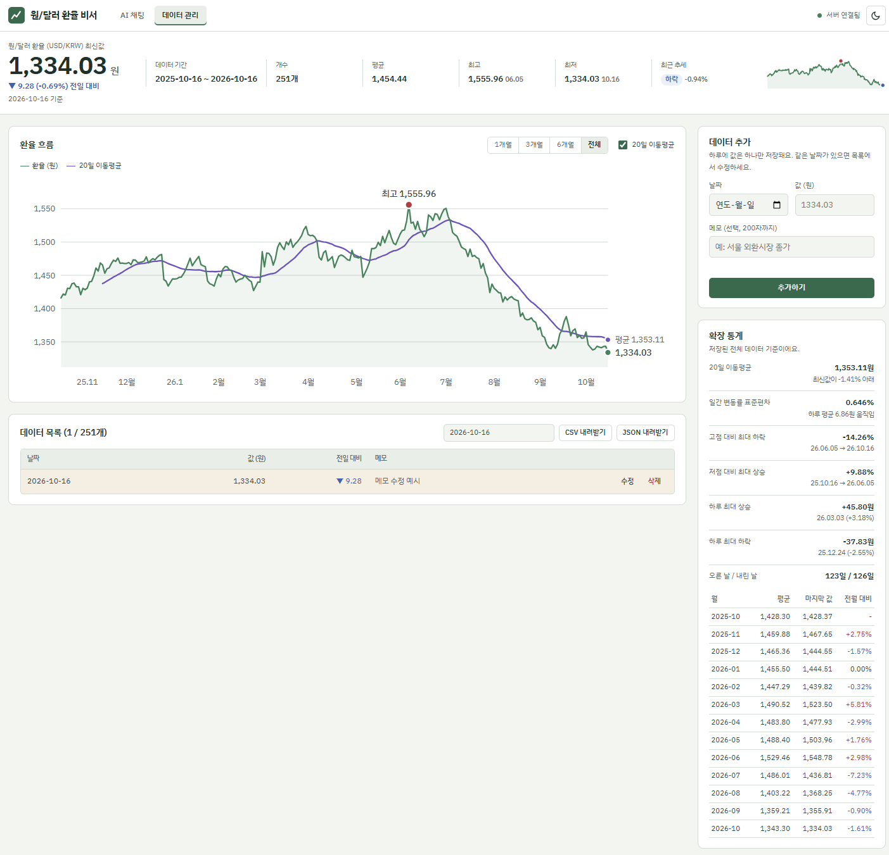
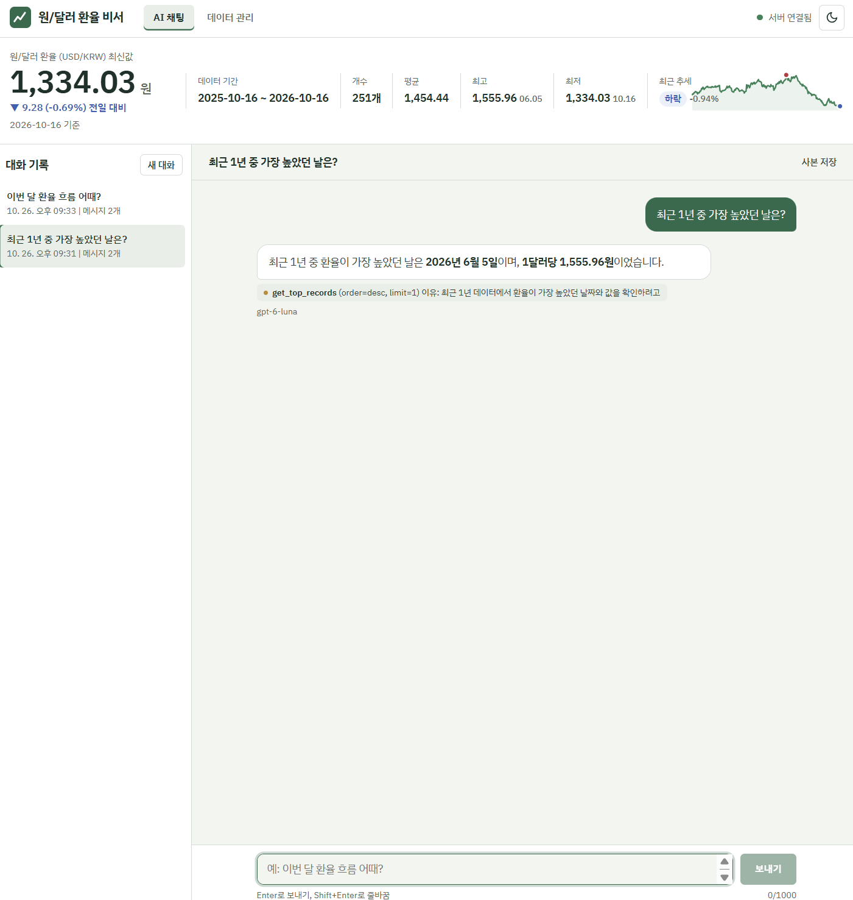
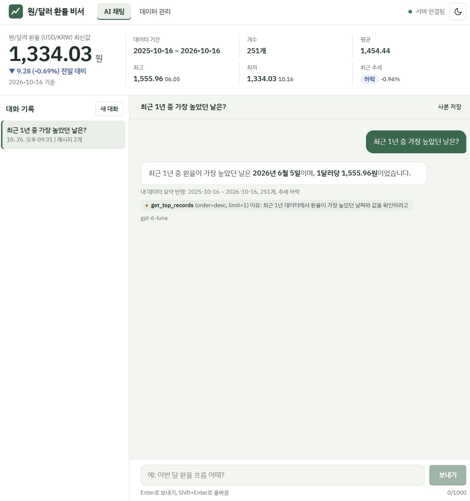

# 구현 설명서: 요구사항별로 무엇을, 어떻게 만들었나

코디세이 M1-2 "AI Agent 개발: 나만의 AI 비서 구축" | 작성: 김성태

> **한 줄 소개**: 일반 ChatGPT는 제 데이터를 모르기 때문에, 원/달러 환율 251개를 요약해서 질문할 때마다 GPT에게 같이 넘겨주는 "내 데이터를 아는 AI 비서"를 만들었습니다.

| 구분 | 주소 |
|---|---|
| 화면 (Vercel) | https://usdkrw-ai-assistant.vercel.app |
| 서버 (Render) | https://usdkrw-ai-assistant-api.onrender.com |
| Swagger | https://usdkrw-ai-assistant-api.onrender.com/docs |

> 무료 서버는 15분 동안 요청이 없으면 잠들고, 깨는 데 1분쯤 걸립니다. 시연 1~2분 전에 화면 주소를 먼저 열어 둡니다.

## 시연 순서 (5분)

| 순서 | 시간 | 할 일 |
|---|---|---|
| 1 | 30초 | 위의 한 줄 소개 |
| 2 | 2분 | 화면 시연: 요약판 확인 → 질문 하나 → 데이터 관리에서 메모 수정 → 새 대화를 연 뒤 앞의 대화 불러오기 |
| 3 | 30초 | Swagger `/docs`에서 API 목록 보여 주기 |
| 4 | 2분 | 질문을 받으면 아래 설명으로 답하기: "어떻게 만들었나"는 [만든 과정](#만든-과정), "왜 그렇게 했나"는 [주요 결정과 이유](#주요-결정과-이유), 세부 내용은 항목 1~14 |

## 한눈에 보기

| # | 요구사항 | 상태 | 근거 |
|---|---|---|---|
| 1 | [개발 환경 준비](#1-개발-환경-준비) | 완료 | 패키지 5개, 버전 고정 |
| 2 | [데이터 선정과 분석](#2-데이터-선정과-분석) | 완료 | 251개, 요약판 |
| 3 | [FastAPI 프로젝트 구성](#3-fastapi-프로젝트-구성) | 완료 | 라우터·서비스·저장소·스키마 분리, `/docs` |
| 4 | [Firestore 연동](#4-firestore-연동) | 완료 | `/health`에서 Firestore 연결 확인 |
| 5 | [데이터 API 5개](#5-데이터-api-5개) | 완료 | Swagger, 사진 2 |
| 6 | [대화 기록 API](#6-대화-기록-api) | 완료 | (A) 방식, 사진 3 |
| 7 | [AI 챗봇과 컨텍스트 주입](#7-ai-챗봇과-컨텍스트-주입) | 완료 | 사진 1 |
| 8 | [백엔드 배포 Render](#8-백엔드-배포-render) | 완료 | 서버 주소, `render.yaml` |
| 9 | [바닐라 프론트엔드](#9-바닐라-프론트엔드) | 완료 | 사진 1~3 |
| 10 | [프론트엔드 배포 Vercel과 README](#10-프론트엔드-배포-vercel과-readme) | 완료 | 화면 주소, README |
| 11 | [보너스 1 도구 호출과 MCP](#11-보너스-1-도구-호출과-mcp) | 완료 | 답변 아래 도구와 이유 표시 |
| 12 | [보너스 2 통계 그래프 내보내기 다크 모드](#12-보너스-2-통계-그래프-내보내기-다크-모드) | 완료 | 사진 2 오른쪽 |
| 13 | [제약 사항](#13-제약-사항) | 완료 | 환경 변수, 검증, 비용 제한 |
| 14 | [테스트와 검증](#14-테스트와-검증) | 완료 | pytest 70개 통과 |

## 만든 과정

> **한 줄 설명**: 데이터를 고르고 요약을 먼저 만든 뒤, 그 요약을 쓰는 서버와 AI, 화면을 차례로 만들고, 테스트로 확인한 다음 GitHub에 올려 Vercel, Firebase, Render 순서로 배포했습니다.

| 순서 | 한 일 | 결과물 |
|---|---|---|
| 1 | 데이터 고르기와 정제: 미국 연준 H.10 원/달러 환율 1년치에서 값이 없는 휴일 11일을 빼고 251개로 정리 | [backend/data/usdkrw_daily.csv](../backend/data/usdkrw_daily.csv), [prepare_data.py](../backend/scripts/prepare_data.py) |
| 2 | 분석과 요약: 평균·최고·최저·최신값·기간 변화·표준편차, 최근 20개와 직전 20개를 비교한 추세, 월별 통계 | [analysis.py](../backend/app/services/analysis.py), [analysis_summary.json](analysis_summary.json) |
| 3 | 서버 뼈대: FastAPI를 라우터·서비스·저장소·스키마로 나누고, Pydantic 검증과 한국어 오류 형식을 통일 | [backend/app](../backend/app) |
| 4 | 저장소 연결: Firestore(서비스 계정 키는 환경 변수)와 테스트용 메모리 저장소를 같은 모양으로 | [database.py](../backend/app/database.py), [repositories](../backend/app/repositories) |
| 5 | API: 데이터 5개, 대화 기록 4개 | [routers](../backend/app/routers) |
| 6 | AI: 요약을 시스템 프롬프트에 넣는 채팅, 읽기 전용 도구 6개, 토큰·시간·횟수 제한 | [chat_service.py](../backend/app/services/chat_service.py), [tools.py](../backend/app/services/tools.py) |
| 7 | 화면: 바닐라 HTML/CSS/JS로 채팅, 데이터 관리, 대화 기록, 요약판, 그래프 | [frontend/public](../frontend/public) |
| 8 | 테스트: 메모리 저장소와 가짜 AI로 pytest 70개, 가짜 OpenAI 서버로 화면부터 서버까지 전체 흐름 점검 | [backend/tests](../backend/tests) |
| 9 | 배포: GitHub에 올림 → Vercel에 화면 배포(`API_BASE_URL`에 Render 서버 주소를 미리 지정) → Firebase에서 Firestore 만들고 키 발급 → Render Blueprint로 서버 배포(키 입력, 데이터 251개 자동 업로드) | [render.yaml](../render.yaml), [frontend/vercel.json](../frontend/vercel.json), [DEPLOY_GUIDE.md](DEPLOY_GUIDE.md) |
| 10 | 마무리: 배포 주소에서 4가지 기능 확인, 제출 스크린샷 3장, README와 이 설명서 정리 | [README](../README.md) |

## 주요 결정과 이유

| 결정 | 이유 |
|---|---|
| 휴일은 값을 채우지 않고 뺐다 | 앞뒤 값으로 채우면 변화 0%인 가짜 날이 생겨 변동성이 작게 계산된다 |
| 추세 기준을 ±0.5%로 정했다 | 하루 평균 변동이 6.86원(약 0.47%)이라, 그보다 작게 움직이면 방향이 있다고 보기 어렵다 |
| 요약 함수 하나를 요약 API, 화면 요약판, AI 프롬프트가 함께 쓴다 | 세 곳의 숫자가 서로 어긋나지 않는다 |
| 채팅은 요약 API를 HTTP로 다시 부르지 않고 같은 함수를 바로 쓴다 | 결과는 같고, 더 빠르고 단순하다 |
| 같은 날짜는 두 번 저장하지 않는다 (409) | 하루에 값이 둘이면 추세와 통계가 틀어진다 |
| 전체 목록을 60초 동안 기억한다 | Firestore 무료 읽기 횟수를 아낀다. 데이터를 바꾸면 바로 지운다 |
| 도구를 부를 때 이유(`reason`)를 꼭 적게 했다 | AI가 왜 그 값을 조회했는지 화면에서 확인하고 검증할 수 있다 |
| 서버 주소는 빌드 때 `config.js`로 만든다 | 바닐라 HTML은 브라우저에서 환경 변수를 읽을 수 없다 |
| 서버가 처음 켜질 때 비어 있으면 데이터를 자동으로 올린다 | 내 컴퓨터에서 따로 실행하지 않아도 배포 직후 251개가 준비된다 |
| 답변 길이, 질문 시간, 요청 횟수를 제한했다 | 개인 OpenAI 키의 과금을 막는다 |
| CORS는 정확한 주소 목록만 허락한다 | 넓은 규칙은 다른 사람의 Vercel 주소까지 허락할 수 있다 |

---

## 1. 개발 환경 준비

> **한 줄 설명**: Python 가상환경을 만들고, 과제에서 정한 패키지 5개만 써서 개발했습니다. Firebase 프로젝트와 서비스 계정 키, OpenAI 키, Render와 Vercel 계정을 준비했습니다.

- 패키지 버전을 고정했습니다: `fastapi 0.162.0`, `uvicorn 0.54.0`, `firebase-admin 7.7.0`, `openai 3.37.0`, `python-dotenv 1.2.4`
- Render 서버는 Python 3.13.5로 실행합니다 (`render.yaml`의 `PYTHON_VERSION`).
- 키는 내 컴퓨터의 `.env`(GitHub에 올라가지 않음)와 Render 환경 변수에만 넣었습니다.

**근거**: [backend/requirements.txt](../backend/requirements.txt) | [backend/.env.example](../backend/.env.example)

## 2. 데이터 선정과 분석

> **한 줄 설명**: 시계열 데이터로 원/달러 환율을 골랐습니다. 미국 연준 H.10 자료에서 2025-10-16부터 2026-10-16까지 251개를 쓰고, 기간·개수·평균·최고·최저·최신값·추세로 요약했습니다.

- **출처**: FRED DEXKOUS (뉴욕 정오 환율). 100개 이상 조건을 채웠습니다 (251개).
- **정제**: 미국 공휴일처럼 값이 없는 11일은 지어내지 않고 뺐습니다. 앞뒤 값으로 채우면 변화 0%인 가짜 날이 생겨 변동성이 작게 나오기 때문입니다.
- **요약 숫자**

| 항목 | 값 |
|---|---|
| 기간, 개수 | 2025-10-16 ~ 2026-10-16, 251개 |
| 평균 | 1,454.44원 |
| 최고 | 1,555.96원 (2026-06-05) |
| 최저이자 최신 | 1,334.03원 (2026-10-16) |
| 기간 변화 | -82.04원 (-5.79%) |
| 표준편차 | 51.88원 |
| 최근 추세 | 하락: 최근 20개 평균 1,353.11원, 직전 20개 평균 1,365.89원 대비 -0.94% |

- **추세 기준을 ±0.5%로 정한 이유**: 하루 평균 변동이 6.86원(평균 환율의 약 0.47%)입니다. 20개 평균이 하루치 변동만큼도 움직이지 않으면 방향이 있다고 보기 어렵다고 판단했습니다.
- **요약은 한 함수에서 만듭니다**: 같은 함수를 요약 API, 화면 요약판, AI 프롬프트가 함께 쓰기 때문에 세 곳의 숫자가 항상 같습니다.

**근거**: [backend/app/services/analysis.py](../backend/app/services/analysis.py) (`compute_summary`, `compute_trend`) | [backend/scripts/prepare_data.py](../backend/scripts/prepare_data.py) | [docs/analysis_summary.json](analysis_summary.json)

## 3. FastAPI 프로젝트 구성

> **한 줄 설명**: CORS, 오류 처리, 라우터 등록을 `factory.py` 한 곳에서 조립했고, 코드는 라우터·서비스·저장소·스키마로 나눴습니다. 로컬에서 `uvicorn main:app --reload`로 실행하고 `/docs`에서 API 문서를 확인했습니다.

| 폴더 | 맡은 일 | 쉬운 비유 |
|---|---|---|
| `routers/` | 주소와 입력·출력만 | 식당 카운터 |
| `services/` | 규칙과 계산 (중복 날짜 금지, 요약, 프롬프트, GPT 호출, 도구) | 주방 |
| `repositories/` | 저장 (Firestore, 테스트용 메모리 저장소) | 창고 |
| `schemas/` | Pydantic 입력 검증 | 입구 검색대 |

- `container.py`가 서비스들을 조립합니다. 테스트할 때는 저장소만 메모리로 바꿔 끼워서, 키 없이 같은 코드를 검사합니다.
- 오류는 모두 `{"detail": "..."}` 모양의 한국어 JSON으로 돌려줍니다 (404, 409, 413, 422, 429, 502, 503). 예상하지 못한 오류도 500 JSON으로 돌려줍니다.

**근거**: [backend/app/factory.py](../backend/app/factory.py) | [backend/app/container.py](../backend/app/container.py) | [backend/app](../backend/app)

## 4. Firestore 연동

> **한 줄 설명**: Firestore에 `data`와 `conversations` 두 컬렉션을 설계했습니다. 서비스 계정 키는 코드에 쓰지 않고 환경 변수 `FIREBASE_SERVICE_ACCOUNT_JSON`으로만 받아 Admin SDK로 접속합니다.

| 컬렉션 | 문서 하나 = | 들어가는 값 |
|---|---|---|
| `data` | 하루 | `date`, `value`, `memo`, 만든 시각, 고친 시각 |
| `conversations` | 대화 하나 | 제목, `messages` 배열(질문과 답을 차례로), 만든 시각, 고친 시각 |

- **키 형식**: JSON 문자열, base64, 파일 경로 세 가지를 모두 받습니다.
- **보안**: 데이터베이스는 프로덕션 모드라서 브라우저가 직접 읽고 쓸 수 없고, 서버만 서비스 계정 키로 들어갑니다.
- **초기 데이터 자동 업로드**: 서버가 켜질 때 `data` 컬렉션이 완전히 비어 있으면 CSV 251개를 한 번 올립니다 (`SEED_IF_EMPTY=true`). 문서가 하나라도 있으면 건드리지 않아서 화면에서 고친 값이 덮어써지지 않습니다. 배포 직후 251개가 들어간 것을 확인했습니다.

**근거**: [backend/app/database.py](../backend/app/database.py) | [backend/app/repositories/firestore_store.py](../backend/app/repositories/firestore_store.py) | [backend/app/services/seed.py](../backend/app/services/seed.py)

## 5. 데이터 API 5개

> **한 줄 설명**: CRUD 4개와 요약 1개, 모두 5개 엔드포인트를 만들었습니다.

| 주소 | 하는 일 |
|---|---|
| `POST /api/data` | 추가 (성공 201, 같은 날짜가 이미 있으면 409) |
| `GET /api/data` | 목록 |
| `PUT /api/data/{id}` | 수정 (없는 ID면 404) |
| `DELETE /api/data/{id}` | 삭제 |
| `GET /api/data/summary` | 요약 (프롬프트 주입용) |

- **같은 날짜 막기**: 캐시가 아니라 Firestore에서 그 날짜만 찾아보고, 확인과 저장을 잠금 안에서 한 번에 처리합니다. 하루에 값이 둘이면 추세 계산이 틀어지기 때문입니다.
- **읽기 횟수 절약**: 전체 목록을 60초 동안 기억하고, 추가·수정·삭제를 하면 바로 지웁니다 (Firestore 무료 한도 보호).



*사진 2: 2026-10-16 줄의 메모를 "메모 수정 예시"로 수정한 직후. 수정한 줄이 노랗게 표시됩니다.*

**근거**: [backend/app/routers/data.py](../backend/app/routers/data.py) | [backend/app/services/data_service.py](../backend/app/services/data_service.py) | [Swagger](https://usdkrw-ai-assistant-api.onrender.com/docs)

## 6. 대화 기록 API

> **한 줄 설명**: 대화 저장, 목록, 삭제와 함께, 불러오기는 (A) 방식인 `GET /api/conversations/{id}`로 만들었습니다. 목록은 messages를 빼고 가볍게 주고, 상세에서 전체 메시지를 줍니다.

| 주소 | 하는 일 |
|---|---|
| `POST /api/conversations` | 대화 저장 |
| `GET /api/conversations` | 목록 (제목, 시각, 메시지 수만) |
| `GET /api/conversations/{id}` | 특정 대화의 전체 메시지 ((A) 방식) |
| `DELETE /api/conversations/{id}` | 삭제 |

- Firestore 문서 하나의 한도가 1MiB라서, 한 대화가 메시지 200개나 900KB를 넘으면 413 오류로 막고 새 대화를 권합니다.



*사진 3: 대화가 2개 있는 상태에서 앞의 대화를 눌러 예전 질문과 답을 다시 불러온 화면.*

**근거**: [backend/app/routers/conversations.py](../backend/app/routers/conversations.py) | [backend/app/services/conversation_service.py](../backend/app/services/conversation_service.py)

## 7. AI 챗봇과 컨텍스트 주입

> **한 줄 설명**: `POST /api/chat`은 과제의 4단계 흐름대로 동작합니다. 요약 조회, 시스템 프롬프트에 삽입, GPT 호출, conversations 자동 저장입니다.

| 단계 | 하는 일 |
|---|---|
| ① 요약 조회 | `/api/data/summary`와 같은 함수(`DataService.summary`)를 서버 안에서 바로 부릅니다. 자기 API를 HTTP로 다시 부르지 않아서 빠르고 단순합니다. |
| ② 프롬프트에 삽입 | 시스템 프롬프트의 `[사용자 데이터 요약]` 칸에 요약을 글로 넣고, 답변 규칙도 함께 넣습니다. |
| ③ GPT 호출 | 기본 모델은 `gpt-6-luna`이고, 쓸 수 없으면 `gpt-4o-mini`로 자동으로 바꿉니다. 요약에 없는 값은 도구로 조회합니다 (최대 3번). |
| ④ 자동 저장 | 질문과 답을 conversations에 저장하고, 응답에 사용한 모델·도구·이유·요약을 함께 돌려줍니다. |

- **답변 규칙**: 요약과 도구 결과에 있는 숫자만 쓰기, "이번 달"은 데이터 마지막 날 기준으로 풀기, 원인을 단정하지 않기, 투자를 권하지 않기, 3~6문장으로 답하기
- **쉬운 비유**: 시험 볼 때 요약 노트를 같이 건네주는 것과 같습니다. GPT는 제 데이터를 모르니까 질문할 때마다 노트를 같이 줍니다.
- **실제 결과 (데이터와 대조해 정확함 확인)**

| 질문 | 답변 | 사용한 도구 |
|---|---|---|
| 최근 1년 중 가장 높았던 날은? | 2026년 6월 5일, 1,555.96원 | `get_top_records` |
| 이번 달 환율 흐름 어때? | 10월 1일 1,364.83원에서 16일 1,334.03원으로 30.80원(2.26%) 하락, 10월 평균 1,343.30원 | `get_data_by_range` |



*사진 1: 위쪽 요약판, 질문과 답, "내 데이터 요약 반영" 표시, 사용한 도구와 이유, 실제 모델 이름.*

**근거**: [backend/app/services/chat_service.py](../backend/app/services/chat_service.py) (① ~ ④ 주석) | [backend/app/services/prompt.py](../backend/app/services/prompt.py) | 테스트 `test_chat_injects_summary_and_saves` ([backend/tests/test_chat_api.py](../backend/tests/test_chat_api.py))

## 8. 백엔드 배포 Render

> **한 줄 설명**: GitHub에 코드를 올리고 Render Blueprint(`render.yaml`)로 Web Service를 만들었습니다. 배포 주소의 `/docs`에서 Swagger가 열리고, 무료 서버의 첫 요청 지연은 화면에서 안내합니다.

| 설정 | 값 |
|---|---|
| 요금제, 지역 | free, singapore |
| 폴더 | `backend` |
| 빌드 | `pip install -r requirements.txt` |
| 시작 | `uvicorn main:app --host 0.0.0.0 --port $PORT` |
| 상태 확인 | `/health` |
| 키 2개 | `OPENAI_API_KEY`, `FIREBASE_SERVICE_ACCOUNT_JSON`은 파일에 값이 없고(`sync: false`) 배포 화면에서 직접 입력 |

- **콜드 스타트 대응**
  - 화면이 열리자마자 `/health`로 서버를 깨우고 "서버 깨우는 중 N초"를 보여 줍니다.
  - 답이 늦으면 "서버가 잠들어 있었다면 1분 정도 걸릴 수 있어요"라고 안내합니다.
  - 서버는 질문 하나를 75초 안에 끝내고, 화면은 최대 150초까지 기다립니다.
- **배포 확인 (2026-10-26)**: `/health` 응답 `"status":"ok"`, Firestore 연결됨, OpenAI 키 설정됨.

**근거**: [render.yaml](../render.yaml) | [frontend/public/app.js](../frontend/public/app.js) | [Swagger](https://usdkrw-ai-assistant-api.onrender.com/docs)

## 9. 바닐라 프론트엔드

> **한 줄 설명**: 프레임워크 없이 HTML, CSS, JavaScript만으로 만들었고, 필수 화면 4가지를 모두 넣었습니다.

| 화면 | 들어간 것 | 사진 |
|---|---|---|
| 채팅 | 입력창(1000자), 대화 표시, 로딩 "답을 만드는 중이에요 (N초)" | 사진 1 |
| 데이터 관리 | 추가 폼, 251개 목록과 검색, 수정·삭제 | 사진 2 |
| 대화 기록 | 왼쪽 목록, 눌러서 불러오기, 새 대화 | 사진 3 |
| 데이터 요약 | 위쪽 요약판: 최신값, 기간, 개수, 평균, 최고, 최저, 추세 | 사진 1~3 위쪽 |

| 파일 | 역할 |
|---|---|
| `index.html`, `styles.css` | 화면 구조와 디자인 |
| `app.js` | 화면 동작 (탭, 채팅, 데이터 관리, 대화 기록) |
| `api.js` | 서버 호출 (주소는 `config.js`에서 읽음) |
| `chart.js` | SVG 그래프 (차트 라이브러리 없이 직접 그림) |
| `format.js` | 숫자와 날짜 표시 |

- 한국 시장 색을 따라서 오르면 빨강 ▲, 내리면 파랑 ▼으로 표시합니다.

**근거**: [frontend/public](../frontend/public)

## 10. 프론트엔드 배포 Vercel과 README

> **한 줄 설명**: Vercel에 `frontend` 폴더를 배포했고, 서버 주소는 코드에 박지 않고 환경 변수 `API_BASE_URL`로 넣었습니다. 바닐라 HTML은 브라우저에서 환경 변수를 못 읽기 때문에, 빌드할 때 `config.js` 파일로 바꿔 넣습니다.

- **Vercel 설정**: Root Directory `frontend`, 빌드 명령 `node scripts/generate-config.mjs`가 `public/config.js`를 만듭니다. 값이 없으면 빌드가 일부러 실패하게 해서 잘못된 주소로 배포되는 일을 막았습니다.
- GitHub에 push하면 자동으로 다시 배포됩니다.
- **README 필수 항목**: 서비스 소개, 기술 스택, 배포 주소(프론트·백엔드·Swagger), 로컬 실행 방법, 환경 변수 목록, 제출 스크린샷 3장을 모두 넣었습니다.

**근거**: [frontend/vercel.json](../frontend/vercel.json) | [frontend/scripts/generate-config.mjs](../frontend/scripts/generate-config.mjs) | [README](../README.md)

## 11. 보너스 1 도구 호출과 MCP

> **한 줄 설명**: GPT가 요약에 없는 값이 필요하면 스스로 도구를 부르게 했습니다. 도구 6개는 모두 읽기 전용이고, 부를 때 이유(`reason`)를 꼭 적게 해서 화면에 근거를 보여 줍니다. 같은 기능을 MCP 서버로도 연결했습니다.

| 도구 | 언제 쓰나 |
|---|---|
| `get_data_summary` | 전체 요약 |
| `get_data_by_range` | 특정 날짜·기간의 값 |
| `get_top_records` | 가장 높은 날, 가장 낮은 날 |
| `get_statistics` | 이동평균, 변동성, 가장 크게 움직인 날, 월별 변화 |
| `list_conversations` | 이전 대화 목록 |
| `get_conversation` | 특정 대화 내용 |

- **실제 호출 증거**: 사진 1의 `get_top_records`(가장 높았던 날), [7번](#7-ai-챗봇과-컨텍스트-주입)의 `get_data_by_range`(10월 1~16일).
- **MCP 서버**: `mcp_server/server.py`에 도구 7개(위 6개와 `ask_assistant`)가 있고, 배포 서버의 `/api/tools`와 `/api/chat`을 부릅니다. `check_client.py`로 호출을 점검했습니다.

**근거**: [backend/app/services/tools.py](../backend/app/services/tools.py) | [mcp_server/server.py](../mcp_server/server.py) | [docs/TOOL_CALLING.md](TOOL_CALLING.md) (호출 흐름 다이어그램)

## 12. 보너스 2 통계 그래프 내보내기 다크 모드

> **한 줄 설명**: 요약 외에 `/api/data/statistics`로 지표를 더 만들었고, 그래프, CSV·JSON 내보내기, 다크 모드를 넣었습니다.

| 추가 지표 | 실제 값 |
|---|---|
| 20일 이동평균 | 1,353.11원 (최신값이 1.41% 아래) |
| 일간 변동률 표준편차 | 0.646% (하루 평균 6.86원 움직임) |
| 고점 대비 최대 하락 | -14.26% (2026-06-05 → 2026-10-16) |
| 저점 대비 최대 상승 | +9.88% (2025-10-16 → 2026-06-05) |
| 하루 최대 상승 | +45.80원 (2026-03-03, +3.18%) |
| 하루 최대 하락 | -37.83원 (2025-12-24, -2.55%) |
| 오른 날 / 내린 날 | 123일 / 126일 |
| 월별 표 | 월 평균, 마지막 값, 전월 대비 |

- **그래프**: 환율 선과 20일 이동평균 선. 1개월, 3개월, 6개월, 전체 중에서 고릅니다.
- **내보내기**: CSV·JSON 다운로드 (`GET /api/data/export`)
- **다크 모드**: 오른쪽 위 달 아이콘
- 사진 2의 오른쪽 "확장 통계"와 가운데 그래프가 이 부분입니다.

**근거**: [backend/app/routers/data.py](../backend/app/routers/data.py) | [frontend/public/chart.js](../frontend/public/chart.js)

## 13. 제약 사항

| 제약 | 지킨 방법 |
|---|---|
| 배포 고정 | 백엔드는 Render, 프론트엔드는 Vercel에 배포했습니다. |
| 키 관리 | 키는 환경 변수에만 넣었습니다. `render.yaml`에는 값이 없고(`sync: false`), `.gitignore`가 `.env`와 서비스 계정 키 파일 이름을 막습니다. GitHub 저장소에 비밀 파일이 0개인 것을 확인했습니다. |
| 입력 검증 | 날짜는 1900-01-01부터 오늘(한국 시간)까지, 값은 0보다 크고 1,000만 이하인 숫자만 받습니다(`true`, `"1334"` 같은 문자, NaN 거절). 메모 200자, 질문 1000자, 대화 ID는 영문·숫자·`-`·`_`만 받습니다. |
| 예외 처리 | 404·409·413·422·429·502·503을 한국어 JSON으로 돌려주고, 예상 못한 오류도 500 JSON으로 돌려줍니다. 422는 "입력값을 확인하세요: ..."처럼 어느 칸이 틀렸는지 알려 줍니다. |
| 비용 관리 | 답변 700토큰, 도구 최대 3번, 질문 하나에 75초 상한. 요청은 IP당 분당 10회·하루 100회, 서버 전체 분당 30회·하루 300회로 제한합니다. 개발할 때는 가짜 OpenAI 서버로 먼저 검증했습니다. |

**근거**: [backend/app/schemas/data.py](../backend/app/schemas/data.py) | [backend/app/errors.py](../backend/app/errors.py) | [backend/app/rate_limit.py](../backend/app/rate_limit.py) | [.gitignore](../.gitignore)

## 14. 테스트와 검증

> **한 줄 설명**: 키 없이도 실제 코드를 검사할 수 있게, 메모리 저장소와 가짜 AI로 자동 테스트 70개를 만들었습니다.

- **pytest 70개**: 입력 검증, CRUD, 같은 날짜 막기, 컨텍스트 주입, 도구 호출, 대화 크기 제한, 배포 설정, 초기 데이터 자동 업로드를 검사합니다.
- **전체 흐름 점검**: 가짜 OpenAI 서버를 띄워 화면부터 서버까지 실제 HTTP로 확인했습니다. 가짜 서버의 답에는 항상 "[테스트용 가짜 모델]"이 붙어서 실제 답과 헷갈리지 않습니다.
- **배포 후 확인 (2026-10-26)**: `/health` 정상, 요약 251개, 실제 화면에서 채팅·데이터 수정·대화 불러오기 동작.

```bash
cd backend
pip install -r requirements-dev.txt
python -m pytest -q        # 70 passed
```

**근거**: [backend/tests](../backend/tests) | [backend/tests/e2e/fake_openai.py](../backend/tests/e2e/fake_openai.py)

---

## 예상 질문과 짧은 답

| 질문 | 답 |
|---|---|
| 왜 환율 데이터인가요? | 매일 값이 있어 시계열 분석에 맞고, 수출 제조 기업의 채산성에 바로 영향을 주는 지표라서 골랐습니다. |
| 데이터를 바꾸면 AI 답도 바뀌나요? | 네. 요약을 질문마다 다시 만들고, 데이터가 바뀌면 캐시를 바로 비워서 다음 질문부터 반영됩니다. |
| AI가 숫자를 지어내면요? | 프롬프트로 요약과 도구 결과의 숫자만 쓰게 했고, 요약에 없는 값은 도구로 읽게 했습니다. 답 아래에 사용한 도구와 이유를 보여 줘서 검증할 수 있습니다. |
| 왜 합계(total)가 없나요? | 환율은 더해서 의미가 있는 값이 아니라서 넣지 않고, 대신 최신값·변화율·표준편차를 넣었습니다. |
| CORS면 보안이 다 되나요? | 아니요. CORS는 브라우저가 지키는 규칙이라 로그인 같은 잠금장치는 아닙니다. 다음 단계는 관리자 키나 Firebase Authentication입니다. |
| 서버가 여러 대가 되면 같은 날짜 막기가 안전한가요? | 지금은 무료 서버 1대라 잠금으로 충분합니다. 여러 대가 되면 Firestore 트랜잭션이나 날짜를 문서 ID로 쓰는 방식이 필요합니다. |
| 첫 화면이 느린 이유는요? | Render 무료 서버가 15분 동안 요청이 없으면 잠들기 때문입니다. 화면이 열리자마자 서버를 깨우고 경과 시간을 안내합니다. |

과제 목표 6개(분석 흐름, 라우터·서비스 분리, Pydantic, Firestore CRUD, 컨텍스트 주입, CORS·환경 변수·키 관리)에 대한 설명은 [docs/DEFENSE_QA.md](DEFENSE_QA.md)에 있습니다.

## 숫자의 근거

이 문서의 숫자는 아래 세 곳과 대조했습니다.

- 분석 결과 파일: [docs/analysis_summary.json](analysis_summary.json)
- 배포 서버의 요약 API: https://usdkrw-ai-assistant-api.onrender.com/api/data/summary (2026-10-26 확인)
- 배포 화면의 확장 통계와 AI 답변: 사진 1~3 (2026-10-26 촬영)
