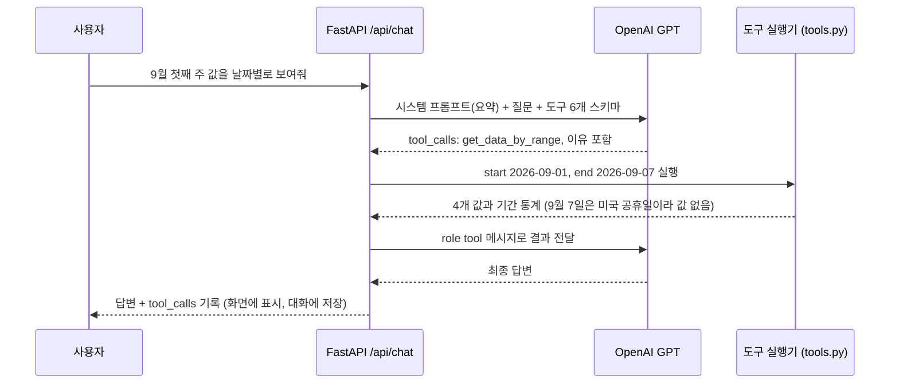
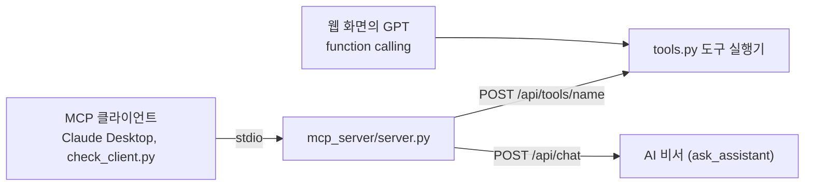

# 보너스: AI 도구 호출(Function Calling) + MCP 연동

## 1. 왜 도구가 필요한가

시스템 프롬프트에는 요약(기간, 개수, 평균·최고·최저, 추세, 월별 평균, 최근 10개 값)만 넣습니다.
251개 전체를 매번 넣으면 토큰(비용)이 커지고 답도 흐려지기 때문입니다.
그래서 "9월 첫째 주 값", "가장 높았던 날 3개", "하루에 가장 크게 오른 날"처럼 요약에 없는 값이 필요할 때는
**GPT가 스스로 도구를 골라 부르고, 서버가 실행한 결과를 받아 답하게** 했습니다.

## 2. 도구 목록 (모두 읽기 전용)

| 도구 | 언제 부르나 (설명에 적은 근거) | 인자 | 돌려주는 값 |
|---|---|---|---|
| `get_data_summary` | 요약이 최신인지 다시 확인할 때 | reason | `/api/data/summary`와 같은 요약 |
| `get_data_by_range` | 특정 날짜·기간 값이 필요할 때 ("10월 첫째 주", "3월 값") | start_date, end_date (YYYY-MM-DD 또는 YYYY-MM), reason | 기간 통계 + 날짜별 값 (62개 넘으면 월별 요약) |
| `get_top_records` | 가장 높은·낮은 날을 순서대로 물을 때 | order(desc/asc), limit(1~10), reason | 날짜와 값 목록 |
| `get_statistics` | 이동평균, 변동성, 최대 하락, 크게 움직인 날, 월별 변화를 물을 때 | reason | `/api/data/statistics` 결과 |
| `list_conversations` | "지난번에 물어본 것"처럼 이전 대화를 언급할 때 | limit(1~20), reason | 대화 제목, ID, 날짜 |
| `get_conversation` | 이전 대화 내용을 읽어야 할 때 | conversation_id, reason | 그 대화의 메시지 (최근 20개) |

도구 정의(JSON 스키마)는 `backend/app/services/tools.py`의 `TOOL_SPECS`에 있고, `GET /api/tools`로도 확인합니다.

## 3. 어떤 근거로 어떤 도구를 부르는가

GPT가 도구를 고르는 근거는 세 가지입니다.

1. **도구 설명(description)**: 각 도구에 "언제 쓰는지"를 적었습니다 (위 표의 두 번째 칸).
2. **시스템 프롬프트 규칙 2번**: "요약에 없는 구체적인 값이 필요하면 추측하지 말고 도구를 부르세요. 특정 날짜·기간은 get_data_by_range, 가장 높거나 낮은 날은 get_top_records, ... 요약만으로 답할 수 있으면 도구를 부르지 마세요."
3. **reason 인자 (호출 이유 기록)**: 모든 도구에 `reason`(필수)을 두어, GPT가 부를 때마다 이유를 한 문장으로 적게 했습니다.
   서버는 이 이유를 응답의 `tool_calls`와 대화 기록에 저장하고, 화면은 답변 아래에 `도구 이름 (인자) 이유: ...` 형태로 보여 줍니다.

질문별로 기대하는 동작

| 질문 | 기대 동작 |
|---|---|
| 이번 달 환율 흐름 어때? | 요약의 10월 평균, 최근 값, 추세로 답함 (도구 없음) |
| 최근 1년 중 가장 높았던 날은? | 최고값은 요약에 있어 바로 답하거나, 순위가 필요하면 `get_top_records` |
| 9월 첫째 주 값을 날짜별로 보여줘 | `get_data_by_range(2026-09-01, 2026-09-07)` |
| 하루에 가장 크게 오른 날 3개 알려줘 | `get_statistics` (top_rises) |
| 지난번에 뭐 물어봤지? | `list_conversations` 후 필요하면 `get_conversation` |

## 4. 호출 흐름



안전장치

- 한 질문에서 도구 왕복은 최대 3번(`MAX_TOOL_ROUNDS`). 마지막 회차는 `tool_choice: "none"`으로 보내 반드시 글로 답하게 합니다.
- 한 번에 부르는 도구는 6개까지 실행하고, 넘는 호출에는 오류 메시지를 돌려줍니다 (OpenAI 규칙상 모든 호출에 응답이 있어야 함).
- 인자가 JSON이 아니거나 날짜 형식이 틀리면 서버가 멈추지 않고 `{"error": ...}`를 GPT에 돌려줘 스스로 고치게 합니다.
- 도구는 데이터를 바꾸지 않습니다 (읽기 전용).

모델 설정 근거 (OpenAI 공식 문서, 2026-10 확인)

- GPT-6 Sol·Luna는 Chat Completions에서 `reasoning_effort: "none"`일 때 function calling을 지원합니다. 그래서 기본값을 `gpt-6-luna` + `none`으로 했습니다.
- 기본 모델을 쓸 수 없으면(권한 없음, 모델 없음, 요청 형식 오류) `gpt-4o-mini`로 바꿔 다시 부르고, 실제로 답한 모델을 응답의 `model`에 남깁니다.

## 5. MCP 서버로 같은 도구를 외부 클라이언트에서 쓰기

같은 도구 실행기를 `POST /api/tools/{name}`로 열어 두었고, `mcp_server/server.py`가 이 주소를 부르는 MCP 서버입니다.
그래서 웹 화면의 GPT와 외부 AI 클라이언트(Claude Desktop 등)가 **같은 코드로 같은 결과**를 받습니다.



MCP 서버 도구 7개: 위 6개 + `ask_assistant`(웹 서비스의 AI 비서에게 직접 질문, 대화 자동 저장)

### 실행과 확인

```powershell
cd mcp_server
pip install -r requirements.txt
$env:API_BASE_URL="https://내-render-주소.onrender.com"   # (Mac: export API_BASE_URL=...)
python check_client.py                                    # 도구 목록 + 요약, 10월 값, 최고 3개 호출
python check_client.py --ask "하루에 가장 크게 오른 날 3개 알려줘"   # AI 비서까지 호출 (OpenAI 1회 과금)
```

### Claude Desktop에 연결 (선택)

`%APPDATA%\Claude\claude_desktop_config.json` (Mac: `~/Library/Application Support/Claude/claude_desktop_config.json`)에 추가합니다.

```json
{
  "mcpServers": {
    "usdkrw-assistant": {
      "command": "python",
      "args": ["C:\\경로\\codyssey-ai-assistant-M1-2\\mcp_server\\server.py"],
      "env": { "API_BASE_URL": "https://내-render-주소.onrender.com" }
    }
  }
}
```

Claude Desktop을 다시 열고 "환율 비서 도구로 2026년 9월 값 요약해줘"처럼 물으면 `get_data_by_range`가 호출됩니다.

### 로컬 점검 기록 (테스트용 가짜 OpenAI 서버 사용)

키 없이 흐름만 확인하려고 `backend/tests/e2e/fake_openai.py`(항상 "[테스트용 가짜 모델]"로 시작하는 답을 돌려줌)를 OpenAI 대신 연결해 확인한 결과입니다. 실제 GPT 답변은 배포 후 확인합니다.

```
도구 목록: get_data_summary, get_data_by_range, get_top_records, get_statistics, list_conversations, get_conversation, ask_assistant
get_data_by_range 2026-10 → count 11, max 1364.83 (2026-10-01), min 1334.03 (2026-10-16), 날짜별 값 11개
get_top_records desc 3   → 2026-06-05 1555.96, 2026-07-01 1550.59, 2026-06-30 1548.78
ask_assistant            → tool_calls: get_statistics, 이유 "하루 상승 폭이 가장 컸던 날을 확인하려고"
                           답: 2026-03-03 +45.80원(+3.18%), 2026-06-18 +26.40원(+1.74%), 2026-06-05 +24.05원(+1.57%)
백엔드가 꺼져 있을 때     → {"error": "백엔드(...)에 연결하지 못했습니다: ConnectError"} (서버가 멈추지 않음)
```
