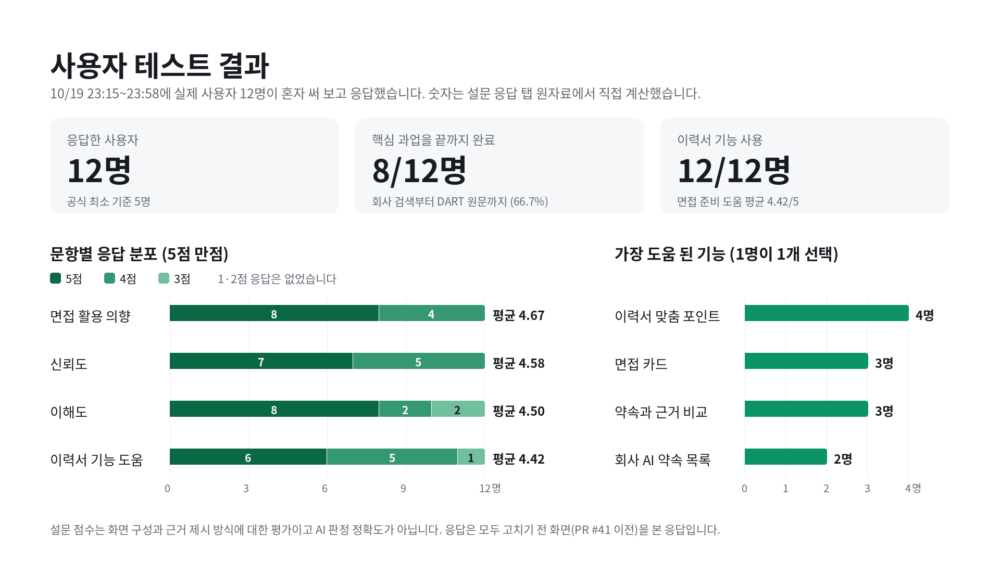

# AI Promise | 기업 AI 약속 검증

회사가 사업보고서에 "AI로 이것을 하겠다"고 쓴 약속을 찾고, 다음 보고서에 실행 근거가 있는지 찾아 4가지(근거 확인, 일부 확인, 공시에서 확인 불가, 회사가 미추진으로 공시)로 판정해 보여주는 웹 서비스입니다. Codyssey Final Project입니다.

- 서비스 주소: https://ai-promise-six.vercel.app (Vercel, `app/` 폴더. main에 올리면 자동으로 다시 배포됩니다)
- 사용자: 취업·이직 준비자 (면접 전 5분 안에 지원 회사의 AI 계획과 실행을 공시 원문으로 확인)
- 검증 시연 기업 (사람 원문 검토 완료: 사람이 공시 원문을 읽고 판정): 삼성전자(개발용), SK하이닉스(평가용)
- 확장 분석 기업 (AI 엔진 결과, 사람 검토 전): 카카오, 현대자동차, 신한지주. 10/19 OpenDART 자동 수집으로 후보 11곳을 돌려 미리 정한 기준(구체적 AI 약속 3개 이상)을 넘은 기업만 넣었습니다. 신한은행·NAVER 등 기준 미달 기업과 이유는 [시연용 기업 계획](docs/company-expansion-plan.md)에 있습니다. 평가 수치에는 넣지 않습니다.
- 약속을 찾는 보고서: 2024 사업보고서 / 근거를 찾는 보고서: 2025 사업보고서, 2026 반기보고서

## 1. 핵심 AI 활용

미션의 필수 기술 요소 5개(AI Agent, RAG, 멀티모달 AI, 자동화 워크플로우, Long-term Memory) 중 2개 이상이 필요합니다. AI Promise는 **RAG와 자동화 워크플로우를 주 근거**로 제시하고, **AI Agent는 제한적 재검색 형태로 보조**로 씁니다. 자세한 내용은 [기능 요구 명세서](docs/requirements.md) 4장에 있습니다.

| 기술 요소 | AI Promise에서 하는 일 | 코드 |
| --- | --- | --- |
| RAG (주) | 후속 보고서에서 키워드 검색(BM25)과 의미 검색(OpenAI 임베딩 + ChromaDB)으로 근거 후보를 찾고, 그 후보 문장만 근거로 LLM이 판정합니다 | `engine/aipromise/retrieve.py`, `engine/aipromise/judge.py` |
| 자동화 워크플로우 (주) | 기업 이름만 주면 OpenDART에서 보고서 3개를 찾아 받고(10/19), 7단계(수집, 약속 추출, 분류, 근거 검색, 판정, 원문 존재 확인, 면접 카드)와 결과 파일, 사람 정답 비교까지 차례로 돕니다. GitHub Actions `Engine run`이 기업마다 병렬로 돌려 결과 브랜치에 남기고, 화면에 합쳐 main에 올리면 CI 검사와 Vercel 배포가 이어집니다 | `engine/analyze_companies.py`, `engine/aipromise/dart.py`, `.github/workflows/engine-run.yml`, `.github/workflows/ci.yml` |
| AI Agent (보조: 제한적 재검색) | 근거를 못 찾으면 AI가 새 검색어를 정하고, 코드가 그 검색어로 다시 검색합니다. 근거를 찾거나, 처음 검색을 포함해 3번이 되거나, 더 쓸 검색어가 없으면 멈추고, 검색 기록을 남깁니다. 완전 자율 Agent라고 부르지 않습니다 | `engine/aipromise/judge.py` |

AI가 고른 근거는 원문에 글자 그대로 있는지 코드로 다시 검사합니다(원문 존재 확인, citation verification). 통과하지 못한 근거는 빼고, 근거가 필요한 판정인데 통과한 근거가 하나도 없으면 "공시에서 확인 불가"로 낮춥니다. 이 검사는 인용이 지어낸 문장이 아님을 보이는 것이고 판정이 맞다는 뜻은 아닙니다. 판정이 맞는지 사람이 원문을 읽고 확인한 것(사람 원문 검토)은 삼성전자·SK하이닉스만 했고, 화면에서 둘을 다른 이름으로 따로 표시합니다 ([아키텍처](docs/architecture.md)).

## 2. 기술 스택과 선정 이유

| 영역 | 쓰는 것 | 고른 이유 |
| --- | --- | --- |
| 엔진 언어 | Python (CI는 3.11) | 팀에서 RAG를 만들어 본 사람이 김성태뿐이고, 그 경험(DART-Foresight AI)이 Python이라 그대로 이어 씁니다 |
| LLM | OpenAI: 약속 추출 gpt-6-luna, 판정·면접 카드 gpt-6.1-sol, "일부 확인" 판정만 gpt-6-astra로 두 번째 판정 (10/19 올림, 처음 구성은 gpt-4o-mini) | 작업마다 모델을 나눴습니다. 약속 추출은 구조화 작업이라 가벼운 모델, 판정은 약속과 근거의 차이를 보는 핵심 단계라 더 강한 모델을 씁니다. 상위 모델은 경계가 애매한 판정에만 써서 비용을 줄입니다. 설정한 모델을 부를 수 없으면 gpt-4o-mini로 바꿔 계속하고, 실제로 답한 모델을 결과 파일(`models_used`, `judge_model_used`)과 기록에 남깁니다. 모델을 바꾼 효과는 엔진 결과를 같은 사람 정답과 비교해서만 말합니다 |
| AI 연결 | LangChain (langchain-openai, langchain-chroma) | DART-Foresight AI의 검색 구성을 출처를 밝히고 다시 씁니다 |
| 근거 검색 | BM25(직접 구현) + text-embedding-3-large(10/19 올림, 처음은 small) + ChromaDB, RRF로 순위 합치기 | DART-Foresight AI 평가에서 의미 검색만으로는 Hit@4가 14/20으로 약했습니다(`engine/README.md` 9장). 제품명, 공장명처럼 글자가 같은 문장을 잘 찾는 키워드 검색을 더했습니다 |
| 공시 수집 | OpenDART API (기업 고유번호, 정기공시 목록, 공시서류 원본) + pypdf | 10/19부터 OpenDART에서 보고서 원본(XML)을 자동으로 받아 글로 바꿉니다. 사람이 PDF를 받던 방법(pypdf)도 그대로 씁니다. 인증키는 GitHub Secrets와 `engine/.env`에만 둡니다 |
| 화면 | HTML, CSS, JavaScript (빌드 없음) | 화면 담당이 React·Streamlit 경험이 없고 AI 도구로 Vercel에 배포해 본 경험이 있어 가장 단순한 정적 웹을 골랐습니다. 화면은 결과 파일 하나만 읽어 엔진과 따로 만들 수 있습니다 |
| 배포 | Vercel (Root Directory: `app`) | 빌드 없이 `app/` 폴더를 바로 배포하고, main에 올리면 자동으로 다시 배포됩니다. 저장소와 배포를 김성태 계정 하나로 모았습니다 (10/8 결정) |
| 서버 함수 | Vercel Node.js 함수 `app/api/resume-fit.js` (내 경험 연결) | 화면은 그대로 정적 파일이고, 이력서 분석만 서버에서 OpenAI를 부릅니다. 키는 Vercel 환경 변수 `OPENAI_API_KEY`에만 둡니다 |
| 자동 검사 | GitHub Actions, Playwright | Pull Request를 올리거나 main에 올릴 때마다 엔진 설정 검사, 엔진 시험, 화면 검사(글자 대비, 가로 넘침)를 자동으로 돌립니다 |
| 사용자 테스트 설문 | Google Forms, Google Sheets (Apps Script로 생성) | 이름·연락처·이메일을 받지 않게 설정할 수 있고, 응답이 시트에 자동으로 쌓입니다 |
| 협업 | GitHub Issues·Pull Request, Google Drive | 팀원은 드라이브에 파일을 올리고 김성태가 저장소에 반영합니다. 기록은 커밋, PR, 이슈에 남깁니다 |

버전은 `engine/requirements.txt`에 고정했습니다.

## 3. 실행 방법

**화면만 내 컴퓨터에서 보기** (저장소 맨 위 폴더에서)

```bash
cd app
python -m http.server 8000
# 브라우저에서 http://localhost:8000 을 엽니다
```

`index.html`을 더블클릭해 열면(주소가 `file://`로 시작) 브라우저 보안 규칙 때문에 결과 파일을 읽지 못하고 예시 데이터가 보입니다. 위처럼 작은 서버로 엽니다. 운영 사이트에서는 결과 파일을 못 읽어도 예시 데이터로 바꾸지 않습니다(5장).

**엔진 돌리기** (준비 약 30분, 자세한 순서는 [engine/README.md](engine/README.md))

```bash
cd engine
pip install -r requirements.txt
cp .env.example .env        # .env에 OPENAI_API_KEY를 적습니다. 이 파일은 저장소에 올리지 않습니다
python run.py doctor --company samsung     # 설치, 키, PDF 점검 (판정 모델·임베딩 모델을 1번씩 실제 호출)
python run.py all --company samsung        # 1~7단계 실행 (PDF 또는 자동 수집 글)
python analyze_companies.py kakao hyundai shinhanfg  # OpenDART 자동 수집부터 결과 파일까지 한 번에 (.env에 OPENDART_API_KEY 필요)
python run.py export --companies samsung   # 결과는 data/results/ai_promise_data.json 에만 저장
python run.py check --file ../data/results/ai_promise_data.json
# 확장 분석 기업을 화면에 더할 때 (삼성·SK 사람 원문 검토 데이터는 그대로 둠):
#   python merge_screen.py --engine ../data/results/ai_promise_data.json --companies kakao hyundai shinhanfg --write
```

사용자 테스트 중에는 `--copy-to`를 붙이지 않습니다. 붙이면 지금 화면의 검증용 시연 데이터(`app/data/results.json`)를 덮어씁니다. SK하이닉스(`skhynix`)는 평가용이라 화면 데이터에 엔진 결과를 넣지 않고 사람 정답과 비교만 합니다. PDF는 `data/pdf/`, 자동 수집 글은 `data/dart/`에 둡니다 (둘 다 저장소에 올리지 않고, 접수번호와 원문 주소는 `data/dart/manifest.json`에 남깁니다). GitHub에서 돌릴 때는 Actions > `Engine run` > Run workflow에 기업 목록(예: `["kakao","hyundai"]`)을 넣습니다.

**코드 점검** (키 없이 가상 회사로 시험)

```bash
python tests/test_config.py      # 엔진 설정: 핵심 2곳, 시연용 3곳, 검색 설정의 모양. 마지막 줄에 "설정 검사 통과"
python tests/test_mock.py        # 엔진·평가: 마지막 줄에 "시험 통과"
python tests/test_ui_static.py   # 화면: app.js가 쓰는 class가 CSS에 모두 있는지 (브라우저 없이)
python tests/ui_check.py         # 화면: 모든 화면(results.json이 있으면 그 화면, 없으면 예시 데이터 18개) x 다크/라이트의 글자 대비, 가로 넘침, 필수 부품 (Playwright 필요)
python tests/check_citation_badges.py   # 화면: 약속 상세의 "원문 존재 확인" 표시가 results.json의 citation_verified와 같은지 (Playwright 필요)
```

네 검사는 Pull Request를 올리거나 main에 올릴 때 CI에서도 자동으로 돌아갑니다.

## 4. 폴더

| 폴더 | 내용 | 만든 사람 |
| --- | --- | --- |
| `app/` | 웹 화면 4개 (HTML, CSS, JS). Vercel이 이 폴더를 배포합니다 | 화면: 박수민 (`1011_수민_화면.zip`) / 디자인: 서준용 (시안 v4, 10/12·10/13) / 엔진 결과 연결: 김성태 (`1012_김성태_화면_데이터연결.zip`) |
| `engine/` | 공시(PDF 또는 OpenDART 자동 수집 글)에서 약속을 찾고, 근거를 검색해 판정하고, 면접 카드를 만드는 AI 엔진 | 김성태 |
| `eval/` | 판정 기준(v1, v2)과 사람 정답으로 AI를 평가하는 코드 | 김성태 (정답: 김서원, 김성태) |
| `tests/` | 인터넷과 API 키 없이 가상 회사로 끝까지 도는 시험 | 김성태 |
| `data/` | 공시 PDF와 실행 결과 자리 (PDF는 저장소에 올리지 않습니다) | |
| `docs/` | 기능 요구 명세서, 아키텍처, 평가 계획, 진행 기록 등 문서 | 김성태 |

## 5. 화면

- `app/index.html`은 `app/data/results.json`을 읽습니다. 운영 사이트에서 이 파일을 못 읽으면 예시 데이터로 바꾸지 않고 "분석 데이터를 불러오지 못했어요" 안내를 보여줍니다. 가상 회사 2곳 예시 데이터(`app/data/sample-data.js`)는 이 컴퓨터에서 여는 경우(파일 더블클릭, localhost, 127.0.0.1)나 주소에 `?sample=1`이 있을 때만 쓰고 "예시 데이터입니다" 띠를 붙입니다. 실제 결과 파일은 `meta.is_sample: false`, `meta.data_status: "real"`이고, `meta.show_validation_notice`가 true라서 맨 위에 검토 상태 안내 띠(`meta.notice`)가 나옵니다 (10/20 정리).
- 모든 화면에 안내 문구 2개가 항상 보입니다. 첫 문구는 "공시 범위 안에서 확인한 결과입니다."입니다. 두 번째 문구는 확장 분석 기업(AI 엔진 결과) 화면에서 "AI가 생성한 분석입니다."이고, 첫 화면과 검증 시연 기업 화면에서는 "삼성전자, SK하이닉스는 사람이 공시 원문을 읽고 판정했고, 카카오, 현대자동차, 신한지주는 AI가 생성한 분석입니다."입니다 (결과 파일의 `labels.disclaimers`).
- 화면 고치는 규칙은 `app/README.md`에 있습니다. 디자인 변경은 CSS에서 합니다.
- 첫 화면(10/20 v2): "기업이 말한 AI 전략, 실제 공시 근거와 함께 확인하세요" 문구와 회사 검색, 신뢰 장치 4개(OpenDART 정기공시 기반, 원문 존재 확인, AI 판정 + 상위 모델 재검토, 면접 활용 인사이트), 숫자 4개(분석 완료 기업(사람 2, AI 3), 분석한 AI 약속, 판정한 구체적 약속, 원문 존재 확인 근거), "처음이라면 이 순서로 보세요" 3단계(FB-01), 기업 묶음 2개(검증 시연 기업: 삼성전자·SK하이닉스, 사람 원문 검토 완료 / 확장 분석 기업: 카카오·현대자동차·신한지주, AI 엔진 · 사람 검토 전), 검증 방식 4단계와 SK하이닉스 시범 평가 한 줄입니다. 숫자는 모두 데이터에서 셉니다.
- 검색 결과는 분석 완료(결과 열기), 분석 준비 중, 상장 기업이지만 아직 분석 전, 세 가지로 보여줍니다. 상장 기업 목록(`app/data/listed-companies.json`)은 한국거래소 상장 종목 보통주 2,753곳(2026-10-15 기준)으로, 공개 저장소 FinanceData/marcap의 2026년 파일에서 뽑았습니다. 목록에 있다고 분석했다는 뜻은 아닙니다.
- 웹에서 아무 회사나 바로 분석하는 기능(실시간 분석)은 없습니다. 새 기업은 엔진이 OpenDART에서 보고서 3개(약속 1, 근거 2)를 자동으로 받아 분석하고, 기준을 넘으면 화면에 올립니다. 확장 설계는 `docs/architecture.md`에 있습니다.
- 내 경험 연결(10/20 v2, `#/c/<기업>/fit`): 기업 화면(약속 목록)과 면접 카드 아래 입구에서 지원 직무(목록 9개 또는 직접 입력, 선택 사항)와 이력서 내용을 넣으면, AI가 경험 → 지원 직무 역량 → 회사 AI 약속 순서로만 연결합니다. 결과는 직무 기준 두 문장 요약, 나에게 있는 것 / 아직 없는 것, 직접 연결(그 제품·기술을 직접 다룬 경험), 간접 연결(직무 역량으로 옮겨 쓸 수 있는 경험, 한계 문장 필수), 내 이력서에 없는 부분과 면접 전에 준비할 것, 면접 포인트, 역질문입니다. 이어지지 않는 경험은 억지로 연결하지 않습니다(고친 뒤 후기 FB-08 반영). 근거 검사(약속 번호가 결과 파일에 있는지, 이력서 인용이 보낸 글에 그대로 있는지)를 통과한 항목만 보여주고, 점수나 합격 가능성은 만들지 않습니다. 이력서는 저장하지 않습니다. 분석하는 동안에는 진행 막대와 경과 시간을 보여줍니다(FB-04, 실제 진행률은 알 수 없어 퍼센트는 쓰지 않음).
- 약속 상세는 약속 → 근거 → 판정 시간축과 "확인 4단계"(단계마다 누가 했는지)입니다. 10/20 사용자 의견(FB-02)을 반영해 약속 문장과 근거 문장에 글자 그대로 함께 나오는 말을 형광으로 표시하고, 근거마다 "약속과 같은 말"을 보여줍니다(코드가 글자만 비교, 뜻 판단 아님). 약속한 시기가 근거를 찾은 마지막 보고서(2026 반기보고서, 6월 말 기준)보다 뒤인 약속에는 "실행 시기 전"을 표시합니다(FB-03). 그 약속과 근거 문장에 나온 용어(HBM, SDV 등)는 "이 약속에 나온 용어" 칸에서 쉬운 말로 풀고, 판정 칸에 판정의 뜻을 한 줄로 보여줍니다(FB-05). 고친 화면이 배포된 뒤 응답한 설문 2명이 "글자가 너무 많다", "핵심이 한눈에 들어오지 않는다"고 해서(FB-09), 10/20 v2부터 용어 칸과 확인 4단계는 처음에 접어 두고 접힌 줄에 용어 이름, 원문 존재 확인 N/M, 사람 원문 검토 완료/전만 보여줍니다. 기업 화면 아래 "분석 정보"(데이터 출처, 약속 기준 보고서, 근거 검색 범위, 분석 기준일, 분석 방식, 원문 존재 확인, 사람 원문 검토)도 같은 방식입니다. 면접 카드는 공시에서 확인할 핵심 이슈, 면접에서 활용할 소재, 회사에 물어볼 역질문입니다. 화면 문구는 한국어로 쓰고, 링크는 http(s) 주소만 만듭니다.

### Final Sprint 데이터 모드 (10/19, PR #19)

현재 `app/data/results.json`에는 **삼성전자·SK하이닉스 실제 공시 문장을 사람이 원문을 읽고 판정한 검증용 시연 데이터(사람 원문 검토 완료)**와, 카카오·현대자동차·신한지주의 AI 엔진 결과(사람 검토 전, PR #39)가 함께 들어 있습니다. 사람 원문 검토 데이터는 fake sample이 아니지만, 자동 엔진의 최종 accuracy 결과로 주장하지 않습니다. 기업마다 `data_mode`(`human_reviewed_demo` 또는 `engine`)를 적어 화면 표시를 정합니다.

- 삼성전자: 김서원 연습 Human Review를 v2 기준에 맞춰 정리
- SK하이닉스: 김성태·김서원 공동 검토(10/19, 드라이브 `1019_SK하이닉스_Human_Gold_공동합의본`)와 같은 판정. 구체적 약속 3건(확인 불가 2, 일부 확인 1), 방향성 2건은 판정 제외. 공동 검토라 평정자 간 일치도(Cohen's kappa)에는 쓰지 않습니다
- 화면 상단 안내 띠에 두 묶음(사람 원문 검토 완료 / AI 엔진 결과, 사람 원문 검토 전)을 구분해 명시
- 자동 엔진 결과와 Human Gold 합의 평가는 별도 증빙으로 구분

이 임시 모드는 사용자 테스트에서 **UI/이해도/신뢰도/활용 의향**을 확인하기 위한 것입니다. 실제 AI 정확도 수치가 없으면 만들어 쓰지 않습니다.

SK하이닉스 사람 정답은 10/19 김성태·김서원 공동 검토로 고정했습니다. 화면의 SK하이닉스 데이터는 이 공동합의본과 같습니다(10/19 방향성 약속 1건 추가로 맞춤).

## 6. 작업 규칙

- main에 올라간 것은 바로 서비스 주소에 배포됩니다.
- 최종 마감 구간에는 **최신 main → 작업 브랜치 → 테스트 → Pull Request → merge** 순서만 사용합니다. 두 도구가 main을 동시에 고치면 서로 덮어쓰기 때문입니다.
- 실제 배포 여부와 배포 URL은 README 14장의 제출 링크에 적고, 배포가 확인되지 않은 상태를 '배포 완료'라고 쓰지 않습니다.
- main에 합치기 전 `python tests/test_config.py`, `python tests/test_mock.py`, `python tests/test_ui_static.py`, `python tests/ui_check.py`를 통과시킵니다.
- 디자인을 바꾸면 `app/css/style.css` 맨 아래 데이터 연결 부품을 유지하고, 320~390px 모바일 화면과 명도 대비를 다시 확인합니다.
- 사용자 테스트 기간(링크를 보내기 시작해 마지막 응답까지)에는 main의 화면과 `app/data/results.json`을 바꾸지 않습니다. 테스트를 막는 오류만 바로 고치고, 나머지는 기록해 두었다가 테스트가 끝난 뒤 우선순위가 높은 것부터 브랜치에서 고칩니다.

## 7. 지키는 것

- API 키(`engine/.env`), 사용자 테스트 참여자의 이름과 연락처는 저장소에 올리지 않습니다. (`.gitignore`로 막아 둠)
- 화면과 판정 이유에 "거짓", "AI 워싱" 같은 단정 표현을 쓰지 않습니다. 근거를 못 찾은 약속은 "공시에서 확인 불가"로 표시하며, 안 했다는 뜻이 아닙니다.
- SK하이닉스는 평가용 기업이라, 사람 정답을 먼저 만든 뒤 AI 결과와 비교합니다.
- 사용자 테스트는 참여 동의를 받은 뒤 진행하고, 참여자는 번호(P01 등)나 스스로 정한 닉네임으로만 기록합니다. 이름·연락처·이메일은 받지 않습니다.

## 8. 역할

- 김성태: 총괄, AI 엔진, 평가 설계, 저장소와 배포
- 박수민: 화면 4개
- 김서원: 공시 직접 읽기와 정답 매기기, 사용자 테스트 진행
- 서준용: 화면 디자인, 사용자 테스트 진행 보조, 발표자료, 3분 시연 영상

## 9. 결과

숫자는 실제로 잰 값만 씁니다.

**AI 판정 시범 평가 (SK하이닉스, n=3)**: 사람 정답(김성태·김서원 공동 검토, 엔진 실행 전 고정)과 최종 엔진을 같은 입력으로 3번 돌린 판정을 비교했습니다. 자세한 표와 엔진 버전별 기록은 [eval/results/skhynix_runs.md](eval/results/skhynix_runs.md)에 있습니다.

| 지표 | 결과 | 비고 |
| --- | --- | --- |
| 판정 일치 (약속 3개 × 같은 엔진 3번) | 1회차 2/3, 2회차 3/3, 3회차 2/3 | 같은 약속 3개를 3번 반복한 것이라 독립 표본 9개가 아니어서 정확도(예: 78%)로 해석하지 않음 |
| 다른 판정 | 1회차·3회차의 QLC 61TB 1건 (같은 약속) | AI는 2025 사업보고서 PS1012 문장을 근거로 근거 확인(2번)·일부 확인(1번), 사람은 일부 확인. 정답 재검토 후보 (정답은 바꾸지 않음) |
| 인용 원문 일치 | 100% (3번 모두) | AI가 고른 근거 문장이 원문에 글자 그대로 있음 |
| 근거 없는 실행 판정 | 0건 | |
| 약속 찾기 | 사람 약속 4/4 | AI 관련 말이 없는 1문장은 판정기준 v2로 뺌 |

**자동화 워크플로우 실행 기록 (10/19)**: OpenDART 자동 수집 → 엔진 → 결과 파일을 GitHub Actions로 기업마다 병렬 실행했습니다(엔진 실행은 기업당 1~3분). 후보 11곳 중 기준(구체적 약속 3개 이상)을 넘은 카카오, 현대자동차, 신한지주를 화면에 넣었습니다 (SK텔레콤도 넘었지만 예비) ([선별 기록](docs/company-expansion-plan.md)). 실행 중 찾은 수집 오류 3가지(그림 태그를 지우다 본문 삭제, 정정 보고서의 정정표를 장 제목으로 잡음, 최신 정정본 원문 파일 없음)를 고치고 시험(`tests/test_dart.py`)에 넣었습니다.

**내 경험 연결 실배포 점검 (10/19 22:05)**: GitHub Actions `Resume fit smoke test`가 배포된 `/api/resume-fit`을 지어낸 가상 이력서로 불렀습니다. 응답 200, 27.0초, 실제로 답한 모델 gpt-6.1-sol(대체 모델 아님), 연결 3, 보완점 2, 면접 포인트 3, 질문 2, 근거 검사에서 빠진 항목 0개. 10/20 02:00에 PR #41 배포본으로 다시 점검했습니다(삼성전자, 현대자동차 각 1번): 두 번 모두 응답 200(25.6초, 22.9초), gpt-6.1-sol, 연결 3·보완점 2·면접 포인트 3·질문 2, 빠진 항목 0개, 연결의 이력서 인용 3개가 모두 보낸 이력서에 글자 그대로 있었고 점수·퍼센트 표현은 0건이었습니다 (결과 브랜치 `smoke-results/39290280295`, `smoke-results/39290283500`).

**사용자 테스트 (설문 14명: 고치기 전 화면 12명 10/19 23:15~23:58, 고친 화면 배포 뒤 2명 10/20 02:17·02:25)**: 혼자 써 보는 방식의 구글 설문 응답을 응답 탭 원자료에서 직접 셌습니다. 참여자는 스스로 정한 닉네임으로만 응답했고 이름·연락처·이메일은 받지 않았습니다. 아래 표는 고치기 전 화면을 본 12명입니다.

| 지표 | 결과 | 비고 |
| --- | --- | --- |
| 응답 수 | 12명 | 공식 최소 5명. 5개 기업 모두 테스트 (삼성전자 4, 나머지 4곳 각 2) |
| 핵심 과업 완료 | 8/12 (66.7%) | 회사 하나를 검색해 AI 약속, 후속 근거, DART 원문까지 확인. 나머지는 "일부만 확인" |
| 이해도 평균 (1~5) | 4.50 | 판정 이유와 공시 근거를 이해하기 쉬웠나 |
| 신뢰도 평균 (1~5) | 4.58 | 결과를 믿고 참고할 수 있나 |
| 면접 활용 의향 평균 (1~5) | 4.67 | |
| 이력서 맞춤 기능 | 12/12명 사용, 도움 평균 4.42 | |
| 가장 도움 된 기능 | 이력서 맞춤 4명, 면접 카드 3명, 약속과 근거 비교 3명, 약속 목록 2명 | |
| 개선 의견 | 6건 | 4건 반영(FB-01, FB-02, FB-04, FB-05), 2건 후속 과제(FB-06, FB-07). 설문 밖 후기 2건으로 FB-03을 더 반영하고 FB-04, FB-05가 반복 의견임을 확인 ([피드백 반영 로그](docs/feedback-log.md)) |

**고친 화면(PR #41)이 배포된 뒤 받은 의견 (10/20 02:11~02:25)**: 설문 2명은 핵심 과업 모두 확인 2/2, 이해도 4.50, 신뢰도 4.50, 면접 활용 의향 5.00, 이력서 기능 도움 5.00이었습니다. 2명이라 고치기 전과 비교해 효과를 주장하지 않습니다. 개선 의견은 둘 다 글자 양("글자가 너무 많음", "기능 설명이 함께 모여 있어 핵심이 한눈에 들어오지 않음", FB-09)이었고, 설문 밖 후기 1명은 용어 풀이와 보완점이 준비에 좋았다고 하면서 이력서 연결 문장이 직무보다 제품 약속에 억지로 이어진다고 했습니다(FB-08). 두 의견은 10/20 v2에 반영했습니다(5장). 14명 전체로 셈하면 핵심 과업 완료 10/14(71.4%), 이해도 4.50, 신뢰도 4.57, 면접 활용 의향 4.71, 이력서 기능 14/14명 사용·도움 4.50입니다.

설문 점수는 화면 구성과 근거 제시 방식에 대한 평가이고 AI 판정 정확도가 아닙니다. 고친 화면(PR #41)은 마지막 응답(23:58) 뒤에 합쳤고, 위 표의 12명은 모두 고치기 전 화면을 본 응답입니다. 응답과 설문 밖 후기를 종합한 분석 보고서와 보고서의 개선 과제별 반영 현황은 [사용자 테스트 분석 보고서](docs/user-test-report.md)에 있습니다.



고치기 전·후 화면 비교(FB-01~FB-05)는 [피드백 반영 로그](docs/feedback-log.md#고치기-전후-화면)에 있습니다.

| 결과 | 원자료 | 계산 |
| --- | --- | --- |
| AI 판정 평가 | `eval/gold/skhynix_합의.csv`(사람 정답), 결과 브랜치의 `data/work/skhynix/judged.json` | `python eval/evaluate.py --companies skhynix` (Actions `Engine run`이 자동 실행) |
| 사용자 테스트 (응답 수, 핵심 과업 완료율, 이해도·신뢰도·활용 의향 평균, 이력서 기능 사용 수) | 설문 응답 시트 `1019_AI_Promise_사용자테스트_설문응답_최종` (이름·연락처 없음) | 응답 탭 원자료에서 직접 계산 (시트의 `요약` 탭은 응답이 있어도 0으로 나와 쓰지 않음) |
| 피드백 반영 (의견, 원인, 조치, 커밋, 재확인) | [사용자 피드백 반영 로그](docs/feedback-log.md) | FB-01~FB-05 반영 (PR #41), FB-08·FB-09 반영 (10/20 v2), FB-06·FB-07 후속 과제 |

## 10. AI 사용

엔진 코드의 첫 버전, 화면의 엔진 결과 연결 수정, 디자인 시안 반영과 접근성 보정, 화면 자동 검사, 기능 요구 명세서와 진행 기록의 초안은 AI 도구(Claude)로 작성했습니다. 문서, CI, 평가 코드 일부(PR #1, #2)와 판정기준 v2 동결 및 엔진 검색어·지시문 동기화(PR #13)는 ChatGPT가 Pull Request로 올렸습니다. 10/19 OpenDART 자동 수집과 자동 실행 워크플로(PR #35, #37), 화면 최종 수정, 10/20 피드백 반영(PR #41)과 v2(지원 직무 기준 이력서 연결, 분석 정보, 접는 설명)는 Claude(Claude Code)로 작성했고, 면접 카드 디자인 수정은 서준용 시안을 박수민이 반영했습니다(PR #36). 실행, 점검, 수정은 김성태가 합니다. 엔진의 모든 LLM 호출 기록은 실행할 때 `data/work/<기업>/llm_log.jsonl`에 남습니다 (화면에 넣은 카카오, 현대자동차, 신한지주 기록은 저장소에 있음).

## 11. 프로젝트 문서

- [심사용 요약 (Executive Summary)](docs/executive-summary.md)
- [프로젝트 기획서](docs/project-plan.md)
- [기능 요구 명세서 (기능·비기능 요구사항)](docs/requirements.md)
- [공식 요구사항 ↔ 증빙 매트릭스](docs/official-requirements-matrix.md)
- [제출 증빙 체크리스트 (공식 미션 19개 항목)](docs/submission-evidence-checklist.md)
- [최종 제출 Release Checklist](docs/release-checklist.md)
- [마감 최소 완성안](docs/final-sprint.md)
- [진행 기록](docs/progress-log.md)
- [아키텍처](docs/architecture.md)
- [평가 계획](docs/evaluation-plan.md)
- [빠른 사용자 테스트 (혼자 써 보기)](docs/user-test-quick.md)
- [10분 비대면 사용자 테스트 (화면공유)](docs/user-test-protocol.md)
- [사용자 피드백 반영 로그](docs/feedback-log.md)
- [사용자 테스트 분석 보고서와 반영 현황](docs/user-test-report.md)
- [최종 발표 구성안](docs/presentation-outline.md)
- [3분 시연 대본](docs/demo-script-3min.md)
- [예상 심사 질문과 답](docs/judge-qa.md)
- [Final Project 결과보고서 초안](docs/final-report-draft.md)
- [팀 기여 내역](docs/team-contributions.md)
- [시연용 기업 확장 계획](docs/company-expansion-plan.md)
- [AI 윤리·신뢰성](docs/ai-ethics.md)
- [Vercel 배포](docs/deploy.md)
- [Google Drive ↔ GitHub 동기화](docs/drive-sync.md)
- [후속 연구 계획](docs/follow-up-study-plan.md)
- [팀 협업 규칙](CONTRIBUTING.md)

## 12. 추가 평가

- 사용자 테스트: `eval/user_test/`
- 문장 분류 ML 실험 (`eval/ml/`): 이번 제출에서는 하지 않고 다음 단계로 둡니다 (기획 보고서 8.3). 코드와 데이터 형식만 있습니다.

## 13. 공식 Final Project 요구사항 대응

- 생성형 AI / AI Agent 핵심 기능: 약속 추출, 근거 검색·재검색, 판정, 원문 존재 확인(citation verification), 면접 카드, 내 경험 연결
- 필수 기술요소: **RAG + 자동화 워크플로우** (AI Agent는 제한적 재검색으로 보조)
- 외부 배포: 공개 URL (14장 제출 링크)
- 실제 사용자: **최소 5명 이상**
- 사용자 피드백: 수집 후 최소 1건 이상 실제 서비스에 반영하고 commit/PR로 증빙
- AI 윤리: AI 생성 분석 고지, 단정 표현 금지, 개인정보 비저장
- 기능·비기능 요구사항: [docs/requirements.md](docs/requirements.md)
- 마감 최소 완성안: [docs/final-sprint.md](docs/final-sprint.md)
- 빠른 사용자 테스트: [docs/user-test-quick.md](docs/user-test-quick.md)

## 14. 심사자에게 보여줄 핵심

**AI Promise는 공시 요약기가 아니라 ‘기업의 AI 약속 ↔ 후속 실행 근거’를 연결하는 조사 서비스입니다.**

1. **공식 데이터**: DART 정기공시를 근거로 사용
2. **AI Native 구조**: OpenDART 자동 수집 + LLM 약속 추출 + RAG 검색 + 제한적 재검색 + 판정(경계 판정은 상위 모델이 재검토) + 원문 존재 확인(citation verification) + 면접 카드 + 내 경험 연결(지원 직무 기준)
3. **검증 가능성**: 사용자가 판정에서 DART 원문까지 되돌아갈 수 있음
4. **안전한 표현**: ‘공시에서 확인 불가’를 실제 미이행으로 단정하지 않음
5. **실사용 검증**: 실제 사용자 설문 14명(고치기 전 화면 12명: 이해도 4.50, 신뢰도 4.58, 면접 활용 의향 4.67, 5점 만점)과 피드백 7건 반영(FB-01~FB-05 PR #41, 고친 뒤 의견 FB-08·FB-09 10/20 v2)
6. **정직한 평가**: SK하이닉스 시범 평가(약속 3개 × 같은 엔진 3번, 1회차 2/3, 2회차 3/3, 3회차 2/3)와 1회차·3회차에 달랐던 1건(QLC 61TB)의 원인, 기준 미달 기업 제외 기록을 그대로 공개

### 제출 링크
- 서비스 URL: https://ai-promise-six.vercel.app (검증 시연 기업 2곳은 사람 원문 검토 완료, 확장 분석 기업 3곳은 AI 엔진 결과(사람 검토 전). 5장)
- 서비스 URL 최종 검증: 10/20 01:16 시크릿 창에서 첫 화면(PR #41 반영)과 DART 원문 링크 확인 (김성태). 휴대폰 폭 화면은 `tests/ui_check.py`가 390·320px로 검사
- 사용자 테스트: **설문 14명** (고치기 전 화면 12명 10/19 23:15~23:58, 고친 화면 배포 뒤 2명 10/20 02:17·02:25, 9장)
- 피드백 반영: 7건 (PR #41: FB-01 사용 순서 안내, FB-02 약속과 근거에 함께 나오는 말 형광 표시, FB-03 "실행 시기 전" 표시, FB-04 이력서 분석 진행 표시, FB-05 용어 풀이 / 10/20 v2: FB-08 이력서 연결을 지원 직무 기준으로, FB-09 설명은 접어 두고 핵심 먼저), [docs/feedback-log.md](docs/feedback-log.md)
- 드라이브 폴더: [`1020_발표자료_영상`](https://drive.google.com/drive/folders/10GobC-Tp1ROIlxsMdvtc1s90YzkIAMBo) (사용자 피드백 증빙 문서와 발표 준비 자료. 링크만 있으면 바로 열림)
- 발표자료와 3분 시연 영상은 저장소 동결(10/20 07:00) 뒤에 만들기 때문에 이 저장소에는 넣지 않았습니다.
