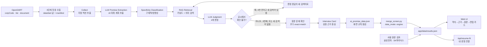

# AI Promise 아키텍처

## 목표
기업이 정기공시에서 밝힌 AI 계획과 이후 정기공시의 실행 근거를 연결하고, 근거가 검증된 정보만 면접 준비에 사용합니다.

이 문서는 지금 구현된 구조를 다룹니다: OpenDART 자동 수집(0단계)부터 엔진 7단계, GitHub Actions 실행, 화면 데이터 규칙, 내 경험 연결 서버 함수. 화면, 배포, 평가까지 포함한 요구사항 전체는 [기능 요구 명세서](requirements.md) 5장에 있습니다. (10/20 최신화: 예전 판에 남아 있던 "PDF를 사람이 넣는 구조"와 "OpenDART 미구현" 설명을 지금 구현에 맞게 고쳤습니다.)

## 0~7단계
0. **DART 자동 수집** (`engine/fetch_dart.py`, `engine/aipromise/dart.py`): OpenDART 고유번호 목록(`corpCode.xml`)에서 회사를 찾고, 공시검색(`list.json`)으로 2024·2025 사업보고서와 2026 반기보고서의 접수번호를 찾은 뒤, 공시서류원본파일(`document.xml`)을 받아 글(`data/dart/<기업>_<보고서>.txt`)로 저장합니다. 기업 고유번호, 접수번호, DART 원문 주소, 글자 수, 장 찾기 결과는 `data/dart/manifest.json`에 남깁니다. 받은 글은 저장소에 올리지 않고 언제든 다시 받습니다.
1. **Collect**: 받은 글(없으면 `data/pdf`의 PDF)에서 지정 섹션을 추출해 `collected_<보고서>.json`으로 저장
2. **Promise Extraction**: 2024 사업보고서에서 AI 관련 미래 계획 문장을 원문 그대로 선택
3. **Specificity Classification**: 구체적 약속 / 방향성 약속 분리 (`promises.json`)
4. **Evidence Retrieval**: 2025 사업보고서와 2026 반기보고서를 hybrid retrieval(키워드 + 의미 검색)로 검색
5. **LLM Judgment**: 4개 판정 중 하나 선택 (`judged.json`)
6. **원문 존재 확인 (Citation Verification)**: 선택한 근거 문장이 수집 원문에 글자 그대로 있는지 코드로 검사
7. **Interview Card**: 원문 존재 확인을 통과한 근거만 사용해 핵심 이슈·답변 소재·역질문 생성 (`card.json`)

내보내기(export)는 `data/results/ai_promise_data.json`을 만들고, 화면 규칙 점검(`engine/aipromise/checker.py`)을 통과해야 화면 데이터에 합칠 수 있습니다.

## 두 가지 확인은 다른 일입니다: 원문 존재 확인과 사람 원문 검토

| 구분 | 원문 존재 확인 (Citation Verification) | 사람 원문 검토 (Human Review) |
|---|---|---|
| 누가 | 코드 (엔진 6단계, 화면 검사 `tests/check_citation_badges.py`) | 사람 (김성태, 김서원) |
| 무엇을 | 근거 문장이 수집한 공시 원문에 글자 그대로 있는지 | 판정 자체가 판정기준 v2에 맞는지 DART 원문을 읽고 확인 |
| 통과의 뜻 | 인용이 지어낸 문장이 아님 | 판정을 사람이 확인함 |
| 통과해도 아닌 것 | 판정이 맞다는 뜻은 아님 | 엔진 정확도 평가는 아님 (별도 `eval/`) |
| 대상 | 화면의 모든 기업 근거 문장 | 삼성전자, SK하이닉스 (`data_mode: human_reviewed_demo`) |
| 화면 표시 | 근거 카드 배지 "원문 존재 확인", 기업 화면 "분석 정보" 카드의 "근거 문장 N개 중 M개" | 기업 목록 배지 "사람 원문 검토 완료" 또는 "AI 엔진 · 사람 검토 전", "분석 정보" 카드의 "사람 원문 검토: 완료 / 아직 안 함", 처리 과정 아래 한 줄 |

카카오, 현대자동차, 신한지주(`data_mode: engine`)는 원문 존재 확인은 거쳤지만 사람 원문 검토는 하지 않았습니다. 화면과 문서는 이 둘을 같은 말로 부르지 않습니다.

## 핵심 안전장치
- 근거가 필요한 판정인데 원문 존재 확인을 통과한 문장이 없으면 판정을 낮춥니다.
- 검색 실패 시 검색어를 바꾸되 최대 횟수를 제한합니다.
- `not_verifiable`은 미이행을 뜻하지 않습니다.
- 모든 실제 결과는 `engine/run.py check`(화면 규칙 점검)를 통과한 뒤 화면으로 내보냅니다.
- 인증키(OpenDART, OpenAI)는 GitHub Secrets, Vercel 환경 변수, `engine/.env`에만 두고 기록과 화면에 찍지 않습니다.

## 데이터 흐름
```text
OpenDART (corpCode.xml -> list.json -> document.xml)          0단계 자동 수집
  -> data/dart/<기업>_<보고서>.txt + data/dart/manifest.json
  -> collected_<보고서>.json                                    1단계
  -> promises.json                                              2~3단계
  -> judged.json                                                4~6단계
  -> card.json                                                  7단계
  -> data/results/ai_promise_data.json                          내보내기 + 화면 규칙 점검
  -> app/data/results.json  (engine/merge_screen.py, data_mode: engine)
  -> Web UI

사람 원문 검토 데이터 (삼성전자, SK하이닉스, PR #19)
  -> app/data/results.json  (data_mode: human_reviewed_demo)
```

## 소스 오브 트루스
- 판정 방법론: `eval/판정기준_v2.md`
- 엔진 설정(기업, 보고서 3개, 모델): `engine/config.yaml`
- 화면 데이터 계약: `tests/sample_data.json` + `engine/aipromise/checker.py`
- 실제 화면 데이터: `app/data/results.json`
- 사람 정답과 AI 판정 비교: `eval/evaluate.py`, `eval/results/`

## 시스템 아키텍처



## 실행 환경: GitHub Actions와 Vercel

| 워크플로 | 언제 | 하는 일 |
|---|---|---|
| CI (`.github/workflows/ci.yml`) | main에 push, 모든 PR | validate(가짜 모델로 엔진 끝까지, OpenDART 가짜 응답, 화면 합치기, 화면 데이터 JSON, 이력서 함수(가짜 OpenAI), 화면 코드와 CSS 일치)와 ui(화면 40개 × 테마 2개 × 폭 3개 검사, `tests/ui_check.py`) |
| Engine run (`.github/workflows/engine-run.yml`) | Run workflow(기업 목록 입력) 또는 `engine-run/` 브랜치 push | 기업마다 병렬(matrix)로 0~7단계를 돌리고 결과를 `engine-results/<실행번호>-<기업>-<순번>` 브랜치에 올림. main과 화면 데이터는 바꾸지 않음. 같은 기업을 여러 번 넣으면 재현성 점검(SK하이닉스 3회 반복실행) |
| Resume fit smoke test (`.github/workflows/resume-smoke.yml`) | 배포 뒤 Run workflow | 운영 사이트의 `/api/resume-fit`을 지어낸 가상 이력서로 호출하고, 답한 모델, 걸린 시간, 결과 개수, 근거 검사에서 빠진 항목 수를 `smoke-results/<실행번호>` 브랜치에 남김 |

엔진 결과는 사람이 결과 브랜치를 확인한 뒤 `engine/merge_screen.py`로 화면 데이터에 합칩니다(PR #39). Vercel은 main을 운영 사이트(https://ai-promise-six.vercel.app)로, PR 브랜치를 미리 보기로 배포합니다.

## 화면 데이터 표시 규칙 (10/20)
- 운영 사이트는 `app/data/results.json`만 씁니다. 이 파일을 못 읽으면 예시 데이터로 바꾸지 않고 "분석 데이터를 불러오지 못했어요. 새로고침한 뒤 다시 시도해 주세요."를 보여줍니다.
- 예시 데이터(`app/data/sample-data.js`)는 이 컴퓨터에서 여는 경우(파일 더블클릭, localhost, 127.0.0.1)나 주소에 `?sample=1`이 있을 때만 씁니다. 이때는 "예시 데이터입니다" 띠가 붙습니다.
- `meta.is_sample: false`, `meta.data_status: "real"`: 실제 공시 데이터입니다. `meta.show_validation_notice: true`라서 맨 위에 검토 상태 안내 띠(사람 원문 검토 2곳, AI 엔진 결과 3곳)를 보여줍니다.
- 기업마다 `data_mode`(`human_reviewed_demo` 또는 `engine`)를 적고, 화면의 "분석 방식"과 "사람 원문 검토" 표시는 이 값으로만 정합니다.
- 기업 화면 "분석 정보" 카드: 데이터 출처, 약속 기준 보고서, 근거 검색 범위, 분석 기준일, 분석 방식, 원문 존재 확인(근거 문장 N개 중 M개), 사람 원문 검토(완료 / 아직 안 함).
- 숫자는 모두 데이터에서 셉니다. 첫 화면 숫자 4개: 분석 완료 기업(사람 검토 2, AI 엔진 3), 분석한 AI 약속, 판정한 구체적 약속, 원문 존재 확인 근거.

## 공식 필수 기술요소 대응

### 1. RAG
후속 정기공시를 작은 단위로 검색해 약속과 관련된 근거 후보를 LLM 판정 컨텍스트에 제공합니다. 검색 실패 시 전체 보고서를 통째로 생성 모델에 넣는 대신 관련 후보를 재검색합니다.

### 2. 자동화 워크플로우
OpenDART 자동 수집부터 화면 JSON 출력까지 Fetch → Collect → Extract → Retrieve → Judge → Verify → Card → Export가 하나의 Python pipeline(`engine/analyze_companies.py`)으로 연결되고, GitHub Actions(Engine run)가 기업마다 병렬로 실행합니다. 배포 뒤 점검(Resume fit smoke test)과 PR마다 화면 검사(CI)도 자동입니다.

### 3. Agent-style retry (보조)
AI 판정이 '공시에서 확인 불가'이면 새 검색어로 다시 찾습니다(처음 검색 포함 최대 3번, 쓸 새 검색어가 없으면 그 전에 멈춤). 완전 자율 Agent라고 과장하지 않고, 구현된 **상태 기반 재검색·도구 사용 흐름**만 설명합니다.

심사 시 필수 기술요소는 **RAG + 자동화 워크플로우**를 주 근거로 제시하고, Agent-style retry는 추가 AI Native 설계로 설명합니다.

## 확장 설계: 아무 회사나 화면에서 바로 분석하기 (아직 구현하지 않음)

구현된 것: OpenDART에서 회사를 찾고 보고서 3개를 자동으로 받아 0~7단계를 돌리는 일(Engine run)은 됩니다. 첫 화면 검색은 한국거래소 상장 종목 목록으로 "상장 기업이지만 아직 분석 전"까지 보여줍니다.

아직 안 한 것: 사용자가 화면에서 고른 회사를 그 자리에서 분석하는 기능은 없습니다. 화면과 문서에서 "모든 기업 실시간 분석"이라고 쓰지 않습니다. 만들려면 아래가 함께 필요합니다.
1. 분석 요청을 받는 서버 함수와 결과 저장소(캐시): 처음 한 번만 분석하고 다음 사용자는 저장된 결과를 봅니다.
2. 서버 함수 시간 제한 대응: Vercel 무료 요금제 함수는 최대 300초라서, 기업 하나에 수 분이 걸리는 엔진은 작업 대기열이나 GitHub Actions 호출로 넘겨야 합니다.
3. 호출 비용 제한과 사람 원문 검토 전 결과임을 알리는 표시.

## 서버 함수: 내 경험 연결 v2 (10/20)

`app/api/resume-fit.js` (Vercel Node.js 함수, 주소 `/api/resume-fit`)

1. 화면이 이력서 글(80~6,000자), 기업 id, 지원 직무를 보냅니다. 지원 직무는 목록 9개(전략기획, 사업개발·신사업, 재무·투자, 기술사업화, 상품·서비스 전략, PM·PMO, AI·데이터, 소프트웨어·엔지니어링, 마케팅)에서 고르거나 직접 입력하며(30자 이하), 고르지 않아도 됩니다. PDF는 브라우저에서 pdf.js로 글자만 뽑아 보냅니다.
2. 함수가 결과 파일(`app/data/results.json`)에서 그 기업의 약속, 판정, 원문 존재 확인을 통과한 근거만 골라 이력서, 지원 직무와 함께 OpenAI Responses API에 보냅니다(gpt-6.1-sol, JSON 형식 지정. 실패하면 형식 없이, 그다음 gpt-4o-mini).
3. 연결 원칙 (10/20 사용자 의견 FB-08 반영): 경험 → 지원 직무 역량 → 회사 AI 약속 순서로만 연결합니다. 그 제품이나 기술을 직접 다룬 경험은 "직접 연결", 직무 역량으로 옮겨 쓸 수 있는 경험은 "간접 연결"로 나누고, 간접 연결에는 한계 문장을 반드시 붙입니다(모델이 빠뜨리면 기본 한계 문장을 붙임). 이어지지 않는 경험을 억지로 약속에 붙이지 않습니다.
4. 이력서에 없는 부분은 최대 3개, 항목마다 면접 전에 준비할 것 2~4개를 돌려줍니다. 맨 위에는 두 문장 요약(직무 기준)이 붙습니다.
5. 근거 검사: 결과 파일에 없는 약속 번호, 보낸 이력서에 글자 그대로 없는 인용, 점수·합격 가능성·단정 표현이 든 항목을 빼고 뺀 개수를 함께 돌려줍니다.
6. 이력서는 저장하지 않고 로그에 남기지 않습니다. 같은 주소에서 10분에 6번까지만 받습니다(서버 한 대 기준).
7. `GET /api/resume-fit`은 키가 들어 있는지만 알려 주고, `GET /api/resume-fit?check=1`은 짧은 시험 문장으로 모델 호출을 확인합니다(10분에 한 번만 실제 호출).
