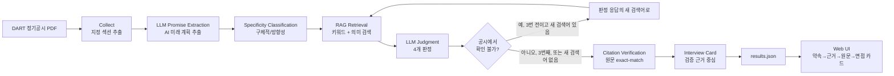

# AI Promise 아키텍처

## 목표
기업이 정기공시에서 밝힌 AI 계획과 이후 정기공시의 실행 근거를 연결하고, 근거가 검증된 정보만 면접 준비에 사용합니다.

이 문서는 엔진 7단계와 그 흐름 그림을 다룹니다. 화면, 배포, 평가까지 포함한 시스템 전체 그림은 [기능 요구 명세서](requirements.md) 5장에 있습니다.

## 7단계
1. **Collect**: 2024 사업보고서와 후속 보고서에서 지정 섹션을 추출
2. **Promise Extraction**: AI 관련 미래 계획 문장을 원문 그대로 선택
3. **Specificity Classification**: 구체적 약속 / 방향성 약속 분리
4. **Evidence Retrieval**: 후속 공시를 hybrid retrieval로 검색
5. **LLM Judgment**: 4개 판정 중 하나 선택
6. **Citation Verification**: 선택한 근거 문장이 수집 원문에 실제 존재하는지 코드로 검사
7. **Interview Card**: 검증된 근거만 사용해 핵심 이슈·답변 소재·역질문 생성

## 핵심 안전장치
- 근거가 필요한 판정인데 인용 검사를 통과한 문장이 없으면 판정을 낮춥니다.
- 검색 실패 시 검색어를 바꾸되 최대 횟수를 제한합니다.
- `not_verifiable`은 미이행을 뜻하지 않습니다.
- 모든 실제 결과는 `engine/run.py check`를 통과한 뒤 화면으로 내보냅니다.

## 데이터 흐름
```text
DART PDF
  -> collected_*.json
  -> promises.json
  -> judged.json
  -> card.json
  -> ai_promise_data.json
  -> app/data/results.json
  -> Web UI
```

## 소스 오브 트루스
- 판정 방법론: `eval/판정기준_v2.md`
- 엔진 설정: `engine/config.yaml`
- 화면 데이터 계약: `tests/sample_data.json` + `engine/aipromise/checker.py`
- 실제 결과: `app/data/results.json` (생성 후)


## 시스템 아키텍처



## 공식 필수 기술요소 대응

### 1. RAG
후속 정기공시를 작은 단위로 검색해 약속과 관련된 근거 후보를 LLM 판정 컨텍스트에 제공합니다. 검색 실패 시 전체 보고서를 통째로 생성 모델에 넣는 대신 관련 후보를 재검색합니다.

### 2. 자동화 워크플로우
PDF 입력부터 화면 JSON 출력까지 Collect → Extract → Retrieve → Judge → Verify → Card → Export가 하나의 Python pipeline으로 연결됩니다.

### 3. Agent-style retry (보조)
AI 판정이 '공시에서 확인 불가'이면 새 검색어로 다시 찾습니다(처음 검색 포함 최대 3번, 쓸 새 검색어가 없으면 그 전에 멈춤). 완전 자율 Agent라고 과장하지 않고, 구현된 **상태 기반 재검색·도구 사용 흐름**만 설명합니다.

심사 시 필수 기술요소는 **RAG + 자동화 워크플로우**를 주 근거로 제시하고, Agent-style retry는 추가 AI Native 설계로 설명합니다.

## 확장 설계: 아무 회사나 분석하기 (아직 구현하지 않음)

지금은 사업보고서 PDF 3개(약속 1, 근거 2)를 `data/pdf/`에 넣고 엔진을 돌리는 구조입니다. 첫 화면 검색은 한국거래소 상장 종목 목록으로 "상장 기업이지만 아직 분석 전"까지만 보여줍니다. 아래는 제출 뒤에 만들 확장 설계이고, 화면과 문서에서 "모든 기업 실시간 분석"이라고 쓰지 않습니다.

1. 회사 검색: OpenDART 고유번호 목록(`corpCode.xml`, 인증키 필요, zip 안의 CORPCODE.xml)에서 회사를 찾습니다. OpenDART에는 이름 검색 API가 없어서 목록을 받아 직접 찾습니다.
2. 보고서 찾기: 공시검색(`list.json`)으로 사업보고서와 반기보고서의 접수번호를 찾습니다.
3. 원문 받기: 공시서류원본파일(`document.xml`)은 zip으로 옵니다. 지금 엔진은 PDF를 읽으므로(collect.py, pypdf) 이 형식을 읽는 부분을 새로 만들어야 합니다.
4. 같은 7단계 실행 → 결과 저장(캐시). 처음 한 번만 분석하고 다음 사용자는 저장된 결과를 봅니다. 서버 함수 시간 제한(Vercel 무료 요금제 최대 300초), 결과 저장소, 호출 비용 제한이 함께 필요합니다.

## 서버 함수: 내 경험 연결 (10/19)

`app/api/resume-fit.js` (Vercel Node.js 함수, 주소 `/api/resume-fit`)

1. 화면이 이력서 글(80~6,000자)과 기업 id를 보냅니다. PDF는 브라우저에서 pdf.js로 글자만 뽑아 보냅니다.
2. 함수가 결과 파일(`app/data/results.json`)에서 그 기업의 약속, 판정, 인용 검사를 통과한 근거만 골라 이력서와 함께 OpenAI Responses API에 보냅니다(gpt-6.1-sol, JSON 형식 지정. 실패하면 형식 없이, 그다음 gpt-4o-mini).
3. 근거 검사: 결과 파일에 없는 약속 번호, 보낸 이력서에 없는 인용, 점수·합격 가능성·단정 표현이 든 항목을 빼고 뺀 개수를 함께 돌려줍니다.
4. 이력서는 저장하지 않고 로그에 남기지 않습니다. 같은 주소에서 10분에 6번까지만 받습니다(서버 한 대 기준).
5. `GET /api/resume-fit`은 키가 들어 있는지만 알려 주고, `GET /api/resume-fit?check=1`은 짧은 시험 문장으로 모델 호출을 확인합니다(10분에 한 번만 실제 호출).

