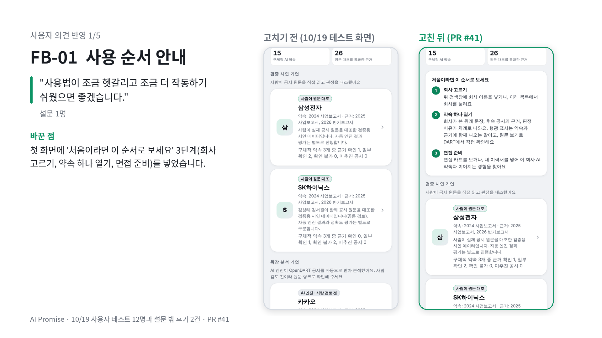
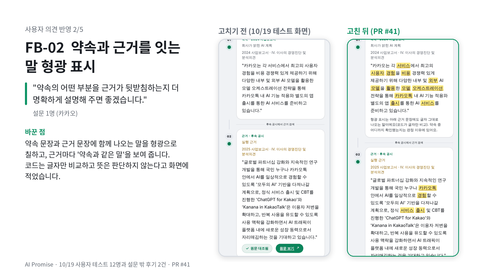
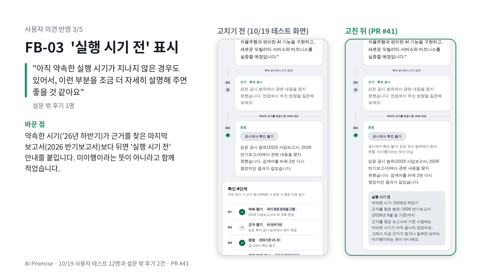
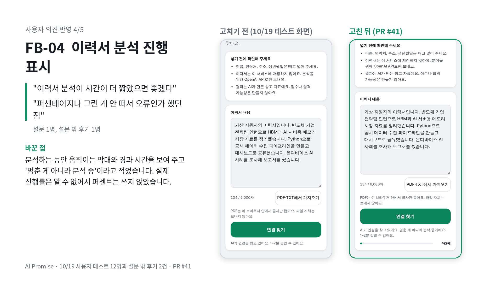
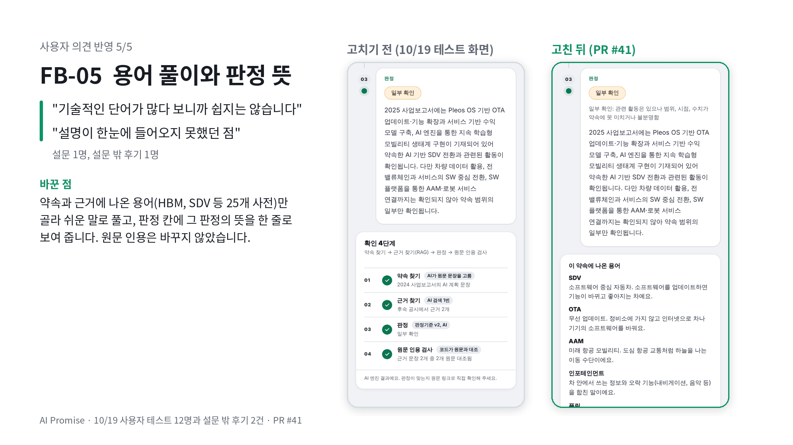
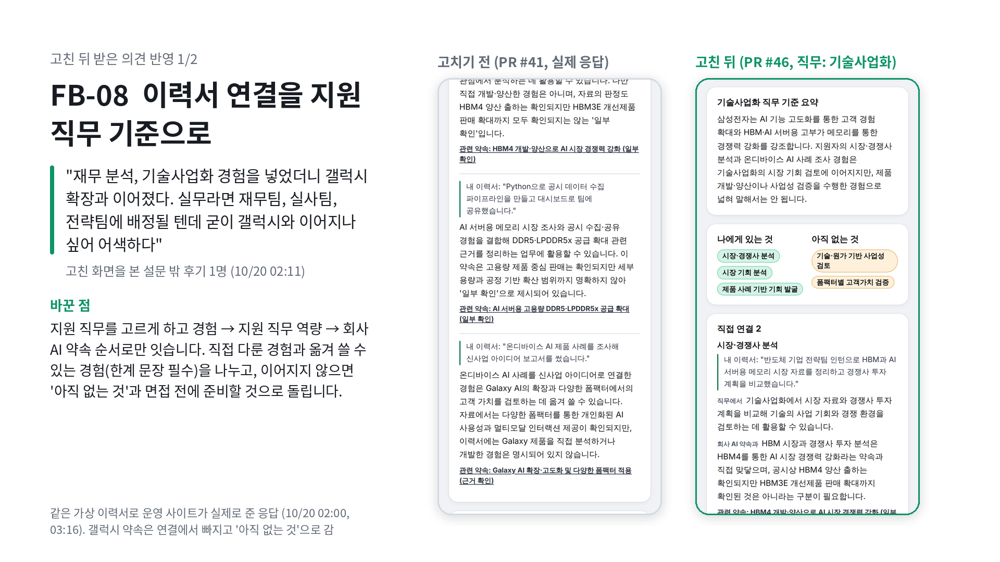
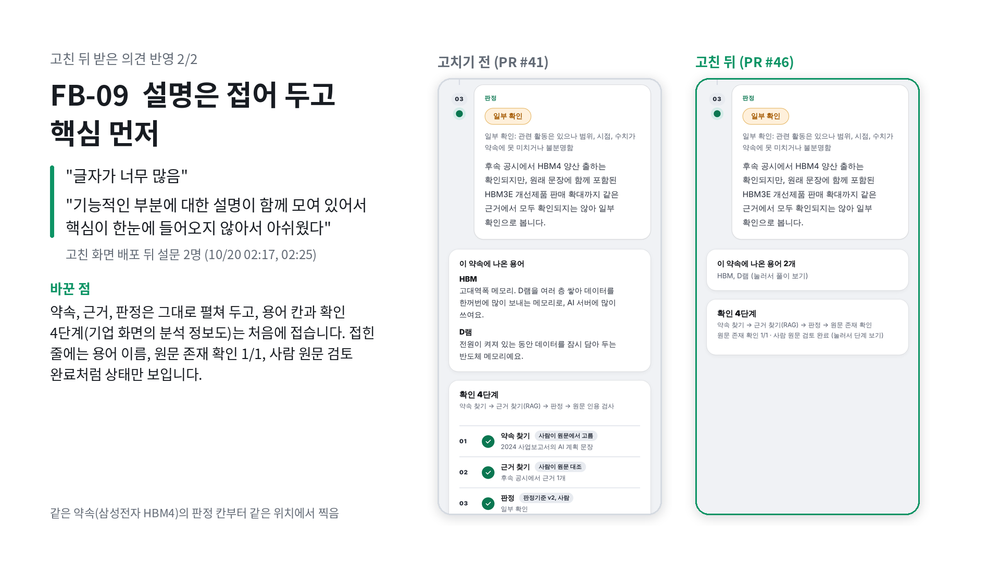

# 사용자 피드백 반영 로그

사용자 테스트 후 반복된 의견 중 실제로 제품에 반영한 것만 기록합니다. 사실과 다른 예시는 삭제하고 실제 값으로 채웁니다.

고치기 전 화면의 설문 응답 12건과 설문 밖 후기를 종합한 분석과, 그 보고서의 개선 과제별 반영 현황은 [사용자 테스트 분석 보고서](user-test-report.md)에 있습니다. 고친 화면(PR #41)이 배포된 뒤 받은 설문 응답 2건과 후기 1건은 아래 "고친 뒤 받은 의견"에 따로 적고, 그 의견으로 다시 고친 것(FB-08, FB-09)은 표에 함께 적었습니다.

| ID | 반복 피드백 | 관찰/원인 | 반영 내용 | 담당 | Commit/PR | 재확인 |
|---|---|---|---|---|---|---|
| FB-01 | "사용법이 조금 헷갈리고 조금 더 작동하기 쉬웠으면 좋겠습니다." (설문 1명, 10/19 23:15 응답) | 첫 화면에 검색창, 기업 목록, 검증 방식은 있었지만 무엇부터 눌러 어디까지 보면 되는지 순서 안내가 없었습니다 | 첫 화면 검색 아래에 "처음이라면 이 순서로 보세요" 3단계(회사 고르기, 약속 하나 열기, 면접 준비)를 넣었습니다 | 김성태 | PR #41 | `tests/ui_check.py`(다크·라이트, 390·320·1280px) 통과, 화면 캡처로 확인 |
| FB-02 | "약속의 어떤 부분을 근거가 뒷받침하는지 더 명확하게 설명해 주면 좋겠습니다." (설문 1명, 10/19 23:52 응답, 카카오) | 판정 이유에는 확인된 부분과 안 된 부분이 적혀 있었지만, 약속 문장과 근거 문장에서 서로 이어지는 말이 눈에 보이지 않았습니다 | 약속 상세에서 약속 문장과 근거 문장에 글자 그대로 함께 나오는 말을 형광으로 표시하고, 근거마다 "약속과 같은 말"을 칩으로 보여 줍니다. 코드가 글자만 비교하며 뜻은 판단하지 않는다고 화면에 적었습니다. 지금 데이터의 근거 26개 중 24개에 표시됩니다 | 김성태 | PR #41 | `tests/ui_check.py` 통과, 실제 데이터와 예외 문장(조사, '디스플레이'처럼 끝 글자가 조사와 같은 말, HTML 문자)으로 표시 점검 |
| FB-03 | "아직 약속한 실행 시기가 지나지 않은 경우도 있어서, 이런 부분을 조금 더 자세히 설명해 주면 좋을 것 같아요" (설문 밖 후기 1명, 10/20 00:11 김성태가 받아 전달) | 약속 문장에 실행 시기(예: 현대자동차 "'26년 하반기")가 적혀 있어도, 근거를 찾은 마지막 보고서(2026 반기보고서, 6월 말 기준)보다 뒤인지 화면에서 알려 주지 않았습니다. 그래서 '공시에서 확인 불가'가 미이행처럼 읽힐 수 있었습니다 | 약속 문장의 시기(연도, 상반기·하반기, 분기)를 읽어 근거를 찾은 마지막 보고서의 기준 시점보다 뒤면, 약속 상세에 "실행 시기 전" 안내(약속한 시기, 근거를 찾은 범위)를, 약속 목록에 "실행 시기 전" 표시를 붙입니다. 첫 화면 검증 방식에도 근거를 찾는 범위를 한 줄로 적었습니다. 지금 데이터에서는 현대자동차 약속 1건에 표시됩니다 | 김성태 | PR #41 | `tests/ui_check.py` 통과, 시기 문장 10개(연도, 'XX년, 분기, '10년 동안' 같은 기간 표현)로 점검 |
| FB-04 | 이력서 분석 기다림: "이력서 분석이 시간이 더 짧았으면 좋겠다" (설문 1명, 카카오), "이력서 넣고 1-2분 소요된다고 뜨긴 하지만 퍼센테이지나 그런 게 안 떠서 오류인가 했던 점" (설문 밖 후기 1명, 10/20 00:23) | 분석 중에는 "1~2분 걸릴 수 있어요" 문장만 있고 움직이는 표시가 없어, 멈춘 것처럼 보였습니다 | 분석하는 동안 움직이는 진행 막대와 경과 시간("23초째")을 보여 주고, "멈춘 게 아니라 분석 중"이라고 적었습니다. 실제 진행률은 알 수 없어서 퍼센트는 쓰지 않았습니다. 분석 시간 자체를 줄이는 것은 모델이나 요청 방식을 바꿔야 해서 후속 과제로 남깁니다 | 김성태 | PR #41 | 응답을 3.5초 늦게 주는 가짜 서버로 브라우저에서 확인(분석 중 보임, 초가 늘어남, 끝나면 사라짐, 다크·라이트), `tests/ui_check.py` 통과 |
| FB-05 | 기술 용어: "기술적인 단어가 많다 보니까 쉽지는 않습니다" (설문 1명, 현대자동차), "ai 관련해서 많은 기술을 알지는 못해서 설명이 한눈에 들어오지 못했던 점" (설문 밖 후기 1명, 10/20 00:23) | 공시 원문을 그대로 인용하는 것이 원칙이라 HBM, SDV 같은 용어가 풀이 없이 나왔고, 판정 4가지의 뜻도 약속 상세에서는 보이지 않았습니다 | 약속 상세에 그 약속과 근거 문장에 나온 용어만 골라 쉬운 말로 푼 "이 약속에 나온 용어" 칸(25개 용어 사전, 영어 줄임말은 'LPDDR5x' 안의 'DDR5'처럼 다른 말의 일부면 빼요)을 넣고, 판정 칸에 그 판정의 뜻을 한 줄로 보여 줍니다. 원문 인용은 바꾸지 않았습니다. 지금 데이터에서 약속 24개 중 19개에 용어 칸이 나옵니다 | 김성태 | PR #41 | `tests/ui_check.py` 통과, 실제 데이터 24개 약속과 예외 문장 8개(LPDDR5x, TOTAL, PBR 등)로 점검 |
| FB-08 | 이력서 연결 문장이 직무가 아니라 특정 제품 약속에 억지로 이어짐: "재무 분석, 기술사업화 경험을 넣었더니 '갤럭시 확장과 고도화를 위한 기술사업화와 투자실사 경험을 연결할 수 있다'처럼 나왔다. 실무라면 재무팀, 실사팀, 전략팀에 배정될 텐데 굳이 갤럭시와 이어지나 싶어 어색하다" (고친 화면을 본 설문 밖 후기 1명, 10/20 02:11) | 이력서 함수가 경험을 회사의 개별 AI 약속에 바로 이어 붙이는 구조였고 지원 직무를 받지 않았습니다. 그래서 키워드가 비슷하면 실제 직무 관련성보다 제품 약속과의 유사성을 앞세울 수 있었습니다(이력서 경험과 기업 약속의 키워드 유사성 과대평가) | 10/20 v2: 지원 직무를 고르게 하고(목록 9개 또는 직접 입력, 선택 사항), 경험 → 지원 직무 역량 → 회사 AI 약속 순서로만 연결합니다. 그 제품·기술을 직접 다룬 경험은 "직접 연결", 직무 역량으로 옮겨 쓸 수 있는 경험은 "간접 연결"로 나누고 간접 연결에는 한계 문장을 꼭 붙입니다. 이어지지 않는 경험은 억지로 연결하지 않고 "내 이력서에 없는 부분"으로 돌려 면접 전에 준비할 것 2~4개를 보여 줍니다. 맨 위에는 직무 기준 두 문장 요약과 나에게 있는 것 / 아직 없는 것을 둡니다 | 김성태 | PR #46 (10/20 03:14 합침) | 가짜 OpenAI 시험(`tests/test_resume_api.js`: 직무 전달, 간접 연결 한계 문장, 준비할 것, 근거 없는 항목 제외), 가짜 서버로 브라우저 확인(다크·라이트), `tests/ui_check.py` 통과. 배포 뒤 운영 사이트를 실제 모델로 점검(10/20 03:16, 삼성전자 직무 "기술사업화"·SK하이닉스 직무 없음): 간접 연결 3개 모두 한계 문장, 보완점마다 준비할 것, 빠진 항목 0, 갤럭시 약속은 연결이 아니라 보완점으로 나옴 (`smoke-results/39300958868`, `smoke-results/39300967745`) |
| FB-09 | 고친 화면의 글자 양: "글자가 너무 많음" (설문 1명, 10/20 02:17, 신한지주), "내용에 대한 설명뿐만 아니라 기능적인 부분에 대한 설명이 함께 모여 있어서 핵심이 한눈에 들어오지 않아서 아쉬웠다" (설문 1명, 10/20 02:25, 현대자동차) | FB-01~FB-05를 반영하며 안내 문장(사용 순서, 형광 표시 설명, 용어 풀이, 판정 뜻, 실행 시기 안내, 확인 4단계 설명)이 늘었고, 약속·근거·판정 같은 핵심과 기능 설명이 같은 무게로 모두 펼쳐져 있었습니다 | 10/20 v2: 약속 상세의 용어 칸과 확인 4단계, 기업 화면의 분석 정보를 처음에는 접어 두고, 접힌 줄에는 꼭 필요한 상태(용어 이름, 원문 존재 확인 N/M, 사람 원문 검토 완료/전)만 보이게 했습니다. 약속, 근거, 판정은 그대로 펼쳐 보여 줍니다 | 김성태 | PR #46 (10/20 03:14 합침) | `tests/ui_check.py`(접힌 칸을 펼쳐서도 검사) 통과, `tests/check_citation_badges.py`(펼친 뒤 문구 확인) 통과, 휴대폰 폭(390px) 화면 캡처로 확인 |

10/19 23:58까지 들어온 설문 응답 12명 중 개선 의견은 6건이고, 그중 4건(사용법, 근거와 약속의 연결, 기술 용어가 어려움, 기술 개발과 최종 목표 구현의 구분)이 "화면을 이해하기 어렵다"는 같은 방향이었습니다. 설문 밖에서 받은 후기 2건(10/20 00:11, 00:23)까지 합치면 이력서 분석 기다림(FB-04)과 기술 용어(FB-05)는 각각 2명이 말한 반복 의견입니다. 제출 전에 안전하게 고칠 수 있는 5건(FB-01~FB-05)을 반영했습니다. 응답이 들어오는 동안 화면이 바뀌지 않도록, 고친 화면은 마지막 설문 응답(10/19 23:58) 뒤에 합쳤습니다. 고친 화면이 배포된 뒤 받은 의견 중 이력서 연결 방식(FB-08, 1명)과 글자 양(FB-09, 2명이 같은 방향)은 10/20 v2에 반영했습니다.

## 고치기 전·후 화면

같은 데이터로 고치기 전 화면(10/19 사용자 테스트 때 화면, 커밋 99b8d59)과 고친 뒤 화면(PR #41)을 휴대폰 폭(390px)의 같은 위치에서 찍었습니다. FB-04의 "분석 중" 화면은 응답을 일부러 늦게 주는 가짜 서버로 4초째에 찍었습니다. 발표 자료에도 같은 이미지를 씁니다.

고친 화면이 배포된 뒤 받은 의견(FB-08, FB-09)도 같은 방식으로 찍었습니다. FB-08은 같은 가상 이력서로 운영 사이트가 실제로 준 응답을 그대로 그렸습니다(고치기 전 10/20 02:00 `smoke-results/39290280295`, 고친 뒤 03:16 `smoke-results/39300958868`, 직무 "기술사업화").

## 고친 뒤 받은 의견 (10/20 02:11~02:25)

고친 화면(PR #41)이 배포된 10/20 01:01 뒤에 받은 의견입니다. 설문 밖 후기 1명(김성태가 받아 전달, 단어별 용어 칸을 말하고 있어 고친 화면을 본 후기)과 설문 응답 2명입니다. 인원이 적어 효과를 숫자로 주장하지 않습니다.

| 의견 (뜻을 바꾸지 않고 줄임) | 출처 | 분류 | 조치 |
|---|---|---|---|
| "기업별로 면접 대비할 수 있는 게 좋고, 회사가 공시에서 내세우는 주 전략과 주 기술을 보면 그 회사가 원하는 인재상을 파악하기 좋다" | 설문 밖 후기, 02:11 | 좋았던 점 (서비스 핵심) | 유지 |
| "전문용어가 단어별로 정리되어 있어, 면접에서 바로 생각나지 않을 수 있는 용어를 미리 돌려 보면 익숙해져서 준비하기 좋다" | 설문 밖 후기, 02:11 | 좋았던 점 (FB-05 용어 풀이) | 유지 (v2에서는 접어 두고 용어 이름을 먼저 보임) |
| "보완점이 내 이력서에 없는 부분을 짚어 줘서, 이 분야는 경험이 없구나 혹은 이런 이력이 있었나 다시 생각하게 된다" | 설문 밖 후기, 02:11 | 좋았던 점 (이력서 기능의 보완점) | 유지, v2에서 "면접 전에 준비할 것"을 더해 강화 |
| "재무 분석, 기술사업화 경험을 넣었더니 '갤럭시 확장과 고도화를 위한 기술사업화와 투자실사 경험을 연결할 수 있다'처럼 나왔다. 실무라면 갤럭시와 상관없이 재무팀, 실사팀, 전략팀에 배정될 텐데 굳이 갤럭시와 이어지나 싶어 문장이 조금 어색하다" | 설문 밖 후기, 02:11 | 개선 의견 | FB-08, v2 반영 |
| "글자가 너무 많음" | 설문, 02:17, 신한지주 | 개선 의견 | FB-09, v2 반영 |
| "내용에 대한 설명뿐만 아니라 기능적인 부분에 대한 설명이 함께 모여 있어서 핵심이 한눈에 들어오지 않아서 아쉬웠다" | 설문, 02:25, 현대자동차 | 개선 의견 (FB-09와 같은 방향) | FB-09, v2 반영 |

고친 화면 배포 뒤 설문 2명의 점수: 핵심 과업 모두 확인 2/2, 이해도 4.50, 신뢰도 4.50, 면접 활용 의향 5.00, 이력서 기능 도움 5.00 (5점 만점). 2명이라 고치기 전 12명과 비교해 효과를 주장하지 않습니다.

해석 (PR #45 정리를 합침): 강점은 회사가 강조하는 AI 전략·핵심 기술을 미리 파악하는 것, 용어 풀이, 이력서에 없는 경험을 짚는 보완점입니다. 개선점은 이력서 연결이 직무 관련성보다 기업 약속 키워드 유사성을 앞세울 수 있다는 것(FB-08)과, 기능 설명이 핵심과 같은 무게로 펼쳐져 있다는 것(FB-09)입니다.

## 향후 개선 (이번에 반영하지 않음)
| ID | 의견 | 반영하지 않은 이유 |
|---|---|---|
| FB-06 | "AI 내에서도 카테고리를 나눠서 본인의 직무에 맞게 하면 좋을 것 같다" (설문 1명, SK하이닉스) | 약속 목록 자체를 직무별로 나누려면 분류 기준과 데이터가 새로 필요한 새 기능이라 제출(10/20 07:00) 전에 검증할 수 없습니다. 10/20 v2에서는 이력서 기능에만 지원 직무 선택을 넣었고(FB-08), 약속 목록의 직무별 분류는 후속 과제로 남깁니다 |
| FB-07 | "관련 기술의 개발과 최종 목표의 구현을 구분해 설명하면 좋겠습니다" (설문 1명, 현대자동차) | FB-02 형광 표시로 약속과 근거가 이어지는 말은 보이게 했습니다. 판정 이유를 "확인된 부분 / 확인되지 않은 부분"으로 나눠 보여 주는 것은 판정 문장 형식을 바꾸는 일이라 후속 과제로 남깁니다 |
| FB-04 일부 | 이력서 분석 시간 자체 줄이기 | 모델이나 요청 방식을 바꾸면 결과 품질을 다시 검증해야 해서 제출 전에는 바꾸지 않습니다. 기다리는 동안의 진행 표시만 반영했습니다 |

## 기록 원칙
- 1명의 취향보다 2명 이상에게 반복된 문제를 우선합니다.
- 테스트가 모두 끝난 뒤 수정합니다.
- 실제로 수정하지 않은 의견은 '향후 개선'으로 분리합니다.
- 수정 전후 화면 또는 commit/PR을 증빙으로 남깁니다.

## 결과보고서 문장 템플릿
"총 __명의 사용자를 대상으로 테스트한 결과, '__' 의견이 반복되었습니다. 원인을 __로 판단하여 __를 수정했고, PR/commit __에 반영했습니다. 이후 __ 방식으로 재확인했습니다."
