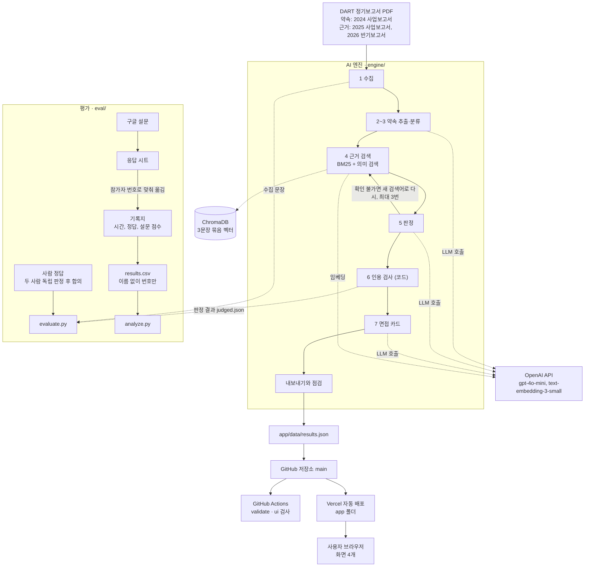

# 기능 요구 명세서

AI Promise의 기능 요구사항, 비기능 요구사항, AI 활용 방식, 시스템 아키텍처를 정리한 문서입니다. 코디세이 Final Project 미션의 "기능 요구 명세서" 항목에 해당합니다.

- 작성: 김성태 / 기준일: 2026-10-15
- 함께 보는 문서: 기획 보고서(10/12 3차 개정), 화면 구성 안내서 v0.4, `eval/판정기준_v2.md`(10/15 확정·동결), `docs/architecture.md`
- 상태 표기: **구현됨**은 저장소 코드에 있는 것, **예정**은 10/16~18 일정에 있는 것, **제외**는 이번 제출에서 하지 않는 것입니다.

## 1. 개요

| 항목 | 내용 |
| --- | --- |
| 서비스 | AI Promise (부제: 기업 AI 약속 검증) |
| 목적 | 회사가 사업보고서에 쓴 AI 약속과 이후 보고서의 실행 근거를 AI가 찾아 연결하고, 모든 판정에 원문 인용을 붙여 보여줍니다 |
| 사용자 | 취업·이직 준비자 (면접 전 5분 안에 지원 회사의 AI 계획과 실행을 확인) |
| 푸는 문제 | 회사의 AI 계획이 실행됐는지 확인하려면 여러 해의 공시를 직접 읽고 대조해야 합니다 |
| 데이터 | DART 정기보고서 PDF. 약속은 2024 사업보고서에서, 근거는 2025 사업보고서와 2026 반기보고서에서 찾습니다 |
| 기업 | 삼성전자(개발·시연용), SK하이닉스(평가용). 관문 2를 통과하면 업종이 다른 시연용 기업 최대 3곳 |

이번 버전에서 하지 않는 것은 다음과 같습니다.

- 점수, 퍼센트, 기업 순위. 개수만 보여줍니다 (기획 보고서 3장).
- "AI 워싱" 같은 단정 판정. 근거를 찾지 못한 약속은 "공시에서 확인 불가"로 표시하며, 안 했다는 뜻이 아닙니다 (3장).
- 투자 추천과 면접 답변 대필 (3장)
- 검색창과 화면에서 실시간으로 다시 분석하는 기능. 준비된 기업 중에서 고르고, 미리 만든 결과를 보여줍니다 (4장, 5장, 13장).
- Long-term Memory (3장). 로그인도 없어서 공개 주소에서 바로 엽니다.
- 문장 분류 ML 실험 (8.3장, `eval/ml/`에는 코드와 데이터 형식만 둠)

## 2. 기능 요구사항

우선순위는 Must(없으면 서비스가 성립하지 않음), Should(있어야 신뢰와 운영이 됨), Could(있으면 좋음)로 나눕니다.

### 2.1 화면 (`app/`)

| ID | 기능 | 설명 | 우선순위 | 구현 위치 | 상태 |
| --- | --- | --- | --- | --- | --- |
| FR-01 | 기업 선택 | 준비된 기업 카드에서 고릅니다. 카드에는 기업 이름, 약속·근거를 찾은 보고서, 개수 요약이 있습니다. 검색창은 두지 않습니다 | Must | `app/js/app.js` | 구현됨 |
| FR-02 | 약속 목록 | "구체적 약속 N개 중 근거 확인 a, 일부 확인 b, 확인 불가 c, 미추진 공시 d" 형태로 개수를 보여주고, 약속마다 판정 배지를 붙입니다. 방향성 약속은 개수에 넣지 않고 접힌 묶음으로 따로 보여줍니다 | Must | `app/js/app.js` | 구현됨 |
| FR-03 | 약속 상세 | 약속 원문과 출처(보고서, 장, 원문 링크), 판정과 판정 이유, 근거 원문과 출처, 원문 링크를 보여줍니다. 인용 검사를 통과한 근거에는 "원문 확인됨"을 붙입니다 | Must | `app/js/app.js` | 구현됨 |
| FR-04 | 면접 카드 | 핵심 이슈 3개, 답변 소재 3개(근거 원문 링크 포함), 역질문 2개를 보여주고 "카드 복사하기"로 복사합니다 | Must | `app/js/app.js` | 구현됨 |
| FR-05 | AI 생성 고지 | "공시 범위 안에서 확인한 결과입니다.", "AI가 생성한 분석입니다." 두 문구를 모든 화면에 항상 보여줍니다 | Must | `app/js/app.js`, `engine/labels.json` | 구현됨 |
| FR-06 | 예시 데이터 표시 | 실제 결과 파일(`app/data/results.json`)이 없으면 가상 회사 예시 데이터를 쓰고, 화면 맨 위에 예시 데이터라는 띠를 띄웁니다 | Must | `app/js/app.js`, `app/data/sample-data.js` | 구현됨 |
| FR-07 | AI가 확인한 과정 | 약속 상세에 근거를 찾으려고 검색한 횟수와 원문 확인 결과를 보여줍니다 | Should | `app/js/app.js` | 구현됨 |
| FR-08 | 기업별 검증 안내 | 기업마다 검증 안내(`check_note`)를 적으면 기업 카드와 약속 목록에 보여줍니다. 지금은 시연용 후보 기업 3곳에 "시연용 기업" 안내가 들어 있습니다 | Should | `app/js/app.js`, `engine/config.yaml` | 구현됨 |
| FR-09 | 다크·라이트 모드 | 테마를 바꾸고, 고른 테마를 브라우저에 기억합니다 | Could | `app/js/app.js` | 구현됨 |

### 2.2 AI 엔진 (`engine/`)

| ID | 기능 | 설명 | 우선순위 | 구현 위치 | 상태 |
| --- | --- | --- | --- | --- | --- |
| FR-10 | 시작 전 점검 | 설치, API 키, PDF, 원문 링크를 확인하고 판정 모델과 임베딩 모델을 실제로 1번씩 호출해 봅니다 (`run.py doctor`) | Should | `engine/aipromise/doctor.py` | 구현됨 |
| FR-11 | 공시 수집 | PDF에서 읽는 장 3곳(I.5 정관에 관한 사항, II 사업의 내용, IV 이사의 경영진단 및 분석의견)을 문장 단위로 저장합니다 | Must | `engine/aipromise/collect.py` | 구현됨 |
| FR-12 | 약속 추출 | 검색어(AI, 인공지능, 머신러닝, 딥러닝, 생성형 AI, 붙여 쓴 생성형AI)가 든 문장을 앞뒤 문장과 함께 AI에게 보여주고, AI는 문장 번호만 고릅니다. 화면에 나가는 문장은 원문 그대로입니다 | Must | `engine/aipromise/extract.py`, `engine/config.yaml` | 구현됨 |
| FR-13 | 약속 분류 | 고른 약속을 구체적 약속(특정 대상이 있음)과 방향성 약속(넓은 분야만 있음)으로 나눕니다. 판정기준 v2를 따릅니다 | Must | `engine/aipromise/extract.py` | 구현됨 |
| FR-14 | 근거 검색 | 키워드 검색(BM25)과 의미 검색(OpenAI 임베딩 + ChromaDB)을 함께 돌려 순위 합치기(RRF)로 섞습니다. 상위 8곳과 그 앞뒤 문장을 최대 24문장까지 판정 후보로 넘깁니다 | Must | `engine/aipromise/retrieve.py` | 구현됨 |
| FR-15 | 판정 | 후보 문장만 근거로 4가지 판정(근거 확인, 일부 확인, 공시에서 확인 불가, 회사가 미추진으로 공시) 중 하나와 이유 2~3문장을 냅니다 | Must | `engine/aipromise/judge.py`, `engine/aipromise/prompts.py` | 구현됨 |
| FR-16 | 다시 검색 (Agent) | 판정이 "공시에서 확인 불가"이면 AI가 새 검색어를 정하고(주지 않으면 약속 제목), 코드가 그 검색어로 다시 검색합니다. 근거를 찾거나, 처음 검색을 포함해 3번이 되거나, 더 쓸 검색어가 없으면 멈추고, 검색 기록을 남깁니다 | Must | `engine/aipromise/judge.py` | 구현됨 |
| FR-17 | 인용 검사 | AI가 고른 근거 문장이 읽은 장의 원문에 그대로 있는지(띄어쓰기 무시) 코드로 확인합니다. 통과하지 못한 근거는 빼고, 근거가 필요한 판정인데 통과한 근거가 없으면 "공시에서 확인 불가"로 낮춥니다 | Must | `engine/aipromise/judge.py` | 구현됨 |
| FR-18 | 방향성 약속의 관련 활동 | 방향성 약속은 판정하지 않고, 같은 분야의 실제 활동 문장을 0~2개 보여줍니다 | Should | `engine/aipromise/judge.py` | 구현됨 |
| FR-19 | 면접 카드 생성 | 핵심 이슈 3개, 답변 소재 3개, 역질문 2개를 만듭니다. 답변 소재는 "근거 확인"과 "일부 확인" 약속만 쓰고, 근거 링크는 데이터에서 붙입니다. 단정 표현이 있거나 개수가 모자라면 규칙 방식으로 채웁니다 | Must | `engine/aipromise/card.py` | 구현됨 |
| FR-20 | 내보내기와 점검 | 화면이 읽는 형식으로 결과 파일을 만들고, 화면 규칙(판정 이름, 단정 표현, 필수 칸)을 점검한 뒤 `app/data/results.json`으로 복사합니다 (`run.py export`, `run.py check`) | Must | `engine/aipromise/export.py`, `engine/aipromise/checker.py` | 구현됨 |
| FR-21 | 실행 기록 | 모든 LLM 호출의 입력과 출력(`data/work/<기업>/llm_log.jsonl`, 임베딩 호출은 제외)과 검색 기록(`data/results/search_log.json`)을 남깁니다 | Should | `engine/aipromise/llm.py`, `engine/aipromise/export.py` | 구현됨 |
| FR-22 | 후보 기업 미리 보기 | 후보 기업의 2024 사업보고서 1개로 수집과 약속 추출만 해서, 구체적 약속이 기준(기본 3개) 이상인지 알려 줍니다 (`run.py scan`) | Could | `engine/run.py` | 구현됨 (관문 2 통과 시 사용) |

### 2.3 평가 (`eval/`)

| ID | 기능 | 설명 | 우선순위 | 구현 위치 | 상태 |
| --- | --- | --- | --- | --- | --- |
| FR-30 | 정답 평가 | 두 사람이 따로 만든 판정과 합의 정답, 엔진의 판정 결과(`data/work/<기업>/judged.json`)를 읽어 사람 간 일치율과 Cohen's kappa, AI 판정의 정확도와 95% 신뢰구간(Wilson), macro-F1, 혼동표, 치명 오류, 비교 coverage, end-to-end 정확도를 계산합니다. 약속 찾기는 키워드 규칙과 정밀도·재현율을 비교합니다 | Must | `eval/evaluate.py` | 구현됨, 실제 평가는 예정 (10/16) |
| FR-31 | 사용자 테스트 분석 | 기록지 CSV(`eval/user_test/results.csv`)에서 4분 안에 정답을 찾은 비율(주 지표)과 4분 안에 끝낸 사례의 시간을 계산합니다. 시간 초과 값으로 "몇 분 단축"을 만들지 않습니다 | Must | `eval/user_test/analyze.py` | 구현됨, 실제 테스트는 예정 (10/16) |
| FR-32 | 설문 만들기 | 이름·연락처·이메일을 받지 않게 설정한 구글 설문과 응답 시트를 한 번에 만듭니다. 설문 점수는 참가자 번호로 맞춰 기록지에 옮깁니다 | Should | `eval/user_test/create_form.gs` | 구현됨 |

## 3. 비기능 요구사항

| ID | 항목 | 요구사항 | 확인 방법 |
| --- | --- | --- | --- |
| NFR-01 | 판정 정확도 | 합의 정답 대비 정확도 80% 이상을 목표로 하고, macro-F1, 혼동표, 95% 신뢰구간을 함께 보고합니다 | `eval/evaluate.py` 결과표 (기획 보고서 9장) |
| NFR-02 | 치명 오류 | 사람은 "공시에서 확인 불가"인데 AI가 "근거 확인"이라고 한 건수 0건 | `eval/evaluate.py`의 치명 오류 |
| NFR-03 | 근거성 | 인용 포함 100%, 인용 원문 일치 100%, 근거 없는 실행 판정 0건 | 인용 검사(FR-17), `eval/evaluate.py` |
| NFR-04 | 원문 보존 | 약속 문장과 근거 문장은 원문 그대로 보여줍니다. AI는 문장 번호만 고릅니다 | `engine/aipromise/prompts.py` 규칙, `tests/test_mock.py` |
| NFR-05 | 표현 | 단정 표현("AI 워싱", "거짓", "약속을 어김", "실행하지 않음" 등)을 코드로 막습니다. 점수, 퍼센트, 순위를 쓰지 않고, "공시에서 확인 불가"에 빨간색이나 경고 표시를 쓰지 않습니다 | `engine/aipromise/textutil.py`, `engine/aipromise/checker.py`, `docs/ai-ethics.md` |
| NFR-06 | AI 생성 고지 | 모든 화면에 AI가 생성한 분석이라는 문구를 표시합니다 | FR-05 (`app/js/app.js`가 화면 6곳에 표시). `tests/ui_check.py`는 안내 문구 칸이 있는지와 글자 크기를 검사합니다 |
| NFR-07 | 개인정보 | 사용자 테스트 참여자의 이름, 전화번호, 이메일을 저장하지 않고 번호로만 기록합니다(설문은 P01, 기록지는 1처럼). 참여 전에 동의를 받습니다 | `docs/user-test-protocol.md`, 설문 설정(FR-32), `.gitignore` |
| NFR-08 | 보안 | API 키는 `engine/.env`에만 두고 저장소, 공유 폴더, 단톡방에 올리지 않습니다 | `.gitignore`, `engine/.env.example` |
| NFR-09 | 접근성 | 글자 대비는 작은 글자 4.5:1, 큰 글자 3:1 이상(WCAG AA)이고, 390px·320px 폭에서 가로로 밀리지 않으며, 다크·라이트 두 테마에서 모두 지킵니다 | `tests/ui_check.py` (CI `ui` 작업) |
| NFR-10 | 재현성 | temperature 0(같은 입력에 최대한 같은 답), 모델과 설정은 `engine/config.yaml`에 고정, 판정기준 v2를 10/15에 동결, LLM 호출 기록을 남깁니다 | `engine/config.yaml`, FR-21 |
| NFR-11 | 품질 관문 | main에 올리기 전에 `tests/test_mock.py`가 "시험 통과"여야 합니다(팀 규칙). CI의 `validate`와 `ui` 작업은 Pull Request와 main에 올릴 때 자동으로 실행됩니다. main 보호 설정은 없어서 규칙으로 지킵니다 | README 6장, `.github/workflows/ci.yml` |
| NFR-12 | 배포 | 외부에서 접속할 수 있는 공개 주소로 배포하고, main에 올리면 자동으로 다시 배포됩니다 | https://ai-promise-six.vercel.app, `docs/deploy.md` |
| NFR-13 | 시연 안정성 | 화면은 실시간 분석을 하지 않고 미리 만든 결과 파일을 읽습니다. 화면에서 AI 응답을 기다리는 일이 없습니다 | 기획 보고서 5장, FR-06 |
| NFR-14 | 평가 공정성 | SK하이닉스는 사람 정답을 고정하기 전에 AI 결과를 보지 않고, 평가가 시작된 뒤 판정 기준을 바꾸지 않습니다 | `docs/evaluation-plan.md`, `eval/판정기준_v2.md` |

## 4. AI 활용 명세

### 4.1 기능별 AI 활용과 공식 기술 요소

미션의 필수 기술 요소 5개(AI Agent, RAG, 멀티모달 AI, 자동화 워크플로우, Long-term Memory) 중 AI Promise가 쓰는 것은 **RAG, AI Agent, 자동화 워크플로우** 3개입니다.

| 기능 | AI 활용 방식 | 상세 | 기술 요소 |
| --- | --- | --- | --- |
| 약속 추출·분류 | 생성형 AI (LLM) | gpt-4o-mini, temperature 0. 검색어 후보 문장 중 약속의 번호만 고르고, 구체적·방향성으로 나눕니다. 제목은 25자 이내로 쓰게 지시합니다(코드는 40자에서 자름) | 서비스 핵심 기능 |
| 근거 검색 | 하이브리드 검색 | BM25(직접 구현) + text-embedding-3-small 임베딩과 ChromaDB, RRF로 순위를 합칩니다 | RAG (검색) |
| 판정 | 검색 결과를 넣은 LLM 판정 | 후보 문장에 적힌 내용만 근거로 판정합니다. 바깥 지식과 추측을 쓰지 않습니다 | RAG (생성) |
| 다시 검색 | 정보 검색 Agent | 목표는 "약속의 실행 근거 찾기"입니다. 근거를 찾지 못하면 AI가 새 검색어를 정하고, 코드가 그 검색어로 검색 도구를 다시 부릅니다. 근거를 찾거나, 3번이 되거나, 더 쓸 검색어가 없으면 멈춥니다 | AI Agent |
| 인용 검사 | 코드 (AI 아님) | AI가 고른 근거가 원문에 있는지 대조해 통과하지 못한 근거는 빼고, 근거가 필요한 판정인데 남은 근거가 없으면 판정을 낮춥니다 | 안전장치 |
| 면접 카드 | 생성형 AI (LLM) + 규칙 점검 | 근거 확인·일부 확인 약속만 사실로 쓰고, 단정 표현과 개수를 코드로 다시 점검합니다 | 서비스 핵심 기능 |
| 결과에서 배포까지 | 자동화 파이프라인 | `run.py all`이 1~7단계를 차례로 실행합니다. 결과 파일을 내보내 main에 올리면(명령 한 줄씩) GitHub Actions 검사 2개와 Vercel 배포가 자동으로 이어집니다. 사용자 테스트 설문 응답은 구글 시트에 자동으로 쌓입니다 | 자동화 워크플로우 |

넣지 않은 기술 요소와 이유는 다음과 같습니다.

- Long-term Memory: 로그인이 없고 사용자마다 다른 기록이 필요 없는 서비스입니다. 기획 단계에서 정확도와 근거 검증에 집중하기로 했습니다 (기획 보고서 10장).
- 멀티모달 AI: PDF에서 글자만 읽고, 이미지나 음성은 다루지 않습니다.

### 4.2 프롬프트 설계와 근거 (`engine/aipromise/prompts.py`)

| 설계 | 이유 |
| --- | --- |
| AI는 문장을 고쳐 쓰지 않고 입력에 있는 문장 번호만 고릅니다 | 화면에 나가는 약속과 근거가 항상 원문 그대로이게 하려는 것입니다. 지어낸 인용을 구조적으로 막습니다 |
| 판정 규칙 10개를 지시문에 적습니다 (같은 대상이어야 근거, "~할 계획"은 실행 근거 아님, 범위·시점이 모자라면 일부 확인 등) | 사람 판정자와 AI가 같은 판정기준 v2를 쓰게 해서 정답 평가를 공정하게 하려는 것입니다 |
| 애매하면 "근거 확인" 대신 "일부 확인", 관련 내용이 없으면 "공시에서 확인 불가"를 고르게 합니다 | 과대 판정(치명 오류)을 줄이는 쪽으로 기울입니다 |
| "공시에서 확인 불가"이면 앞과 다른 새 검색어(`new_query`)를 함께 내게 합니다 | 다시 검색(FR-16)에 쓸 검색어를 AI가 정하게 하려는 것입니다 |
| 출력은 JSON 하나만 받고, 읽지 못하면 "반드시 JSON 하나만 출력하세요"를 붙여 최대 2번 다시 요청합니다 (`engine/aipromise/llm.py`) | 결과를 코드로 검사하고 화면 형식으로 바꾸려면 형식이 일정해야 합니다 |
| 단정 표현 금지를 지시문에 적고, 코드로 한 번 더 걸러 정해진 문장으로 바꿉니다 | 지시문만으로는 100% 보장이 안 되기 때문에 이중으로 막습니다 |

## 5. 시스템 아키텍처

엔진은 김성태의 컴퓨터에서 미리 돌려 결과 파일을 만들고, 화면은 그 결과 파일을 읽습니다(없으면 예시 데이터). 엔진과 화면은 결과 파일 하나로 이어집니다.

| 구성 요소 | 하는 일 | 위치 |
| --- | --- | --- |
| AI 엔진 | 공시 수집부터 면접 카드까지 7단계, 결과 파일 내보내기 | `engine/` |
| 결과 파일 | 화면이 읽는 데이터(없으면 예시 데이터를 씀). 형식은 `tests/sample_data.json`과 같습니다 | `app/data/results.json` (생성 후) |
| 화면 | 기업 선택, 약속 목록, 약속 상세, 면접 카드 4개 | `app/` |
| 자동 검사 | 엔진 시험(가짜 모델로 끝까지), 화면 정적 검사, 브라우저 화면 검사 | `.github/workflows/ci.yml`, `tests/` |
| 배포 | main에 올라간 `app/` 폴더를 공개 주소로 배포 | Vercel (https://ai-promise-six.vercel.app) |
| 평가 | 사람 정답과 엔진 판정(`judged.json`) 비교, 기록지로 사용자 테스트 분석 | `eval/` |

엔진 7단계의 자세한 흐름과 안전장치는 `docs/architecture.md`, 실행 순서는 `engine/README.md`에 있습니다.

## 6. 요구사항과 미션 기준의 연결

| 미션 기준 | 이 문서의 요구사항 |
| --- | --- |
| 생성형 AI 또는 AI Agent가 핵심 기능 | FR-12, FR-13, FR-15, FR-16, FR-19 |
| 필수 기술 요소 2개 이상 | 4.1 (RAG: FR-14·FR-15, AI Agent: FR-16, 자동화 워크플로우: NFR-11·NFR-12) |
| 외부 접근 가능한 배포 | NFR-12 |
| 실사용자 테스트와 피드백 반영 | FR-31, FR-32 (10/16 테스트, 10/17 반영) |
| AI 생성 콘텐츠 명시 | FR-05, NFR-06 |
| 개인정보 동의와 안전한 관리 | NFR-07, NFR-08 |
